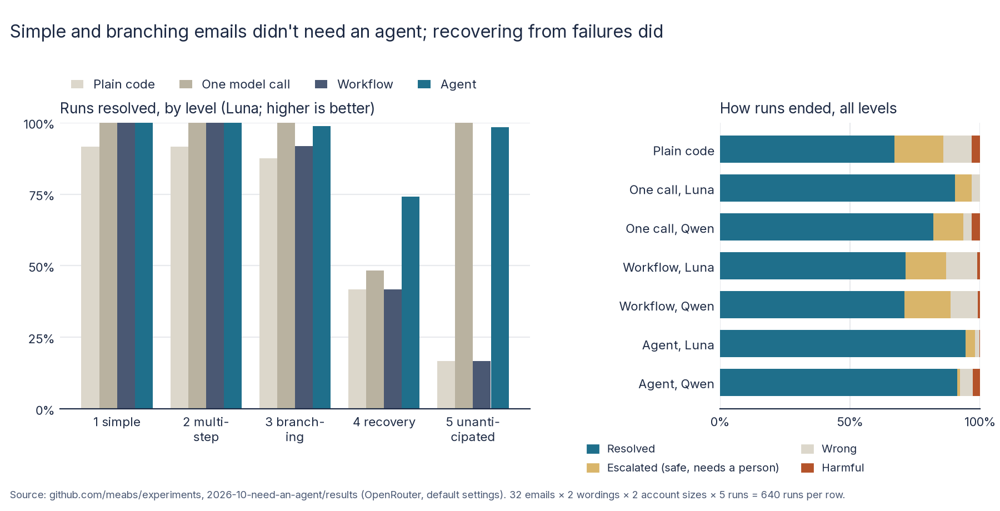

# Do you actually need an AI agent? Report

30 October 2026. Design: [README.md](README.md), committed and pushed (3e6a2562) before the main run. Full numbers:
[results/analysis.md](results/analysis.md); checks and the hand-check: [results/checks.md](results/checks.md).

## 1. What I wanted to find out

A small online shop wants software to answer customer-service emails and act on them. There are four ways to build it,
each a step up in complexity:

- **plain code** with keyword rules;
- **one model call** that sees everything and decides;
- **a workflow**: fixed code steps with the model at two fixed points;
- **an agent**: the model in a loop with the tools.

I wanted to know which architecture handles which kind of request. Where does each stop being good enough, and what
does each cost in money, time, consistency and code?

## 2. Why I thought it was worth testing

"Agent" is the default answer for anything with an LLM in it, and the usual counter-advice is "start with a workflow".
Both are mostly argued, not measured. The user's brief for this experiment was explicit: don't design it to prove that
simpler is better; include tasks where the sophisticated approach should win, and find the point at which its
complexity becomes worthwhile. So the 32 cases range from one lookup to recovering from a failed service and requests
the workflow wasn't built for.

## 3. What I predicted

From the design, written before the main run. This is a proof of concept for an architecture article, so these are
expectations, not tested hypotheses:

1. Plain code is fine on simple and fixed requests in the wording it was written for, worse on paraphrased emails, and
   can't do levels 4 and 5.
2. The workflow is at or near the ceiling on levels 1 to 3, escalates most of level 5, and recovers from read failures
   but not write failures.
3. The agent is best on levels 4 and 5, and costs more and varies more.
4. The one-call version matches the agent on small accounts, but its cost grows with account size.
5. The cheap model (Qwen) is closer to Luna in the workflow than in the agent.

## 4. How I tested it

- **The shop:** Hartley & Finch, a simulated UK homeware shop:
  - 8 customers, 14 products and 15 orders;
  - a one-page policy;
  - 9 tools that behave like services (HTTP-style errors; the refund service doesn't stop duplicates).
- **32 emails** at five levels, each with the state changes the policy requires and the facts the reply must contain:
  - L1 simple, 6;
  - L2 multi-step, 6;
  - L3 branching, 8 (the outcome depends on what lookups return);
  - L4 recovery, 6 (a tool fails once, or the input is slightly off);
  - L5 unanticipated, 6 (requests outside the workflow's four intents, still covered by the policy).
- **Two wordings:** the original, and a paraphrase by a model not under test (google/gemini-3.1-flash-lite), because I
  wrote the plain-code rules after reading the originals.
- **Two account sizes:** small (1 to 3 orders a customer), and large (40 older orders added to every customer).
- **Four architectures:**

  | Architecture | Lines of code | Model calls |
  | --- | --- | --- |
  | Plain code | 204 | 0 |
  | One model call | 53 | 1 |
  | Workflow | 165 | 1 or 2 |
  | Agent | 34 | up to 15 |

  - Plain code and the workflow share the same fixed steps: reads are retried twice; writes are never retried (a
    failed write goes to a person); anything outside four intents goes to a person.
  - The one-call version fetches the customer, all their orders, tracking and stock before its one call.
- **Models (OpenRouter, default settings):** openai/gpt-6-luna and qwen/qwen3.7-flash.
- **Size:** 32 cases × 2 wordings × 2 account sizes × 5 repetitions × 7 architecture-and-model combinations = 4,480
  runs, in a shuffled order.
- **Outcome per run**, from the shop's record of state changes and the reply:
  - **resolved:** exactly the right changes and every required fact;
  - **harmful:** a refund, replacement, cancellation or address change the policy didn't call for;
  - **escalated:** handed to a person when not required, with nothing harmful;
  - **wrong:** anything else.
- **Statistics:** rates with Wilson 95% intervals. No significance tests, as designed.

## 5. What happened

**Resolved, by level** (share of runs; higher is better). Each level cell is 120 runs (L3: 160), and "All" is 640.

| Architecture | 1 simple | 2 multi-step | 3 branching | 4 recovery | 5 unanticipated | All (95% interval) |
| --- | --- | --- | --- | --- | --- | --- |
| Plain code | 92% | 92% | 88% | 42% | 17% | 67% (63–71) |
| One call, Luna | 100% | 100% | 100% | 48% | 100% | 90% (88–92) |
| One call, Qwen | 100% | 99% | 83% | 50% | 78% | 82% (79–85) |
| Workflow, Luna | 100% | 100% | 92% | 42% | 17% | 71% (68–75) |
| Workflow, Qwen | 99% | 100% | 92% | 44% | 12% | 71% (67–74) |
| Agent, Luna | 100% | 100% | 99% | **74%** | 98% | **95% (92–96)** |
| Agent, Qwen | 100% | 98% | 92% | 67% | 98% | 91% (89–93) |



**How runs ended** (share of 640 runs; higher is better for resolved, lower for the rest):

| Architecture | Resolved | Escalated | Wrong | Harmful (runs) |
| --- | --- | --- | --- | --- |
| Plain code | 67% | 19% | 11% | 3% (20) |
| One call, Luna | 90% | 7% | 3% | 0% (0) |
| One call, Qwen | 82% | 12% | 3% | 3% (20) |
| Workflow, Luna | 71% | 16% | 12% | 1% (7) |
| Workflow, Qwen | 71% | 18% | 11% | 1% (5) |
| Agent, Luna | 95% | 4% | 2% | 0.2% (1) |
| Agent, Qwen | 91% | 1% | 5% | 3% (18) |

**Cost, speed and consistency** (lower is better for cost and time; higher for consistency, the share of case ×
wording conditions where all 5 repetitions ended the same way):

| Architecture | Accounts | $ per 1,000 emails | Median prompt tokens | Median seconds | Consistency |
| --- | --- | --- | --- | --- | --- |
| One call, Luna | small / large | 0.15 / 0.45 | 1,362 / 11,178 | 3.2 / 3.5 | 100% / 98% |
| Workflow, Luna | small / large | 0.15 / 0.15 | 437 / 427 | 5.2 / 5.2 | 97% / 94% |
| Agent, Luna | small / large | 0.19 / 0.19 | 5,100 / 5,580 | 6.8 / 6.5 | 89% / 84% |
| One call, Qwen | small / large | 0.24 / 0.52 | 1,542 / 13,585 | 15.2 / 16.8 | 88% / 89% |
| Workflow, Qwen | small / large | 0.36 / 0.35 | 476 / 463 | 25.5 / 25.8 | 88% / 91% |
| Agent, Qwen | small / large | 0.19 / 0.21 | 7,929 / 8,539 | 11.2 / 11.2 | 78% / 91% |

Plain code costs nothing to run, takes no measurable time and is 100% consistent.

**Against the expectations:**

1. **Plain code: as expected.** It was 72% resolved on the original wording and 62% on the paraphrase. It resolved 42%
   at level 4 and 17% at level 5.
2. **Workflow: as expected.** It was at or near the ceiling on levels 1 and 2, and 92% on level 3. It escalated the
   level 5 requests it wasn't built for, and level 4's failed writes.
3. **Agent: best at levels 4 and 5, and varied more, but it did *not* cost more.** With Luna it resolved 74% of level 4
   (66–81), against 42–50% for everything else. At $0.19 per 1,000 emails it cost about the same as the workflow
   ($0.15) and less than one call on large accounts ($0.45).
4. **One call: matched the agent at level 5, not at level 4; its cost grew 3x with account size, its accuracy didn't
   fall.** Luna resolved 120 of 120 level 5 runs in one call.
5. **Qwen against Luna: as expected for success rates** (workflow 71% both; agent 91% against 95%). The bigger
   difference was harm: Qwen's agent made 18 harmful changes, Luna's 1.

**Where the levels split** (resolved of 20 per architecture, Luna unless named):

- **L4-03, the refund that timed out *after* it went through.**
  - Every fixed-code version escalated it, as designed.
  - Luna's agent escalated 15 and accepted the refund in 5.
  - **Qwen's agent retried and refunded the customer twice in 16 of 20.**
- **L4-04, the warehouse failing once on a replacement.** Only the agents retried: Luna 15, Qwen 18. Everything else
  escalated.
- **L4-06, the sender's address in different letter case.** Only the agents tried another lookup: Luna 12, Qwen 2.
  Everything else told the customer the address wasn't registered.
- **L5, requests the workflow wasn't built for** (address change, cancellation, two requests in one email, "hold my
  order", two damaged items with different wishes): one call and the agent resolved nearly all; plain code and the
  workflow escalated them, apart from the double charge, which the policy itself sends to a person.

**Cost:** $1.01 for all 4,480 runs; the pilots cost $0.24.

## 6. What surprised me

- **The agent was not the expensive option.** Its loop sends about 5,000 tokens a run, but it fetches only what it
  needs. "Fetch everything and make one call" sent 11,000 on large accounts and cost more than twice as much. For a
  cost-effective model, the cost differences were fractions of a cent per email in every architecture.
- **Recovery is where the agent won, and also where it did harm.** The same habit, retrying when a call fails, fixed
  the warehouse failure and doubled the timed-out refund. My fixed-code versions never retry writes, so they never
  doubled anything; they handed both cases to a person instead.
- **One model call was enough for the unexpected.** I expected the unanticipated requests to need the agent. With Luna,
  a single call that sees everything handled all 120 runs. The agent's advantage was only where something went wrong
  mid-way.
- **Large accounts broke my fixed code, not the models.** With 40 older orders, "the mug set I ordered recently" and
  the order number written `#a-1042` stopped my item search finding a single order, so plain code and the workflow
  asked for the order number. The models used the dates.
- **The cheap model's harm was concentrated in the most autonomous setups.** Qwen did fine inside the workflow (5
  harmful runs, in two cases) but made 20 harmful changes in one call and 18 as an agent, mostly decisions the
  policy forbids: a £240 refund without a manager, a cancellation nobody asked for, a duplicate refund.

## 7. What this might mean in practice

This section is interpretation, kept apart from the measurements above.

### Impact

- **Most customer emails don't need an agent.** Levels 1 to 3, which are the everyday requests, were handled at or near
  100% by a single call or a workflow. The workflow's advantage is that its decisions are in code you can read and
  test.
- **The crossover is recovery, not complexity.** The agent earned its keep when a service failed or the input was
  slightly off, which a fixed flow handles only if someone wrote that branch. If you can write those branches, the
  workflow catches up. L4-06 needs a one-line lower-casing of the email, and L4-04 a retry of an idempotent call.
- **Retrying is only safe on idempotent operations.** Whatever architecture you use, the double refund came from a
  payment call that can't tell a retry from a new request. The fixed code avoided it by never retrying; the agent can't
  be relied on to know.
- **"Fetch everything" doesn't scale, but fails gently here.** One call cost three times more on large accounts without
  getting worse. On much bigger accounts, or with a smaller context window, that changes.
- **Escalation is a cost too.** Plain code and the workflow sent 16% to 19% of emails to a person, against 4% for the
  Luna agent. A safe hand-off still needs someone's time.
- **The model matters more as autonomy grows.** Luna's agent made 1 harmful change in 640 runs; Qwen's made 18. In the
  workflow they were about level.

### Configuration recommendations

For teams building LLM features that act on customer requests, from this experiment (one domain, two models).

| Recommendation | Why (measured here) | Strength of evidence |
| --- | --- | --- |
| **Start with a workflow or one call for well-understood requests**, and keep business rules (limits, eligibility) in code | Levels 1–3: workflow 92–100%, one call (Luna) 100%; the policy-breaking refunds came from the model deciding | Moderate: 4,480 runs, one domain |
| **Make every write idempotent** (an idempotency key per request on refunds and replacements) before letting anything retry | Qwen's agent refunded twice in 16 of 20 runs of the timed-out refund | Strong for this case |
| **Add an agent where recovery is the problem**: failing services, near-miss input, lookups that need a second try | Level 4: agent (Luna) 74%, others 42–50% | Moderate |
| **Before reaching for an agent, write the recovery branch you're missing**, if you can name it (normalise emails, retry idempotent calls) | L4-04 and L4-06 failed in fixed code for want of one retry or one lower-casing | Descriptive |
| **Use one call with full context for varied requests on small records**; switch to tool use when records grow | Level 5: one call (Luna) 120/120; prompt 1,362 → 11,178 tokens on large accounts, cost 3x | Moderate |
| **Use the stronger model for agents and single-call decisions; a cheap model is fine inside a workflow** | Harmful runs: Qwen 18 (agent) and 20 (one call) against Luna 1 and 0; workflow 5 against 7 | Moderate |
| **Put hard limits in the tools, not just the prompt** (the refund service should refuse over £200 without approval) | All 13 over-limit refunds were made with the limit stated in the policy | Descriptive |
| **Count escalations as a cost** when comparing architectures | Plain code and workflow escalated 16–19% of emails, the Luna agent 4% | Descriptive |

### Risks this exposes

- **Non-idempotent writes plus an agent that retries** is a recipe for duplicate payments. It doesn't show up in demos,
  only when a service times out after succeeding.
- **Policy in the prompt is advisory.** The models broke the £200 rule 13 times, though it was in plain text in front
  of them. Rules that matter need enforcing in the tool.
- **Less consistent outcomes from agents** (84–91% of conditions ended the same way every time, against 94–100% for
  Luna's one-call and workflow versions) make agents harder to test and to explain to a customer who asks twice.
- **Fixed code fails quietly as data grows.** My item search worked on small accounts and stopped working on large
  ones, with no error; it just asked the customer for more.

## 8. What the experiment does not prove

- **One small domain, written by me:** the shop, the policy, the cases and all four architectures. Customer service
  suits a workflow; open-ended work suits agents more.
- **The fixed code was written knowing the case types**, which flatters it on levels 1 to 4. The paraphrased wording
  counters this for language only.
- **Level 4's results depend on my design choices.** My fixed code never retries writes and doesn't lower-case email
  addresses; a different developer might have handled both. The agent's advantage there is partly the advantage of
  not needing someone to foresee the failure.
- **Two models, default settings, no prompt tuning.**
- **Simulated services.** Real latency, rate limits and partial failures are messier.
- **Exact-match grading.** Invented details are not penalised unless they contradict a required fact.
- **Five repetitions per condition.** Single-case results (20 runs) have wide intervals.
- **Timings ran with 8 and then 16 parallel runs** (see section 11), so the seconds are indicative.

## 9. What I'd test next

- **Idempotency keys in the shop's write tools**, to see whether the agent's recovery advantage holds once retries are
  safe for everyone.
- **A workflow with a recovery branch:** fall back to an agent only when a fixed step fails.
- **Much larger accounts or catalogues**, to find where one call with everything stops working.
- **A different domain** with more open-ended tasks (research, IT support), where the case for an agent should be
  stronger.
- **Policy enforced in the tools** (limits and eligibility checked server-side), to see how much of the harm
  disappears.

## 10. How to reproduce the results

```bash
python3 -I src/validate.py                          # cases and grader, no model
python3 -I src/run.py <out> --reps 5 --workers 16   # 4,480 runs; needs ~/.config/openrouter.key (about $1)
gzip -9c <out>/runs.jsonl > results/main/runs.jsonl.gz
python3 -I src/analyse.py results/main > results/analysis.md
uv run --with matplotlib python3 -I src/charts.py <Inter font dir>
bash diagrams/render.sh                             # the article's diagrams, with headless Chrome
```

`results/main/runs.jsonl.gz` holds every run: the case, wording, account size, architecture, model, outcome, the shop's
state changes, every tool call, the reply, and the tokens and cost. `results/pilot/` holds the three pilots. No
personal data is involved: the customers are made up.

## Checks on the runs

From [results/checks.md](results/checks.md):

- **Validity:** 4,480 of 4,480 runs, no duplicates, no crashes, 3 transport retries.
- **Hand-check:** every group with a harmful run was read and all were harmful as defined. The wrong and escalated
  runs on the cases that separate the architectures were read and are graded correctly. A random sample of resolved
  runs was correct.

## 11. What changed from the design

- **Amendment (operational, 2026-10-30):** after 192 runs I stopped the run and resumed it with 16 parallel runs
  instead of 8, because Qwen's calls were slower than in the pilots. Finished runs were kept. This can affect only the
  timing measures.
- **Post-run script changes**, none affecting any outcome:
  - `analyse.py` reads `runs.jsonl.gz` as exported;
  - `charts.py` and `diagrams/` were added.
- **Cost:** $1.01 against the estimate of about $1.40.
