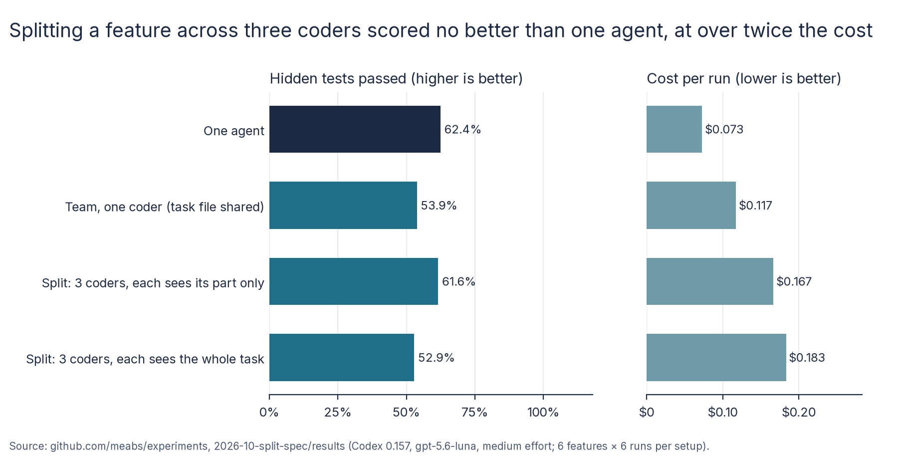

# Split the work, split the spec? Report

Run on 2026-10-26. The design is in [README.md](README.md), committed and pushed before any measured run; later changes are in its amendment log. Every run's grading files, diff, the planner's part files, the rig's event stream and an audit of its Codex session files are in [results/main](results/main) (the raw session files are not published: they carry account ids). The analysis is [results/analysis.md](results/analysis.md), from [`scripts/analyse.py`](scripts/analyse.py), fixed before the runs. Checks I made after the runs are labelled as such. Every figure below comes from those files.

## 1. What I wanted to find out

If a planner splits a feature into parts and gives each part to its own coding agent, all working at the same time, does the team get more of the feature right than one agent? Does it matter whether each coder sees only its own part's spec or the whole task?

## 2. Why I thought it was worth testing

In the [swarm-tax experiment](../2026-10-swarm-tax/REPORT.md) one agent beat a planner–coder–reviewer team (56.8% of hidden tests passed against 25.7%), and giving every agent the task file only brought the team level (54.1%). But that team didn't split the work: the planner handed the whole feature to one coder. The usual pitch for multi-agent coding is the split itself: focused coders, each with a focused brief, working in parallel. The user asked for that to be tested next.

## 3. What I predicted

Three hypotheses, fixed before the runs, two-sided and Holm-adjusted together:

| # | Hypothesis |
| --- | --- |
| H1 | A team that splits the feature, each coder seeing only its part (`split-part`), and one agent (`solo`) differ |
| H2 | The same split with every coder reading the whole task (`split-full`) and `split-part` differ: what scoping a coder to its part costs or gains |
| H3 | `split-full` and a team with one coder that also reads the whole task (`team-spec`) differ: what splitting the work gains |

## 4. How I tested it

- **Agent:** Codex CLI 0.157 with hosted `gpt-5.6-luna` at medium reasoning effort in every arm and every subagent (all 504 session files checked). Teams use Codex's own subagents, each started with no conversation history. Each run is in a fresh clone of shopizer at `6a4a0a6`, inside a bubblewrap sandbox that shows the agent only its own clone.
- **Arms:**
  - **solo:** the task only;
  - **team-spec:** swarm-tax's follow-up arm, unchanged: a planner that may not edit code briefs one coder, a fresh reviewer checks the change, one round of fixes; the task is in the clone as `TASK.md` and the coder and reviewer read it ([`arms/team-spec.md`](arms/team-spec.md));
  - **split-part:** the planner splits the feature into 2 or 3 parts and writes a part file for each (`.team/part-N.md`: what it does, the files it owns, every requirement from the task that applies to it in the task's exact words, what the other parts provide), then starts one coder per part, all at once. Each coder reads only its own part file. A fresh reviewer reads `TASK.md` and checks the whole change; one round of fixes, each fault sent to the coder that owns it ([`arms/split-part.md`](arms/split-part.md));
  - **split-full:** as split-part, but each coder reads `TASK.md` first and then its part file, and the planner doesn't copy requirements into the part files ([`arms/split-full.md`](arms/split-full.md)).
- **Tasks:** swarm-tax's six features, unchanged, each stated as a need with its interface fixed: DISCOUNT, TIERPRICE, WISHLIST, BACKINSTOCK, PRODUCTQA, CARTLIMIT. Each has 13 to 16 hidden API tests that no agent sees; with my reference implementation every hidden test passes, and the existing suite still passes.
- **Size:** 6 runs per task per arm, 144 runs, all four arms in the same hours.
- **Measure:** the share of a task's hidden tests a run passes. Arms are compared by the mean over tasks, so each task counts equally. Permutation tests within tasks (100,000 shuffles), bootstrap intervals within tasks (10,000 resamples), seed 1, Holm over the three.

## 5. What happened

**Splitting the feature across three coders got no more of it right than one agent did, and cost more than twice as much.**

**How to read the scores in this report:** a score is the share of a task's hidden tests that a run's code passed, averaged over the runs. **Higher is better.** 100% means every hidden test passed, so the feature works as the task asked; 0% means none did. So solo's 62.4% means one agent's code passed 62.4% of the hidden tests on average. The analysis file gives the same scores as fractions (0.624 = 62.4%). For cost, tokens and time, **lower is better**.



| | solo | team-spec | split-part | split-full |
| --- | --- | --- | --- | --- |
| Share of hidden tests passed, mean over tasks (higher is better) | **62.4%** | 53.9% | 61.6% | 52.9% |
| Runs passing every hidden test and the existing suite (higher is better) | 5 of 36 | 1 of 36 | 2 of 36 | 3 of 36 |
| Runs where the app would not start, so 0% (lower is better) | 0 of 36 | 1 of 36 | 1 of 36 | 3 of 36 |
| Mean cost per run, every session, list prices (lower is better) | **$0.073** | $0.117 | $0.167 | $0.183 |
| Mean tokens per run (lower is cheaper) | 2.19M | 3.64M | 4.76M | 5.36M |
| Median wall time (lower is faster) | **2.3 min** | 3.9 min | 3.8 min | 3.7 min |
| Cost per hidden test passed (lower is better value) | **$0.0082** | $0.0153 | $0.0189 | $0.0243 |

By task (share of hidden tests passed, higher is better):

| Task | solo | team-spec | split-part | split-full |
| --- | --- | --- | --- | --- |
| BACKINSTOCK | 52.6% | 30.8% | 34.6% | 37.2% |
| CARTLIMIT | 50.0% | 46.4% | 69.0% | 77.4% |
| DISCOUNT | 33.3% | 24.0% | 49.0% | 25.0% |
| PRODUCTQA | 86.9% | 72.6% | 83.3% | 57.1% |
| TIERPRICE | 58.3% | 91.7% | 69.0% | 59.5% |
| WISHLIST | 93.3% | 57.8% | 64.4% | 61.1% |

Each arm wins somewhere: the split arms on CARTLIMIT, split-part on DISCOUNT, team-spec on TIERPRICE, solo on BACKINSTOCK and WISHLIST. Across the six, no arm stands apart.

**The hypotheses.** A difference is the first arm's score minus the second's, in percentage points of hidden tests passed; negative means the first arm did worse. "No measurable difference" means the test could not tell the arms apart, not that they are proven equal: with six tasks, a gap under about 15 points will usually look like this (README, "Power").

| # | Comparison | Difference | 95% interval | Holm p | Reading (fixed in the design) |
| --- | --- | --- | --- | --- | --- |
| H1 | split-part − solo | −0.8 points | −11.5 to +9.3 | 1.0 | No measurable difference: the split as pitched did not beat one agent |
| H2 | split-full − split-part | −8.7 points | −20.6 to +3.2 | 0.60 | No measurable difference: the part files carried enough; letting coders see the whole task did not help |
| H3 | split-full − team-spec | −1.0 points | −12.4 to +9.8 | 1.0 | No measurable difference: splitting bought nothing in score, so the comparison falls to cost and time |

**The split happened as designed.** The design said a split arm would not count if fewer than half its runs had two or more coders, or if split-part coders opened `TASK.md` in more than a quarter of runs. From the session files:

- In all 72 split runs the planner wrote 3 part files and started 3 coders, and in every one the coders' working times overlapped.
- Planners mostly split by layer: data model and service, customer-facing API, admin or report API.
- No planner edited source code, and every subagent started with no history.
- In split-part, 2 of 108 coders opened `TASK.md` (2 of 36 runs; I checked both commands, which were real reads), and 7 opened another part's file.
- In split-full every coder read `TASK.md`; 9 opened another part's file.

**The part files did carry the spec.** In split-part, every stated JSON field and HTTP status from each task appeared in the planner's part files (100%), and 88% reached the code, the highest of any arm (solo 84%, team-spec 76%, split-full 86%). So the brief-writing worked. It just didn't turn into more passing tests.

**Where the split failed: joining the parts.** A whole-app crash scores 0%, because no hidden test can run. These failures were rare but concentrated in the split arms: 4 of 72 split runs, against 1 of 36 team-spec and none of solo. From the test logs and diffs (checked after the runs):

- **split-full WISHLIST run 3:** two classes named `WishlistApi` in different packages, both edited by more than one coder. Spring refused to start because of the duplicate name.
- **split-full PRODUCTQA run 5:** the data-and-service coder wrote a converter class without registering it with Spring, and the admin-API coder's code depended on it. The app could not start. **The reviewer approved this run.**
- **split-full PRODUCTQA run 2:** one coder created `ProductQuestionApi` twice, in two packages, causing the same duplicate-name crash.
- **split-part BACKINSTOCK run 1:** a repository the service needed was never registered, so the app could not start.

Only two of these were clearly seams, where one coder's work didn't fit another's (WISHLIST 3, PRODUCTQA 5). The other two were one coder's own mistake. But in a split, no single agent compiles and starts the whole thing before handing over, so nothing caught them.

**The reviewer still approved broken work.** Over all three team arms, 15 final reviews approved, and 14 of those runs failed hidden tests (team-spec 4 of 4, split-part 5 of 6, split-full 5 of 5). In the other 93 of the 108 team runs, the final review was still asking for changes after the one fix round.

**Success claims were mostly false, in every arm.** The rig's claim check found the final report claimed success while hidden tests failed in 28 of 36 solo runs, 33 team-spec, 34 split-part and 32 split-full.

**As a check, the reruns matched swarm-tax:** solo 62.4% (56.8% there) and team-spec 53.9% (54.1% there).

## 6. What surprised me

- **Parallel coders didn't save time.** The coders worked at the same time in every split run, yet the median run took 3.8 minutes, the same as the one-coder team and over half again solo's 2.3. Planning, review and the fix round took up whatever the parallel work saved.
- **Better briefs didn't mean better code.** The split-part planners copied 100% of the stated interface into the part files, and more of it reached the code than in any other arm. The score stayed level with solo. On these tasks, the details that fail tests are behaviour (rounding, ordering, which records count) more than names, and the part files' word-for-word requirements didn't make the coders build that behaviour correctly.
- **Seeing the whole task didn't help the split coders,** if anything the reverse (split-full 8.7 points below split-part, not a measurable difference). One possible reason, after the fact and untested: with the whole task in view, coders strayed out of their part. split-full had 3 runs where a file was patched by more than one coder; split-part had none.

## 7. What this might mean in practice

This section is interpretation, not measurement.

- **Splitting a feature across agents is not a free upgrade either.** Here it cost 2.3 to 2.5 times as much per run as one agent and about 2.3 to 3 times as much per passing hidden test, was no faster, and got no more of the feature right. For features of this size (a day or two of a developer's work, touching 3 to 10 files), one agent is the better buy. Larger work that one agent can't hold in view might come out differently; that wasn't tested.
- **The risk moves to the joins.** One agent either builds a working whole or not. A split team can build parts that each look right and don't fit: two controllers with the same name, or a class one coder depends on that another never registered. These crash the whole application, not one feature. Here that happened in 1 split run in 18, and the reviewer approved one of them. **If you split work across agents, have something build and start the whole application after the parts are joined, and don't count a reviewer agent's approval as that check.**
- **Writing good briefs is necessary, not enough.** The planner here did what you'd hope for: exact requirements, file ownership, what each part provides. It didn't raise the score. Getting the hand-off right (swarm-tax's lesson) brings a team level with one agent; it doesn't take it past.
- **Reviewer agents and agent reports remain false assurance.** 14 of 15 approvals and most success claims went to code that failed its acceptance tests, as in swarm-tax. None of the setups here gives a signal a user can trust without their own tests.

## 8. What the experiment does not prove

- One repository, one model (`gpt-5.6-luna`) at one effort level, six features of moderate size, and team instructions I wrote. Bigger features, other models, or a split designed by a person rather than the planner could come out differently.
- The tests are within these six tasks. Six tasks is few: a difference under about 15 points would usually read as "no measurable difference", so a modest gain or loss from splitting can't be ruled out.
- "Coders read only their part" was an instruction, checked afterwards from each coder's commands. A coder that read the task without naming the file would not be counted.
- The causes of the four start-up crashes, and the reason given for split-full's lower score, come from checks made after the runs, not from the design.
- No local model, at the user's direction (README, "Known limits").

## 9. What I'd test next

- **A team with a build-and-start step:** after the coders finish, one agent must start the application and call each new endpoint once, before review. That targets the failure the split introduced.
- **Teams that must write tests** from the task before coding, carried over from swarm-tax: the one change that could give the reviewer and the user a real signal.
- **Bigger features,** where one agent's context fills up and a split has something to gain.
- **Other models and effort levels,** including a local model once one can finish a feature in reasonable time.

## 10. How to reproduce the results

```
python3 -I scripts/make_trial.py                     # the four trial files
scripts/run_all.sh <out dir>                          # the four side by side, with the Maven checksum before and after
scripts/export.sh <out dir>/solo main/solo            # likewise team-spec, split-part, split-full: personal paths removed, homes left out
python3 -I scripts/analyse.py results/main/solo results/main/team-spec results/main/split-part results/main/split-full > results/analysis.md
uv run --with matplotlib python3 -I scripts/charts.py <out dir> <Inter font dir>   # the chart
```

The analysis gives the same output from the exported results as from the original run folders (checked).

## Checks on the runs

- **Complete:** all 144 runs finished with status ok and were graded; none timed out, and none showed a usage-limit or rate-limit error.
- **Model and effort:** all 504 session files (main agents and subagents) name `gpt-5.6-luna` at medium effort.
- **Hidden tests not visible:** each run's sandbox showed only its own clone. No session file or event stream mentions a hidden test class or the experiments folder. Some agents wrote to `/tmp` or guessed absolute paths outside their clone, mostly wrong guesses at their own clone's path. Two searched from the folder above the clone, where the sandbox shows only an empty, throwaway file system.
- **Shared Maven repository unchanged:** the checksum of `com/shopizer` in `~/.m2` was the same before the runs, at the restart and after ([results/main/m2.log](results/main/m2.log)). Agents ran `mvn install` in 16 runs (7 solo, 3 team-spec, 4 split-part, 2 split-full). The sandbox's throwaway layer over the Maven repository discarded it. The grader never runs `mvn install`.
- **Behaviour claims** (coders, overlap, part files read, files patched, planner edits, verdicts) come from the session files through [`scripts/audit_run.py`](scripts/audit_run.py), not from the agents' summaries.

## What changed from the design

All recorded in the [README's amendment log](README.md#amendment-log) with the user's words:

- **Paused and restarted:** the user paused the runs for a usage limit ("pause for 2hrs then start") and restarted them early ("Usage has reset start"). The 13 runs already finished were kept. The 8 in progress were stopped, set aside unanalysed (kept locally, not published, since they hold Codex homes) and rerun from scratch.
- **Added after the runs:** [`scripts/charts.py`](scripts/charts.py) for the chart, and the checks on start-up crashes and on the two `TASK.md` reads, labelled as post-hoc above. The analysis script was not changed.
