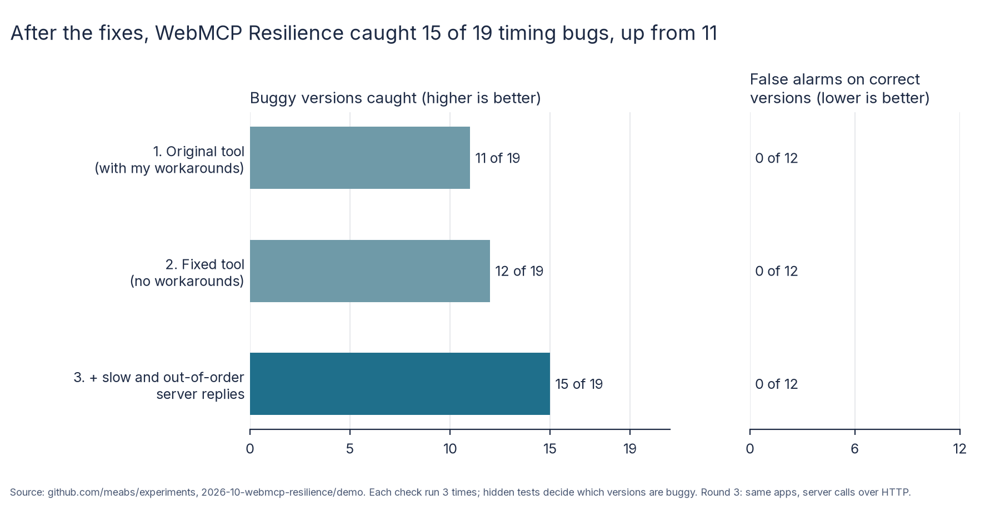

# Does WebMCP Resilience catch timing bugs? A demo

29 October 2026. Not a pre-registered experiment: a quick, honest look at whether the tool is useful.

## The question

[WebMCP Resilience](https://github.com/meabs/WebMCPResilience) tests what happens when a person and an AI tool act on
a WebMCP page at the same time, with delays, repeated calls and cancellations. Does it catch timing bugs that an
ordinary check misses, and does it stay quiet when the code is right?

## What I ran

- **The apps:** the six small WebMCP apps from this folder's parked experiment (`../apps`). Each has one planted timing
  bug: a double add, the last seat sold twice, a lost update, a half-saved listing, a charge with no order, and a stale
  quantity.
- **31 versions of them:**
  - the 6 buggy originals;
  - 6 reference fixes;
  - 12 plausible but wrong fixes (`../wrong-fixes`);
  - 7 real fixes written by coding agents in the pilot runs (`agent-fixes/`: 6 by gpt-5.6-luna, 1 by qwen3.8:27b
    running locally).
- **Ground truth:** the hidden test suite for each app (`../hidden`, plain Playwright, independent of the tool). A
  version is buggy if any hidden case fails.
- **The ordinary check:** the first two hidden cases of each app: one person or one assistant call at normal speed.
  This is the check most teams, and most coding agents, run.
- **WebMCP Resilience:** 14 scenarios, two or three per app (`scenarios/`), each run 3 times, because timing varies.
  - A version counts as caught if a scenario reports an invariant violation.
  - Every scenario uses only what a developer would have: the app's README, its tools and state, and the tool's
    standard faults (a repeated call, a delay, a person acting at the same moment, cancellation, a tool being
    unregistered).
  - Each scenario had to fail on the buggy original and pass on the reference fix before it was run on anything else.
  - **I knew the bugs when I wrote them,** so this shows what the tool can catch with a sensible scenario. It does not
    show what a developer would find blind.

## Results

| Versions | Ordinary check caught (higher is better) | WebMCP Resilience caught (higher is better) |
| --- | --- | --- |
| Buggy originals | 0 of 6 | 5 of 6 |
| Planted wrong fixes | 0 of 12 | 6 of 12 |
| Agent fixes that were wrong | 0 of 1 | 0 of 1 |
| **All buggy versions** | **0 of 19** | **11 of 19** |
| False alarms on correct versions (lower is better) | 0 of 12 | 0 of 12 |

- **Stable:** every verdict was the same in all 3 runs: caught 3 times or not at all.
- **No tool errors** in the final runs.
- When it caught a bug, the tool saved a replayable record: the failed rule and observed state (for example
  `spin.over <= 0 (observed: 1 vs 0)`, two bookings for one seat), a screenshot, a trace and a reduced `repro.yaml`.

### What it missed, and why

| Why | Versions |
| --- | --- |
| The bug needs server replies to be slow or arrive out of order. The tool can delay tool calls but not the server | stale-quantity (original and a wrong fix), two double-add wrong fixes |
| The bug needs another customer acting on the server, outside the page | last-seat: a page-only lock |
| A case my scenarios didn't cover | last-seat with two free seats; lost-update when the customer retypes their email unchanged (a wrong fix and Luna's fix) |

## Rounds 2 and 3: after fixing the tool (29 October 2026)

After the first round, the four worst problems were fixed in WebMCP Resilience:
- [#17](https://github.com/meabs/WebMCPResilience/pull/17): wait for tools that register late, survive page reloads, run headless by default, and a new `http_latency` fault that slows real network replies;
- [#18](https://github.com/meabs/WebMCPResilience/pull/18): per-request delays (`delays_ms`), so a later reply can overtake an earlier one;
- [#19](https://github.com/meabs/WebMCPResilience/pull/19): a regression in #17. Setup got slower and was counted in the schedule, so actions fired up to about 165 ms late. That briefly lost a catch.

The same 31 versions were then checked twice more, each tool check 3 times:
- **Round 2 (`results-round2.json`):** the fixed tool (main with #17 and #19; #18 doesn't affect this round), with no workarounds: no readiness `setup_script` and no `--ci`. The reload scenario (`scenarios-unsupported/`) is added.
- **Round 3 (`results-round3.json`):** the same, run on `../apps-network/`. These are the apps with one change to the shared `latency.js`: each simulated server call also makes a real request to the page's own web server, so network faults can hold it.
  - Ten new scenarios use the slow and out-of-order server faults (`scenarios-network/`). Each passed the reference fix in all 3 runs before it was used.
  - An eleventh failed the reference fix and is excluded (`scenarios-network-excluded/`). It assumed the + button counts a second click while a save is running; the reference fix doesn't.
  - The hidden tests give the same results on these apps as on the originals: every original and wrong fix fails, and every reference passes 3 times out of 3.

| Round | Buggy versions caught, of 19 (higher is better) | False alarms, of 12 correct versions (lower is better) |
| --- | --- | --- |
| 1. Original tool, with my workarounds | 11 | 0 |
| 2. Fixed tool, no workarounds, plus the reload scenario | 12 | 0 |
| 3. Plus slow and out-of-order server replies | 15 | 0 |

Every verdict in every round was the same in all 3 runs. There were no tool errors.

| Newly caught | In round | Caught by | Thanks to |
| --- | --- | --- | --- |
| double-add, wrong fix `page-dedupe` | 2 | `retry-after-reload` | tools surviving a reload (#17) |
| double-add, wrong fix `requestid-only` | 3 | `slow-server-click` | `http_latency` (#17) |
| stale-quantity, the original | 3 | `out-of-order-two-assistant-changes` | `delays_ms` (#18) |
| stale-quantity, wrong fix `one-token` | 3 | `out-of-order-two-assistant-changes` | `delays_ms` (#18) |

Still missed:
- last-seat `conflict-as-full` (no scenario has two free seats);
- last-seat `page-lock` (needs another customer booking outside the page);
- lost-update `dirty-fields-only` and the agent's lost-update fix (no scenario retypes the email unchanged).



## Every version

| App | Version | Really buggy? (hidden tests) | Ordinary check caught it? | WebMCP Resilience caught it? (of 3 runs) | Why it was missed |
| --- | --- | --- | --- | --- | --- |
| stale-quantity | original | yes, 5 of 7 cases fail | no | 0/3 | needs server replies to arrive out of order; the tool cannot slow the server |
| stale-quantity | reference | no | no | 0/3 |  |
| stale-quantity | wrong:one-token | yes, 5 of 7 cases fail | no | 0/3 | the same |
| stale-quantity | agent:luna | no | no | 0/3 |  |
| double-add | original | yes, 7 of 12 cases fail | no | 3/3 |  |
| double-add | reference | no | no | 0/3 |  |
| double-add | wrong:key-per-add-ignores-requestid | yes, 4 of 12 cases fail | no | 3/3 |  |
| double-add | wrong:page-dedupe | yes, 4 of 12 cases fail | no | 0/3 | fails after a page reload (the tool loses the tools after a reload) and on a slow server |
| double-add | wrong:requestid-only | yes, 2 of 12 cases fail | no | 0/3 | fails only when the server is slow |
| double-add | agent:luna | no | no | 0/3 |  |
| last-seat | original | yes, 6 of 10 cases fail | no | 3/3 |  |
| last-seat | reference | no | no | 0/3 |  |
| last-seat | wrong:conflict-as-full | yes, 2 of 10 cases fail | no | 0/3 | fails only with two free seats; my scenarios start with one |
| last-seat | wrong:page-lock | yes, 1 of 10 cases fail | no | 0/3 | fails only when another customer books through the server, outside the page |
| last-seat | agent:luna | no | no | 0/3 |  |
| lost-update | original | yes, 5 of 8 cases fail | no | 3/3 |  |
| lost-update | reference | no | no | 0/3 |  |
| lost-update | wrong:dirty-fields-only | yes, 1 of 8 cases fail | no | 0/3 | fails only when the customer retypes their email unchanged; no scenario of mine does that |
| lost-update | wrong:refill-form | yes, 4 of 8 cases fail | no | 3/3 |  |
| lost-update | agent:luna | yes, 1 of 8 cases fail | no | 0/3 | the same |
| half-saved | original | yes, 4 of 7 cases fail | no | 3/3 |  |
| half-saved | reference | no | no | 0/3 |  |
| half-saved | wrong:atomic-but-cancellable | yes, 2 of 7 cases fail | no | 3/3 |  |
| half-saved | wrong:drop-abort-check | yes, 4 of 7 cases fail | no | 3/3 |  |
| half-saved | agent:luna | no | no | 0/3 |  |
| charge-no-order | original | yes, 5 of 8 cases fail | no | 3/3 |  |
| charge-no-order | reference | no | no | 0/3 |  |
| charge-no-order | wrong:finish-charge-only | yes, 5 of 8 cases fail | no | 3/3 |  |
| charge-no-order | wrong:refund-in-flight-charge | yes, 2 of 8 cases fail | no | 3/3 |  |
| charge-no-order | agent:luna | no | no | 0/3 |  |
| charge-no-order | agent:qwen3.8-27b-local | no | no | 0/3 |  |

## Problems I hit with the tool

- **`webmcp run` doesn't wait for tools registered after the page loads.** Preflight waits up to 2 seconds; `run` asks
  for the tools once, straight after loading. These apps register theirs after their first server calls, so every run
  failed with "scenario references unavailable tools". The workaround is a `setup_script` that waits for the tools
  (`check_tool.py`).
- **After a page reload, the tools are lost.** A scenario that reloads the page and retries (double-add's
  `scenarios-unsupported/`) failed with "WebMCP tool not discovered", even 1.6 seconds after the reload. It isn't
  counted above.
- **`preflight` without `--ci` opens a visible browser,** and hangs on a machine without a display.
- **Actions in one actor run one after another, each waited for.** A `cancel` must come from a different actor from
  the call it cancels, and a `wait` at 0 ms holds up the other actors.
- **Timing between actors isn't guaranteed.** My first stale-quantity scenario assumed the person's click landed before
  the assistant's change. It didn't always, which caused false alarms on correct code. I changed the rule to one
  that doesn't depend on order ("the page shows what is saved"), and with that, the tool missed the stale-quantity bug
  entirely.

## Reproduce

```bash
# needs the parked experiment's two Python environments (Playwright; WebMCP Resilience 0.1.0)
~/code/benchmark/webmcp-exp/env-plain/bin/python -I demo/run_matrix.py      # round 1: writes demo/results.json
# round 3 (round 2: drop WEBMCP_APPS and WEBMCP_SCENARIO_DIRS; WEBMCP_BIN is a WebMCP Resilience at fb1b106 or later)
WEBMCP_BIN=<webmcp> WEBMCP_NO_WORKAROUNDS=1 WEBMCP_EXTRA_SCENARIOS=scenarios-unsupported WEBMCP_APPS=apps-network \
  WEBMCP_SCENARIO_DIRS=scenarios-network WEBMCP_RESULTS=results-round3.json ~/code/benchmark/webmcp-exp/env-plain/bin/python -I demo/run_matrix.py
python3 -I demo/check_tool.py last-seat                                      # one app, the buggy original
```
