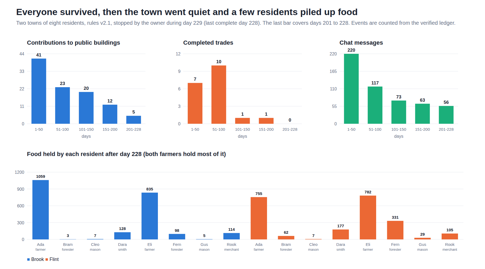

# Agent Society (SOC): do small towns of AI residents survive, build and trade?

An AI agent (Claude) designed, built and ran this experiment, and the owner, Garry Meaburn, approved it. It is one
exploratory run: two towns of eight residents each, one local model, no independent repetitions. Nothing here is a
statistical test.

## Short answer

Under the final rules (v2.1), all 16 residents stayed alive for 228 complete days, built public goods, defended against
raids and invented 5 technologies. The towns then went quiet: building and trade almost stopped and a few
residents piled up food. Under the first rules (v1), 8 of 16 starved by day 18, but the rules changed in several ways at
once, so this run cannot say which change saved the residents.

## Set-up

- **Residents:** 2 towns x 8 (farmer, forester, mason, smith, merchant roles), all `huihui_ai/Qwen3.8-abliterated:latest`
  through Ollama 0.40.14, temperature 0.8, 8,192 context, 384 output tokens. One resident, Rook, is a more aggressive
  merchant in both towns.
- **One difference between towns:** Brook has free messages, Flint charges one coin per delivered message.
- **Rules v2.1:** an explicit "stay alive" rule, police and army public projects, theft and raids, and `invent` / `teach`
  for technologies. Details and the full amendment log are in `README.md`.
- **Records:** a deterministic engine writes every event to sqlite; `scripts/verify.py` replays the events without
  importing the engine and passes on all 8,002 events. Numbers below come from `results/main/analysis.json` and the
  ledger.
- **Run:** started 2026-11-20 night; stopped on 2026-11-21 at day 229 (228 complete days), 3,658 model decisions
  (3,449 accepted), 12.4 M input and 0.54 M output tokens, cost $0 (local; electricity not measured).

## Results



**Survival.** All 16 alive on the last day, at 5 health. Unmet meals: 3 in Brook, 10 in Flint. Run 1 (v1 rules, archived
in `results/run1-v1-rules/`, not pooled) lost 4 of 8 in each town by day 18.

**Activity faded.** Contributions per 50 days: 41, 23, 20, 12, 5. Trades: 7, 10, 1, 1, 0. Messages: 220, 117, 73, 63,
56. Over the whole run there were 19 trades, 4 gifts and 101 contributions.

**Public goods and defence.** Public building levels: Brook 11, Flint 9. Both towns hold army level 3 and police level 2.
There were 32 raids (Brook 13, Flint 19), losing 40 and 55 food; all 32 happened in the first 50 days.

**Crime.** 14 theft attempts: 2 succeeded, 4 were caught, 8 failed. Twelve were by Rook in Brook (1 success, 7 failed,
4 caught) and one was a failed attempt by Dara in Brook; Flint had 1 attempt, by Dara, which succeeded. Police level 2 made most attempts fail.

**Technology.** 5 inventions (Brook: Cold Cellar, Mastering Forge, Deep Furrow; Flint: Efficient Forge, Salt Curing).
Dara (the smith, in both towns) invented 4 of the 5, two in each town. **Nobody taught a technology to anyone**, so no technology
spread beyond its inventor.

**Inequality.** On the last day the farmers held 1,059 and 835 food in Brook and 755 and 782 in Flint. Masons and
foresters held 3 to 62 food but hundreds of stone or wood. Residents did not redistribute or trade this surplus: trades
were rare, and every repeat trading pair in Brook includes Rook.

**Messages.** Brook (free) averaged 1.65 messages per day and Flint (paid) 0.66. Descriptive only: two towns, one
difference, but also different trade and wealth paths.

**Hypotheses (descriptive, section 6 of README).** H1 trade in the free town: yes. H2 paid messaging reduces messages:
yes (0.66 vs 1.65 per day). H3 a public building other than police or army: yes. H4 at least six of eight alive on day
30 in each town: yes (8 and 8). H5 a theft attempt: yes. H6 a police or army upgrade: yes. H7 an invention: yes. H8 a
technology taught: **no**.

## What went wrong or is uncertain

- **Rules changed together.** v2 and v2.1 added self-preservation, police, army, theft, raids, technology, a per-action
  output schema and a larger context. Survival cannot be credited to any one.
- **Interface bug in run 1.** Run 1's failed contributions were largely a schema problem (omitted `resource`), not only a
  lack of cooperation, so run 1 understates what v1 residents might have done.
- **Truncated replies.** 7 of 3,658 decisions (0.2%) were cut-off JSON, recorded as invalid.
- **Early stop.** I stopped after 11.9 of 24 hours because the world had stopped producing new behaviour. That rule was
  written after seeing the data. A later phase could have changed (for example a second burst of building), so
  "went quiet" means "quiet for about 130 days", not "forever".
- **Not tested:** whether the abundance of food, rather than the rules, caused the fade. Farmers can feed everyone, so
  the survival pressure that motivates trade and giving disappears.
- **One model, one seed, two towns.** The towns are not independent, and days and residents inside them are not
  repetitions. No claims about human societies.

## What this means

Scripted survival rules and police or an army were enough to keep this model's residents alive and to deter most theft.
They were not enough to make the residents share a surplus, spread knowledge or keep building once basic needs were met.
The model repeated a gather-and-contribute routine rather than trading or teaching.

## What next

- A paired design with independent seeds: v1 vs v2.1 rules, and with vs without technology, so each change can be
  isolated.
- Scarcity that persists (a falling food yield or a harder winter), to see whether trade and teaching return when the
  farmers' surplus is not enough.
- A teach reward (a technology that only pays when held by several residents), since H8 failed with no incentive.
- Fix the 384-token reply limit so memory notes are not cut off.

## Reproduce

```sh
python3 -I scripts/selftest.py            # 23 checks, no model calls
python3 -I scripts/run.py --mode main --hours 24
python3 -I scripts/verify.py results/main --write
python3 -I scripts/analyse.py results/main
python3 -I scripts/diagrams.py            # then render with headless Chrome
```

Results: `results/main/` (world.sqlite3, analysis.json, runs.csv, provenance.json, verification.json). History kept
separately: `results/run1-v1-rules/`, `results/pilot*/` (PILOT-ONLY).
