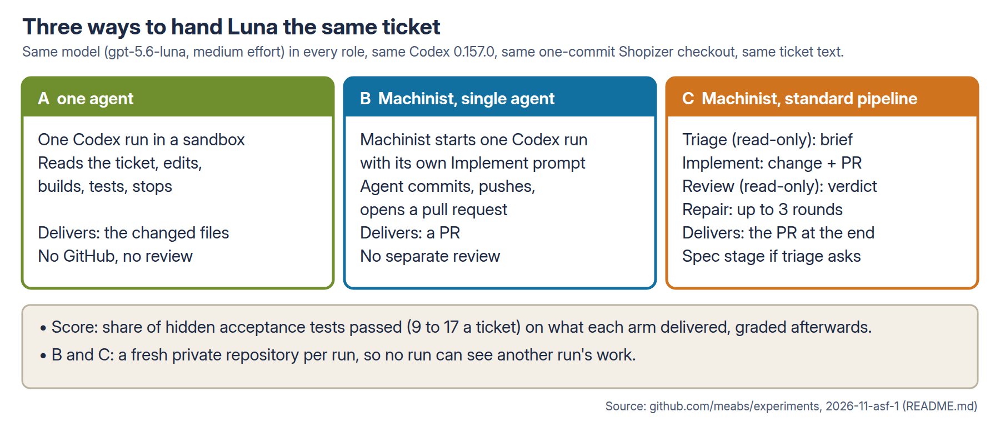
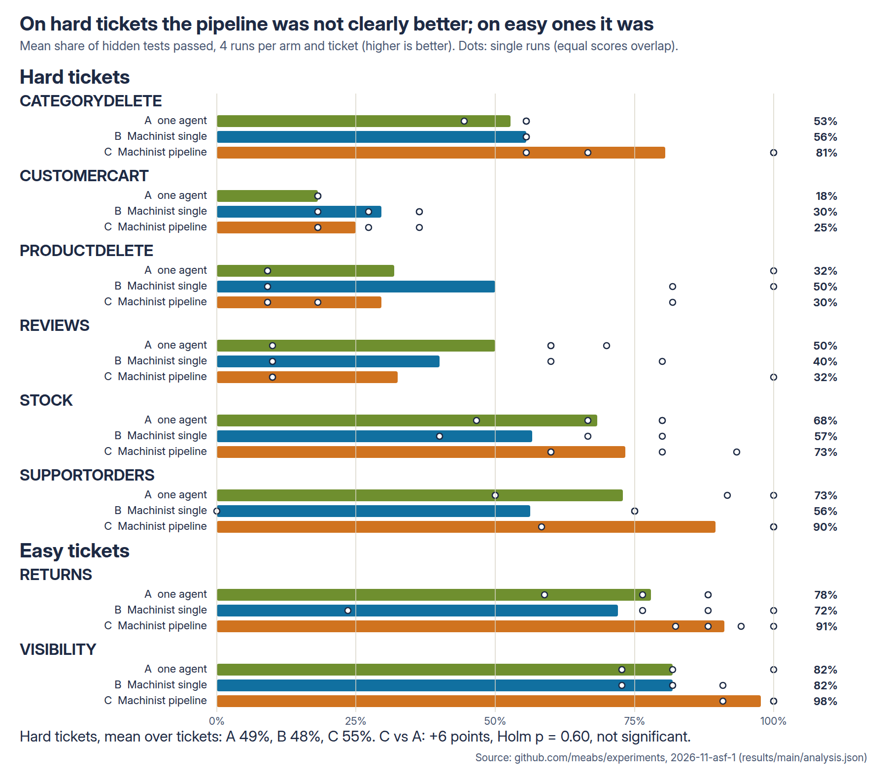
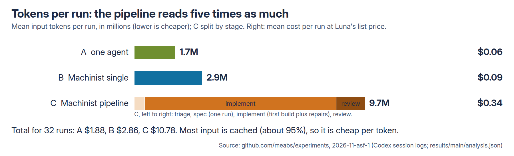
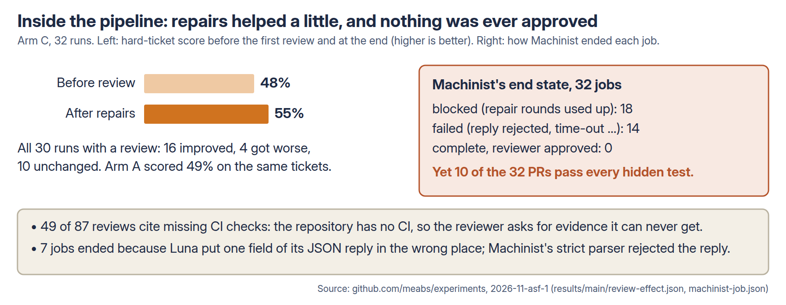

# Does an open-source software factory beat one coding agent? ASF-1 results

**Short answer:**
- On six hard bug-fix tickets, Machinist's standard pipeline passed 55% of the hidden tests. One Codex agent passed
  49%. The difference is not significant (+6 points, Holm p = 0.60, 95% range −7 to +19).
- The pipeline cost 5.7 times as much, and took 28 minutes per ticket against 3.5.
- On two easier tickets, the pipeline did better: 94% against 80%.
- Machinist's reviewer never approved a single change in 32 runs, including the 10 whose PRs pass every hidden test.
  Anyone going by Machinist's own status would have thrown away its best work.

Pre-registered design: `README.md`, pushed as 5e99976f before the main run. All results are in `results/main/`.

## What was tested

- **Machinist** is an open-source "software factory" (MIT, Go; github.com/owainlewis/machinist, commit `4d7d776`).
  It takes a ticket, runs coding agents in set roles, and delivers a GitHub pull request. We ran it as supplied:
  its own prompts, its own stage time limits, and its own repair limit of 3 rounds. We changed only the model and the
  access controls.
- **The standard pipeline (arm C), step by step:**
  1. A **triage** agent reads the repository and writes a brief.
  2. An **implement** agent makes the change and opens a PR.
  3. A separate **review** agent, which can only read, gives a verdict with findings.
  4. If the review asks for changes, implement **repairs** the PR and review runs again. This repeats up to three
     times.
- **Machinist's single-agent mode (arm B):** one implement agent does the whole job and opens a PR.
- **One agent (arm A):** the baseline. One Codex run with the ticket, in the same sandbox as our earlier
  experiments. No GitHub and no review.
- **The same in every arm:**
  - the model: `gpt-5.6-luna` at medium effort, in every role (checked on every turn of every session: 96 of 96
    runs were Luna only);
  - Codex 0.157.0;
  - the same one-commit Shopizer checkout (a Java e-commerce application);
  - the same ticket text and the same Maven cache.
- **No run could see another.** Each B and C run had its own fresh private repository, and only that run's
  repository was reachable with Machinist's GitHub token.
- **Tickets:** the eight tickets from our evidence-led experiment (ELC).
  - Six are hard: real Shopizer defects that span several components, written as a merchant's bug report.
  - Two are easier.
- **Score:** the share of hidden acceptance tests passed (9 to 17 per ticket). Tests were run after each run, on what
  the run delivered: the PR's head for B and C, the changed files for A. The agents never saw the tests.
- 4 runs per arm and ticket, 96 runs in all, in random order, one at a time.

## Results

**Hard tickets**: the six tickets the hypotheses are about. Score is the mean over tickets of each ticket's mean
(higher is better).

| Arm | Hidden tests passed | Runs passing every test | Cost per run | Time per run |
| --- | --- | --- | --- | --- |
| A: one agent | 49% | 2 of 24 | $0.06 | 3.5 min |
| B: Machinist, single agent | 48% | 1 of 24 | $0.09 | 5 min |
| C: Machinist, standard pipeline | 55% | 6 of 24 | $0.34 | 28 min |

Cost is lower-is-better, at Luna's list price ($0.20 input, $0.02 cached input, $1.20 output per million tokens),
counted from every Codex session's own log. Time is lower-is-better wall-clock time. Cost and time are means over all
eight tickets.

**Pre-registered tests** (hard tickets; permutation within ticket, 100,000 shuffles; Holm across the three):

| Hypothesis | Difference (points) | p | Holm p | 95% bootstrap range |
| --- | --- | --- | --- | --- |
| H1: C scores higher than A | +6.1 | 0.21 | 0.60 | −6.5 to +18.9 |
| H2: C scores higher than B | +7.1 | 0.20 | 0.60 | −6.6 to +21.2 |
| H3: B differs from A | −1.0 | 0.90 | 0.90 | −14.9 to +12.3 |

None is significant. That does **not** show the arms are equal. The range for C vs A runs from a 7-point loss to a 19-point gain for the pipeline. A gain much above 19 points on
these hard tickets is unlikely.

**Easy tickets** (RETURNS and VISIBILITY, described rather than tested): A 80%, B 77%, C 94%. C passed every hidden
test in 4 of 8 runs, against 1 of 8 for A and 1 of 8 for B.

**Cost** (all eight tickets; the pre-registered ratio, with a bootstrap range):
- C cost 5.7 times as much as A (range 4.9 to 6.7). The 32 runs cost $10.78 against $1.88.
- B cost 1.5 times as much as A (range 1.4 to 1.7).

## Inside the pipeline

- **Review effect** (pre-registered): we graded each C run's PR at its last commit before the first review, and
  again at the end.
  - On hard tickets, the score went from 48% to 55%, across 22 runs.
  - Over all 30 runs that had a review, 16 improved, 4 got worse and 10 were unchanged.
  - The pipeline's first draft scored the same as the single agent (49%). The small gain comes from the repair
    rounds.
  - Repairs can also break working code. In two REVIEWS runs, the PR fell from 8 of 10 and 7 of 10 passing tests to
    1 of 10 after repairs the reviewer asked for.
- **Nothing was ever approved.** Machinist ended all 32 jobs as "blocked" (18, repair rounds used up) or "failed"
  (14). None ended "complete".
  - 10 of the 32 PRs pass every hidden test, and the reviewer rejected those too.
  - 49 of the 87 reviews give missing CI as a reason. The repository has no CI (true in every arm), and Machinist's
    reviewer asks for check runs that can never appear. A real example, on a PR that passes 12 of 12 hidden tests
    (SUPPORTORDERS, run 4):

    > The diff is consistent with the requested behavior, but acceptance cannot be confirmed: GitHub has zero check
    > runs, and the directly relevant order tests are ignored and contain no assertions.
- **Why the failed jobs failed:**
  - 7: Luna's final reply put one field (`pr_description`) outside the object Machinist expects, and Machinist's
    strict parser rejected the whole reply. Its commits were already pushed, so the PR was still graded.
  - 2: the model's response stream stopped mid-stage, until Machinist's 2-hour stage limit ended it.
  - The rest: a review that asked for changes without listing findings, a repair with no new commit, or uncommitted
    changes left in the workspace.
- **False confidence:**
  - In B, 29 of 32 jobs ended "ready to merge", and 28 of those fail at least one hidden test.
  - In A, the agent's final message admitted unfinished work in none of the 29 runs that fail hidden tests.
  - C's reviewer approved nothing, so it had no false approvals. It turned away all 10 fully correct changes
    instead.

## What it means in practice

- **On hard work, a stock factory is not a reliable upgrade over one agent.** With this model and these tickets, the
  pipeline's extra stages bought at most a modest, uncertain gain in correctness, at about 6 times the cost and 8
  times the wait. Its first draft was no better than a single agent's.
- **The status a factory reports cannot be used as-is.** "Blocked" and "failed" covered every pipeline job, including
  the 10 that were fully correct. "Ready to merge" in single-agent mode covered 28 jobs that were not. A team going by
  these labels would merge broken work from B and discard good work from C. Every result here came from our own
  hidden tests, not from the tools.
- **On well-specified, easier tickets the pipeline did help**: 94% against 80%, and more fully correct changes. That
  is described, not tested, and it rests on two tickets.

## Risks this exposes

- **A review gate with no CI is a gate that never opens.** Machinist's reviewer asks for check runs before it
  approves. On a repository without CI, every job ends blocked, so people must override it by hand, and the gate then
  protects nothing.
- **Repairs can make things worse.** 4 of 30 reviewed runs lost hidden tests during repair rounds. Without an
  independent test, nobody would see it.
- **Strict reply contracts turn small model slips into lost jobs.** One misplaced JSON field ended 7 of 32 pipeline
  jobs as failed, though the work was pushed.
- **Credential timing.** Machinist renews its GitHub token only one minute before it expires, and hands agents the
  current token. One single-agent run got a token that expired 3 minutes in, so its push failed and its work was lost.
  This can hit any job that starts in the last minutes of the 8-hour token life.
- **Hung model calls cost hours.** Two pipeline stages hung until Machinist's 2-hour limit. A shorter stage limit
  would have saved most of that time.

## Configuration recommendations

These are limited to what was tested: Machinist at `4d7d776`, Luna at medium effort, a Java repository without CI.
- **Give Machinist's reviewer real CI**, or don't use its verdict. Wire the repository's build and tests into GitHub
  checks before you rely on review outcomes. Without them, expect every job to end blocked (32 of 32 here).
- **Grade what the factory delivers, not what it reports.** Run your own tests on the PR whatever state the job ends
  in. Here the PR's content and Machinist's state disagreed in 38 of 64 B and C runs: 28 broken PRs in B that were
  marked ready to merge, and 10 fully correct PRs in C that were blocked or failed.
- **Look for a PR even when a job fails.** A rejected final reply still left a PR on GitHub (7 C jobs). In 4 runs
  (2 in B, 2 in C) Machinist recorded no PR at all, though one existed.
- **Use single-agent mode only if you want PRs.** B cost 1.5 times A's price for no measurable gain in correctness
  (−1 point, range −15 to +12).
- **Shorten the stage limits** from 120 minutes for implement and 45 for review, if your tickets are of this size.
  Stages here took a median of 2.2 minutes, and 90% took under 6. Only the hung calls ran long.
- **Renew the token earlier** (a code change in Machinist, `onboarding_github.go`), or don't start jobs in the last
  few minutes of the token's life.

## Limitations

- One model (Luna), one repository, eight tickets and four runs per cell. The ranges are wide.
- **No CI anywhere.** This is the one setting most likely to change Machinist's behaviour. A repository with CI
  could see the reviewer approve, and stop repairing, much earlier. That is not tested here.
- **Time limits were not equal, by design.** A had 60 minutes. B and C kept Machinist's stage limits, with a 3-hour
  cap per job. The longest A run took 6 minutes.
- **Network.** Every arm shared the network, but only B and C had GitHub. B vs A measures the platform and GitHub
  together.
- **Sandbox differences in B and C, disclosed:**
  - Tool commands in the read-only roles kept network access.
  - The sandbox hides the git identity, so agents set one themselves before their first commit.
- **Corrections during the run** (README log items 12–13):
  - The runner first missed one PR that Machinist hadn't recorded. It was re-graded at 9/11 from GitHub.
  - One B run lost its push to token expiry. A disclosed check that was not pre-registered leaves it out: H1
    +6.1 points (Holm p 0.64), H2 +4.0 (0.64), H3 +2.1 (0.77). The conclusions are the same.
- The pilot rule was changed after seeing the pilot, before pre-registration (README log item 11). Under the old rule
  two hard tickets would have been dropped.

## Files

- `results/main/analysis.json` and `runs.csv`: every run's score, cost, tokens and state. `review-effect.json`:
  scores before and after review.
- `results/main/runs/<ticket>/<arm>/codex/<rep>/`:
  - B and C: Machinist's job record, the graded patch log and the Codex evidence;
  - A: under `results/main/A/`.
- `scripts/`: the runner, grading, analysis and diagrams. The pre-registered design and the amendment log are in
  `README.md`.
