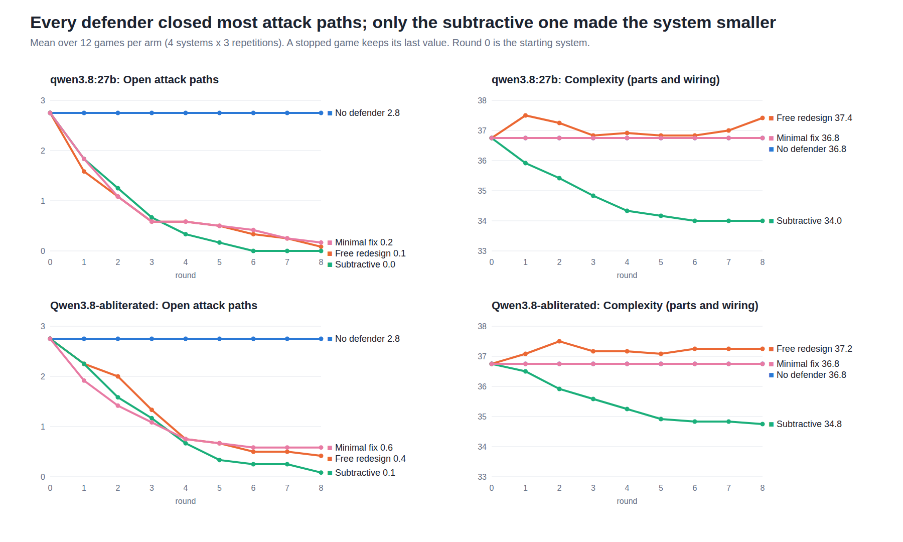

# Attack my architecture: do patches make it safer, or just bigger? Report (experiment AMA)

**Short answer.** On four small, generated systems, letting a defender patch the live architecture after each verified
attack did close the attack paths (2.75 open paths at the start, 0.1 to 0.4 after 8 rounds for the free and the
subtractive defender), and it did not bloat the system: the free defender ended 0.5 to 0.7 parts bigger (not
measurably different from zero), and the subtractive one ended 2 to 2.75 parts smaller. The prediction that free
patching would pile on layers and open new attack surface was not met. Two local models gave the same picture. This is
a toy model run on 12 games per arm per model, so it says little about real systems (section 7).

An AI agent (Claude) designed and ran this experiment and wrote this report; the owner, Garry Meaburn, asked for it,
chose the local models, and approved the design and the main run.

## 1. What I wanted to find out

1. When each successful attack is followed by a defender's change to the live architecture, do the working attack paths
   fall, or does the system just accumulate parts?
2. Does the kind of change the defender may make (anything, only removals and narrowing, or the minimal fix of the exact
   step used) alter that?
3. How often does a fix break something the business needs?

## 2. What I predicted

Written before the main run ([README](README.md) section 6): H1 the free defender (F) ends with fewer paths than it
started with, by less than the subtractive one (S); H2 F ends with more complexity than S and than the scripted minimal
fix (M), and than it started (predicted +3 or more components); H3 F breaks a business flow in more games than S;
H4 a patch creates a new attack path in more than a third of F games; H5 red succeeds more in later rounds against the
undefended system (N) than against F or S.

## 3. How I tested it

- **The system under attack** is a model, not running software: components (APIs, an agent, stores, a vault, a human),
  credentials, edges with scopes, and trust zones. Four generated systems (A to D), 13 to 14 components, each with 3 to 5
  planted weaknesses (an injectable agent, remote code execution on a public service, plaintext or long-lived keys, a
  flat route to data) and six business flows that must keep working.
- **A deterministic engine** (`scripts/engine.py`) decides every outcome. Red's steps succeed only if the rules allow
  them; security is the engine's exhaustive count of minimal attack paths from the internet to a crown jewel
  (2.75 on average at the start). It also replays the business flows after each patch. 40 self-test checks pass
  (`scripts/selftest.py`), including that a harmful shortcut (delete every edge into the data) removes all paths and is
  caught as breaking flows.
- **Agents.** Red and the defenders in F and S are local Ollama calls, JSON only, no tools, thinking off, temperature 0.7:
  `qwen3.8:27b` (main) and `huihui_ai/Qwen3.8-abliterated` (a second full run, a comparison). Red sees the documented
  architecture, not the weaknesses, gets up to three attempts a round, and counts as having breached if the steps that
  worked reach a crown jewel. The defender sees the verified steps and the business flows. N has no defender, M is a
  script that revokes the exact credential or edge used, S may only remove or narrow things.
- **Size.** 4 systems x 4 arms x 3 repetitions = 48 games per model, up to 8 rounds, stopping after two rounds with no
  path left (never in N). Pilot (4 N games) is separate and not pooled.
- **Statistics** as in the design: one-sided permutation within system (100,000 shuffles, seed 1), bootstrap 95%
  intervals within system, Holm correction within each hypothesis group. Unit: the game. Twelve games per arm is small.

## 4. What happened

Each cell is the mean over 12 games (counts are games out of 12). Complexity = components + edges + credentials +
mitigations (36.75 at the start). Source: `results/main*/analysis.json`, `runs.csv`.

| Model | Arm | Paths, end of game | Complexity change | Games that broke a flow | Games where a patch opened a new path | Red success in rounds 3 to 8 |
| --- | --- | --- | --- | --- | --- | --- |
| qwen3.8:27b | N (no defender) | 2.75 | 0 | 0 | 0 | 97% |
| | F (free) | 0.08 | +0.67 | 1 | 1 | 17% |
| | S (subtractive) | 0 | -2.75 | 3 | 0 | 22% |
| | M (minimal fix) | 0.17 | 0 | 0 | 0 | 13% |
| abliterated | N | 2.75 | 0 | 0 | 0 | 99% |
| | F | 0.42 | +0.50 | 1 | 0 | 26% |
| | S | 0.08 | -2.00 | 3 | 0 | 35% |
| | M | 0.58 | 0 | 0 | 0 | 13% |



Hypotheses (Holm-adjusted p within group; intervals are bootstrap 95%):

| | qwen3.8:27b | abliterated |
| --- | --- | --- |
| H1 F ends with fewer paths than it started | Supported: -2.67 paths [2.50, 2.75], p < 0.001 | Supported: -2.33 [2.00, 2.67], p < 0.001 |
| H1 S removes more paths than F | Not shown: +0.08 [0, 0.25], p 0.50 | Not shown: +0.33 [0, 0.67], p 0.14 |
| H2 F more complex than S | Supported: +3.42 [2.08, 4.92], p 0.002 | Supported: +2.50 [1.58, 3.42], p 0.005 |
| H2 F more complex than M | Not shown: +0.67 [-0.67, 2.17], p 0.50 | Not shown: +0.50 [-0.33, 1.42], p 0.50 |
| H2 F ends more complex than it started (predicted +3 or more) | Not shown: +0.67 [-0.58, 2.17], p 0.50 | Not shown: +0.50 [-0.33, 1.33], p 0.50 |
| H3 F breaks a flow in more games than S | Not supported, opposite direction: 1 vs 3 of 12 (p 0.98) | Same: 1 vs 3 of 12 (p 0.95) |
| H4 a patch opens a new path in over a third of F games | Not met: 1 of 12 | Not met: 0 of 12 |
| H5 red succeeds more in later rounds vs N than vs F, S | Supported: +0.81 and +0.75, p < 0.001 | Supported: +0.72 and +0.64, p < 0.001 |

The H2 comparison with S is mostly S getting smaller, not F getting bigger. Every business flow that was ever broken
was the same one, "agent reads the ticket", broken by cutting the edge that carries the ticket to the agent (S 3 games
and F 1 game, in each model).

What the defenders did (all F and S patches, counts of operations): qwen3.8:27b 56 remove-edge, 33 change-credential,
14 add-mitigation, 10 add-edge, 8 change-edge-scope, 4 add-component, 4 add-credential, 1 remove-credential;
abliterated 41, 44, 13, 8, 25, 1, 2, 1. Added parts were a minority. One of 62 defended rounds (27b) and 6 of 79
(abliterated) had a proposal the engine rejected as invalid after the allowed retry; those rounds changed nothing.

## 5. What surprised me

- **The free defender mostly took the subtractive route.** I expected added gateways, vaults and filters. Cutting an
  edge or tightening a credential was usually available, and it took it.
- **The only flow lost was the one a cut edge carried.** Removal is cheap on complexity and costs a business flow now and
  then, so the cost showed up as availability, not as size.
- **With no defender, red kept breaching** (97 to 99% success in later rounds), and in only 6 of 12 (27b) and 5 of 12
  (abliterated) games did it use the identical attack every round. Arm N is a saturation baseline: it shows red
  is capable here, and the defenders' arms are the ones that changed.
- **Scripted minimal fixes left paths open** (0.17 and 0.58 by the end) because red often found a different route to the
  same jewel; the model defenders closed more, so the exact one-step fix looks too narrow when several routes exist (an observation, not a pre-registered test).

## 6. What this might mean in practice

Within this toy, an attack-driven loop with a defender allowed to redesign converged, did not accumulate parts, and
rarely made things worse. If that carried over, the thing to watch would be what the loop removes (here, an edge a
business flow needed), not how large the design gets. It would carry over only where there is a cheap removal that the
business can survive, which real systems often lack.

## 7. What the experiment does not prove

- **A model of a system.** Weaknesses are planted from a short menu and the defender can fix each with one edit; real
  weaknesses are harder to fix and to find. The result may depend on how easy the toy makes removal.
- **Small numbers.** Four systems, 12 games per arm per model, so intervals are wide and "not shown" does not mean
  "the same". The planted weaknesses, not the games, are shared across repetitions.
- **Model difference is exploratory.** The abliterated model left more paths open (F 0.42 against 0.08, M 0.58 against
  0.17) and had more invalid proposals, but I did not test it and the cause (abliteration, a different base, or
  chance) is not separable here. Two local 27B-class models, one quantisation each, thinking off.
- **Complexity is a count** of parts and wiring, not a measure of how hard the system is to operate or reason about.
- **Red is one prompt and three attempts.** A stronger or more persistent attacker might reopen paths the defender
  closed; no human red team was involved.
- **The defender only sees paths red found**, and red stopped finding paths after a few rounds, so "converged" means
  "red ran out of ideas against this model" as much as "the system is secure".

## 8. What I'd test next

Held-out systems with weaknesses that cannot be fixed by one edge; a complexity budget on the defender; a stronger red
model, a hosted model as a check on the local ones; real software (a small compose stack) in place of the model; and
independent seeds so a confirmatory test has proper power.

## 9. How to reproduce the results

```sh
cd 2026-11-attack-architecture
python3 -I scripts/selftest.py                 # 40 free checks, no model
bash scripts/pilot.sh                          # 4 pilot games (PILOT-ONLY)
bash scripts/main.sh                           # qwen3.8:27b, 48 games into results/main/
bash scripts/main-huihui.sh                    # abliterated model, results/main-huihui/
python3 -I scripts/analyse.py results/main && python3 -I scripts/analyse.py results/main-huihui
python3 -I scripts/diagrams.py                 # chart source and the replay viewers in diagrams/
```

Needs Ollama 0.40.14 with `qwen3.8:27b` (digest aaee06c39dcf) and
`huihui_ai/Qwen3.8-abliterated:latest` (bdc5e13cd164). Replay any recorded game in `diagrams/observer-main.html` or
`diagrams/observer-main-huihui.html` (pick a system and an arm, press play). The model runs used 666 and 730 calls
(about 1.0M and 1.1M prompt tokens, 74k and 82k output tokens; 1.2 and 1.5 hours of local time); provider cost $0.

## 10. What changed from the design

- Hosted Luna was replaced by local Ollama models at the owner's request before any pilot; cost is $0 and there was no
  Codex sandbox (each turn is one JSON-only call with no tools).
- A breach now counts if the steps that worked reach a crown jewel (the first rule scored a real breach as a failure
  when a side step failed); found in a 2-round smoke test before the pilot.
- Games stop after two rounds with no engine path (never in N), and red gets up to three attempts a round.
- The abliterated run was added after the design and is exploratory in its comparison with the main model.
- A queued second-run launcher started a duplicate of the first abliterated game; I stopped the duplicate and cleared the
  shared temporary file before it was written, and the 48 finished abliterated games each have a single record.
- The scripted demo (`results/demo/`, `diagrams/observer-demo.html`) is not data.
