# Does a design factory give a better design than an agent that just builds? Report

12 November 2026. Design: [README.md](README.md), pushed before any measured run (1b80cc25). One amendment (12 November,
exploratory, after the main run) is described in section 11; it changes no pre-registered hypothesis, measure or number.
Full numbers: [results/main/analysis.md](results/main/analysis.md), [analysis-crop.md](results/main/analysis-crop.md)
(cropped re-score), [analysis-reasons.md](results/main/analysis-reasons.md) (why the judges chose) and
[skill-use.md](results/main/skill-use.md) (were the skills used). Diagrams: [diagrams/](diagrams/) (made by
`scripts/diagrams.py`). Sample screens: [report/samples/](report/samples/).

## 1. What I wanted to find out

A design and front-end team could give an AI agent a **design factory**: a folder of design, accessibility, UK legal and
banking knowledge in an **OKF (Open Knowledge Format)** bundle (short markdown files behind an index), plus written
**skills** (procedures) for research, storyboarding, visual direction, building and critique, with an `AGENTS.md` that
points the agent to the index. The user's question was: **if we give the agent design knowledge, will it do better?**
The comparison is with the same agent given nothing but the task.

- Does the finished storyboard look and read better to a blind reviewer?
- Is it more complete (the states and information a real journey needs)?
- Is it more accessible, measured by a program?
- Does it cost more, and by how much?
- Does the agent actually use the factory, and does its research shape the design?

## 2. Why I thought it was worth testing

Teams are starting to write this kind of bundle for agents (OKF, skills, rules files) and the effort is real: the factory
here is about 35,000 words, about half of it Impeccable's design guidance. Whether it pays off is rarely measured. The
user also said the point is "design looking vs just build", so the main measure here is how the result looks to a
reviewer, not how many process documents were written. Both arms can search the web, so any gain is over an agent that
can look up trends and rules for itself, not over a blind one.

## 3. What I predicted

The user's prediction, given before the pilot: **"Little difference"**.

I wrote six hypotheses before the main run (H1 to H6, section 4). My own expectation, which I did not pre-register as a
number, was that the factory would win on completeness and accessibility, and that looks were uncertain. The pilot (two
pairs, not part of the results) had already shown the plain agent ahead on looks.

## 4. How I tested it

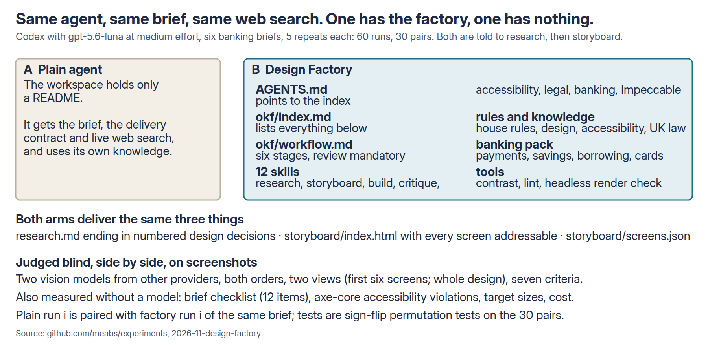

**Agent.** Codex CLI 0.167.1 with hosted `gpt-5.6-luna` at medium effort, inside the sandbox used in earlier
experiments, with live web search in both arms. The prompt is identical in both arms: one sentence of context, a short
ticket, and the task: research current trends and styles in mobile banking app design, write them up with sources in
`research.md` (ending in numbered design decisions), then develop a storyboard of the scenario as
`storyboard/index.html` (each frame a 390 px phone screen, each addressable as `#frame-id`) and `storyboard/screens.json`.
Nobody answers questions.

**Arms.** A, plain: a README saying this is Brindle Bank's design workspace, nothing else. B, Design Factory: the same
plus `AGENTS.md`, `CLAUDE.md`, `okf/` (index, a six-stage workflow, three rules files, design, accessibility, legal and
banking knowledge), 12 skills including Impeccable's design guidance, and three small tools (contrast, lint, a headless
render check). The workflow makes the review stage mandatory: an Impeccable design review, an accessibility review, a
legal review, a banking checklist and a research trace.

**Briefs.** Six for Brindle Bank, a fictional UK bank: D1 pay someone new, D2 open a savings account, D3 an arranged
overdraft, D4 my card is missing, D5 where did my money go this month, D6 account home. **5 runs per brief per arm: 60
runs, 30 pairs** (plain run *i* paired with factory run *i* of the same brief).

**Main measure: blind side-by-side preference.** Each frame is opened by address, photographed, and tiled three to a page
with no names. Two vision models from other providers (`google/gemini-4-argon`, `anthropic/claude-sonnet-5.5`) see the
brief and two designs labelled "Design 1" and "Design 2", in both orders, and say which is better on seven criteria
(hierarchy, polish, identity, content, trust, journey, overall). Two views: the whole design, and the first six screens
only ("looks"). **Pair score** = share of the four votes for the factory (a tie counts half): above 0.5 the factory
wins the pair, below 0.5 the plain agent does.

**Secondary measures.** A 12-item checklist per brief, written before any output was read (states and information a
complete design has; a model reads the screen text and must quote it; I checked every quote and a random fifth by
hand). axe-core 4.10.3 violations of WCAG 2.x A and AA rules per screen, control sizes, sideways scroll at 320 px.
A blind model's judgement of how many of the agent's own research decisions are visibly applied (H6). Tokens, time
and cost at list price. A check of whether the factory was used, from the agent's session logs.

**Hypotheses and tests.** H1 whole design preferred; H2 looks preferred; H3 checklist; H4 axe violations; H5 cost;
H6 research decisions applied. Two-sided sign-flip permutation tests on the 30 pairs, bootstrap 95% intervals, Holm
adjustment across H1 to H4 and H6. "No difference shown" is how I report a non-significant result; it is not "the
same". With 30 pairs the test can only detect a fairly large preference.

## 5. What happened

All 60 runs delivered a storyboard that met the contract (research, screens, every screen opens). No run failed. The
main run took about two hours (21:03 to 23:08).

### Headline

- **Whole design: no preference shown** (0.53, 95% interval 0.39 to 0.66, p 0.80). This is the pre-registered result and
  it matches the user's prediction. Section 5.4 explains why I now doubt it.
- **Looks: the plain agent is preferred** (0.32, 0.19 to 0.45, Holm p 0.031). The plain agent won 21 of 30 pairs, the
  factory 6. Cropping the screens to remove presentation (section 5.4) left this unchanged (0.32).
- **Completeness: the factory is far ahead** (85% of the checklist against 59%). This is circular by construction
  (section 8) but the gap is large.
- **Accessibility, measured by program: the factory is far ahead** (0.06 axe violations per screen against 1.00).
  This measure is independent of the factory's own content.
- **Cost: about 3 times per run** ($0.065 against $0.020; 7 times the input tokens, 2.3 times the time).
- **The factory was used**, in every run (section 5.6).

"Little difference" was half right. There was no clear preference for the whole design, but there were large, measured
differences in completeness, accessibility, cost, and, against the factory, in looks.

### What the screens look like

These are the first screens of rep 1 of each brief (chosen before looking at results), cropped to the phone screen.
Plain on the left in each pair, factory below it.

**D2, open a savings account.** The plain agent leads with an accounts home and a coloured prompt; the factory starts
at the product page with the summary-box questions.

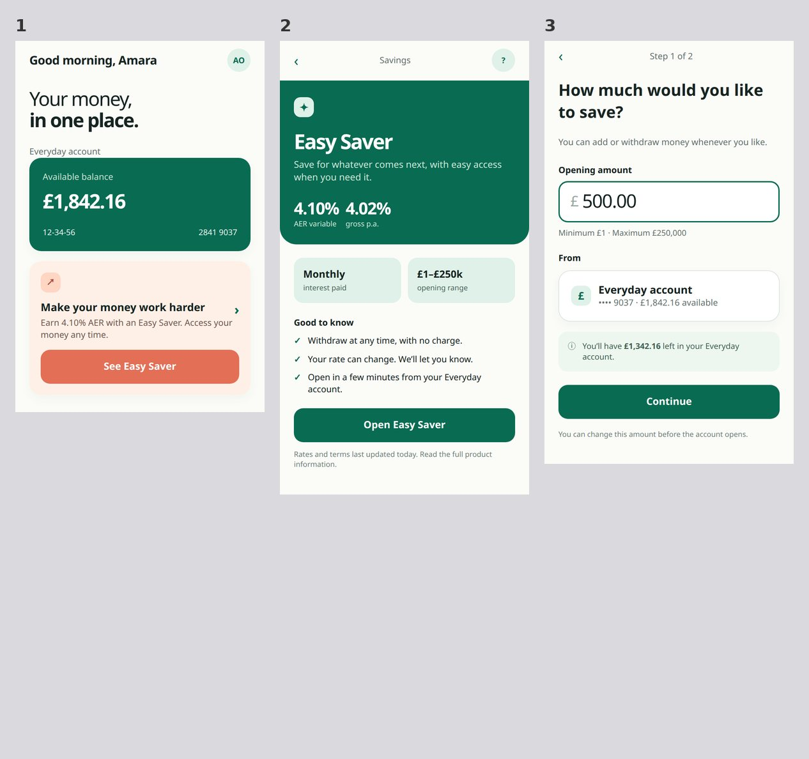
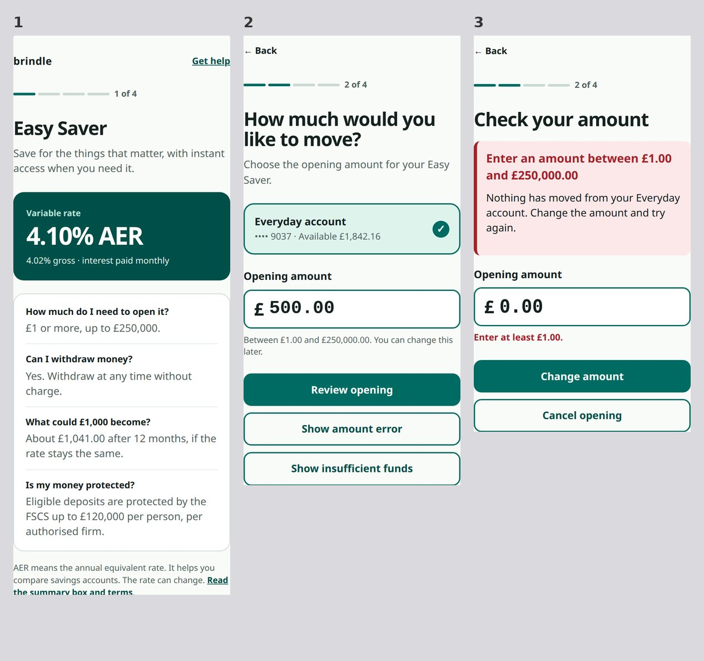

**D6, account home.** The plain agent's frames are a presentation (device frame, dark balance card, tinted accents);
the factory's are flat screens with a loading state and an error state.

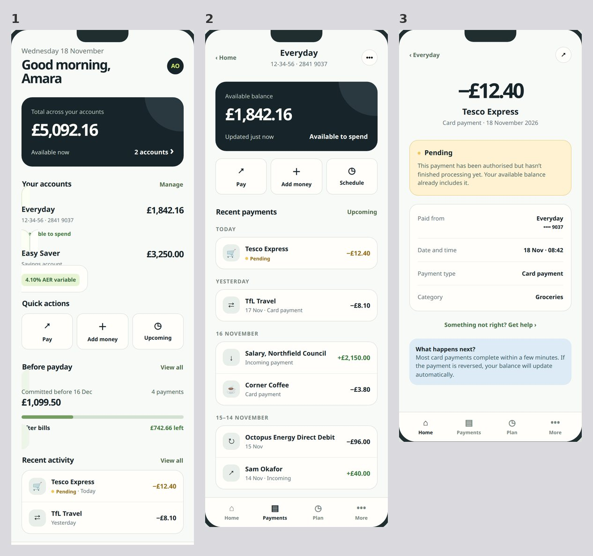
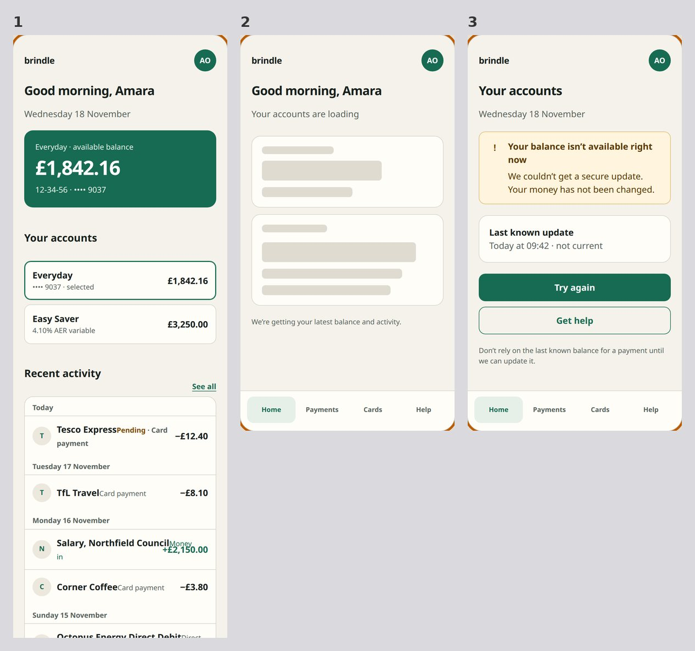

**D3, arranged overdraft, middle of the journey.** Plain (first image) ends its form with one confirm box, shown ticked,
that covers the details and a soft credit check, and goes straight to submit. The factory (second) keeps demo controls on
its decision screen ("Show the offer", "Show declined result") so a reviewer can reach every outcome.

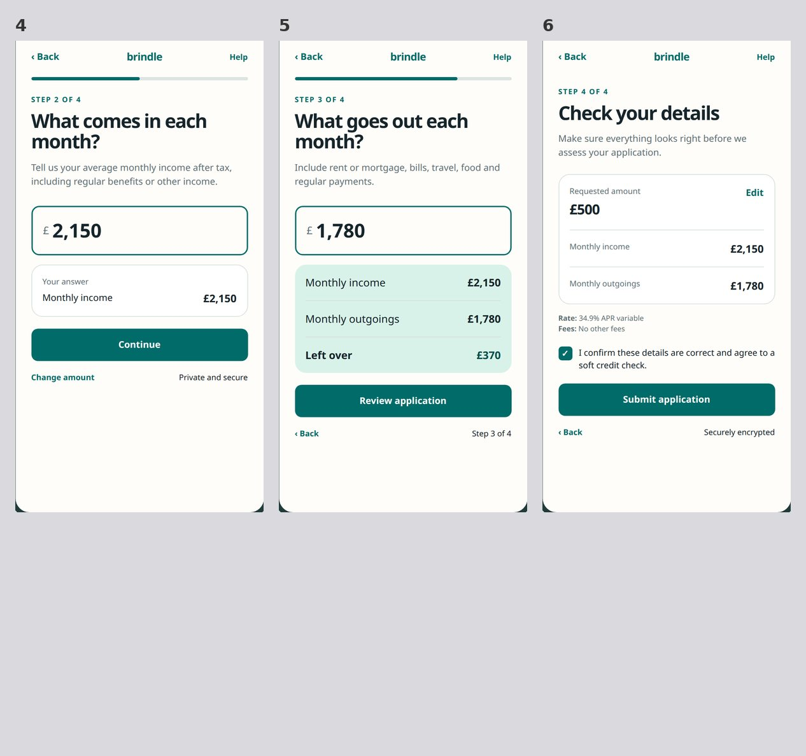
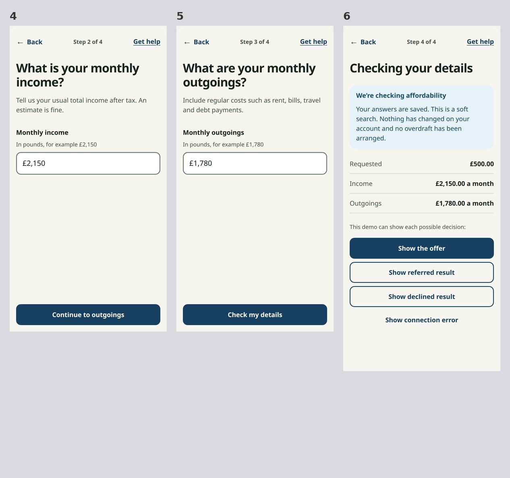

The other briefs are in [report/samples/](report/samples/) (D1, D4, D5, each plain and factory). The sheets the judges
saw were the original captures, which looked different for the plain agent (section 5.4):

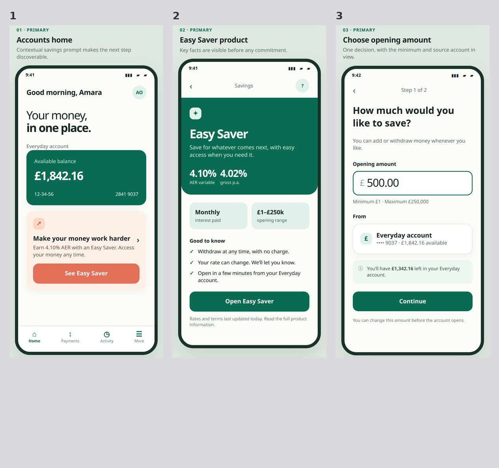

### Which design the judges preferred

Pair score: the share of judge votes for the factory's design, averaged over 30 pairs. 0.5 means no preference; higher
favours the factory, lower favours the plain agent. W-L-S is factory wins, plain wins, split pairs.

| Question | Factory wins | Plain wins | Split | Mean score (95% CI) | p | Holm p |
| --- | --- | --- | --- | --- | --- | --- |
| H1 whole design | 14 | 11 | 5 | 0.53 (0.39 to 0.66) | 0.80 | 0.80 |
| H2 looks only (first six screens) | 6 | 21 | 3 | 0.32 (0.19 to 0.45) | 0.015 | 0.031 |

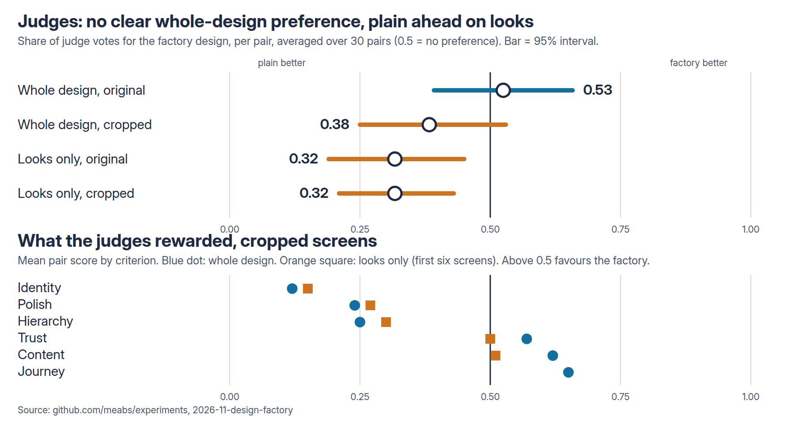

By criterion (descriptive, mean pair score, original captures; above 0.5 favours the factory):

| Criterion | Whole design | Looks only |
| --- | --- | --- |
| overall | 0.53 | 0.32 |
| hierarchy | 0.40 | 0.32 |
| polish | 0.44 | 0.37 |
| identity | 0.13 | 0.14 |
| content | 0.66 | 0.50 |
| trust | 0.72 | 0.51 |
| journey | 0.72 | - |

By brief (whole design and looks score, W-L-S in brackets): D1 0.70 (3-0-2) and 0.15 (0-4-1); D2 0.45 (2-2-1) and 0.25
(1-4-0); D3 0.90 (5-0-0) and 0.55 (2-2-1); D4 0.45 (2-3-0) and 0.25 (1-4-0); D5 0.35 (1-3-1) and 0.40 (1-3-1); D6 0.30
(1-3-1) and 0.30 (1-4-0). The factory did best on the payment and overdraft journeys (D1, D3); the plain agent
did best on the visual briefs (D5, D6), which is what a design lead would expect.

### Why the judges preferred what they preferred

Each judge wrote one sentence explaining its overall choice. I coded all 480 sentences (both judges, both orders,
original and cropped screens, both views) into ten themes with a model that saw only the sentence and which design won,
not the arm. Counts are approximate. The plain agent won 295 of the votes and the factory 185.

| Theme | Decided the vote when plain won | Decided the vote when factory won | Fault found in the factory's design (plain won) | Fault found in the plain design (factory won) |
| --- | --- | --- | --- | --- |
| Looks polished, finished, like a real bank app | 42% | 1% | 16% | 4% |
| Distinctive, deliberate look | 11% | 1% | 29% | 3% |
| Complete journey, states, branches | 32% | 64% | 48% | 61% |
| Trust, honesty, protective information | 1% | 9% | 9% | 19% |
| Layout defects (cropped, overlapping) | 7% | 22% | 48% | 64% |
| Prototype scaffolding (demo buttons, draft text, "web form" feel) | 3% | 0% | 50% | 18% |
| Numbers wrong or rounded | 3% | 1% | 14% | 18% |

(The other three themes, hierarchy, wording and clutter, rarely decided a vote.)

Read this as two different kinds of win.

- **When the plain agent won, it was mostly about how it looked:** "polished, finished, like a real banking app" decided
  42% of its wins, and a distinctive identity was praised in 40% of them. Half of its wins faulted the factory's
  prototype scaffolding: demo buttons such as "Show amount error", draft legal wording left on screen, a "web form" feel.
- **When the factory won, it was about the journey:** a more complete journey decided 64% of its wins, and trust and
  protective information (FSCS cover, scam warnings, what happens to the money) were praised in 71% of them. Looks
  almost never decided a factory win (1%).
- **Both lost on layout defects**, about half the time in both directions, which is why this theme does not separate them.
  Section 5.4 shows this is partly an artefact of how I captured the screens.
- **Accuracy mattered occasionally and cut both ways.** One factory D5 storyboard rounded the October gap to £96.00 where
  the data said £95.70, and two judges named it.

Examples of the judges' own words (quoted from the sentences, shortened): "a more distinctive, finished banking look and
a clear name-mismatch screen" (plain won, D1); "feels like a web wireframe" and "prototype debug buttons and unfinished
placeholder legal text" (plain won, D2); "delivers the whole journey in six screens ... using exact, honest copy" (factory
won, D2); "its product page answers real questions (what £1,000 becomes, FSCS), so it is more trustworthy with money"
(factory won, D2).

### The cropped re-score, and what it changed

After the main analysis I suspected the plain agent's lead on looks came from presentation (device frames, captions,
research tags, a coloured page background) that belongs to the storyboard page, not to the screen. So I recaptured every
screen at desktop width, cropped it to the phone screen interior (503 of 509 screens; 6 factory screens fell back to the
original capture) and re-judged the same pairs with the same judges and prompt. This is exploratory (section 11).

| View | Images | Factory wins | Plain wins | Split | Mean score (95% CI) | p |
| --- | --- | --- | --- | --- | --- | --- |
| Whole design | original | 14 | 11 | 5 | 0.53 (0.39 to 0.66) | 0.80 |
| Whole design | cropped | 11 | 17 | 2 | 0.38 (0.25 to 0.53) | 0.15 |
| Looks only | original | 6 | 21 | 3 | 0.32 (0.19 to 0.45) | 0.015 |
| Looks only | cropped | 6 | 19 | 5 | 0.32 (0.21 to 0.43) | 0.009 |

- **The looks result did not move.** Presentation does not explain the plain agent's lead; the screens themselves look
  more distinctive to the judges. Identity stays at 0.12 to 0.15 whichever images are used.
- **The whole-design tie leaned towards plain** (0.53 to 0.38, not significant). Why: in the original captures, 83% of
  the votes the factory won faulted the plain design for cropped or overlapping layouts, against 40% after cropping.
  The original capture rendered the plain agent's phone frames squeezed into a 390 px browser (about 255 px wide, text
  overlapping) and cut each tile at 1,100 px. That is a capture artefact that hurt the plain agent. So **the
  pre-registered H1 tie is probably flattered by the capture method**, and the fairer reading is "no clear preference,
  with a lean to plain". I report the pre-registered number as the result and this as the caveat.
- The two changes (crop and wider viewport) were made together, so I cannot say how much each did.

### Why the factory's storyboards look the way they do

Measured on all 60 HTML files (details in [report/notes-why-plainer.md](report/notes-why-plainer.md)):

| Measure | Plain | Factory |
| --- | --- | --- |
| Phone status-bar clock (9:41) in the page | 77% of runs | 17% |
| Distinct colours in the file | 31 | 17 |
| Design tokens (CSS custom properties) | 11 | 21 |
| Research tags (R1, R2...) visible on frames, per run | 6.0 | 1.5 |
| Demo buttons such as "Show amount error", per run | 0.0 | 0.5 |
| "Draft", "placeholder", "for review" wording, per run | 2.4 | 4.4 |
| Screens delivered | 7.3 | 9.7 |

The two arms built different things from the word "storyboard". The plain agent built an illustrated presentation:
numbered steps, narrative captions, device mockups, research tags on each frame, a bolder palette. The factory's
`journey-storyboard` and `prototype-build` skills define the storyboard as a working prototype of every screen and state:
one screen at a time, tokens only, demo controls to reach error states, draft legal wording marked as draft. That gives
more coverage and fewer accessibility faults, but reads as a product under test. I did not run an ablation, so I
cannot say which skill causes the look.

### Completeness (the checklist)

Share of the brief's 12 checklist items present in the storyboard's visible text (higher is better). Difference is
factory minus plain, per pair.

| Measure | Plain | Factory | Difference (95% CI) | Holm p |
| --- | --- | --- | --- | --- |
| H3 checklist items present (share of 12) | 0.59 | 0.85 | +0.26 (+0.19 to +0.32) | 0.0004 |

By brief (items out of 12, plain / factory): D1 8.0 / 11.4; D2 4.6 / 10.0; D3 6.8 / 11.0; D4 7.4 / 9.4; D5 7.8 / 8.8;
D6 8.2 / 10.6.

Where the gap is widest: D2's regulatory content. The plain agent's savings storyboards had no summary box (0 of 5), no
AER explanation (0 of 5), no FSCS mention (0 of 5) and no 14-day cancellation right (0 of 5); the factory had a summary
box in 5 of 5, FSCS in 5 of 5 (every one with the correct £120,000, in force since 1 December 2025) and the 14-day right
in 3 of 5. In D3 only the factory told a declined customer that a credit reference agency was used (5 of 5 against 0 of
5) and only the factory had a step where the customer explicitly agrees to terms they can read (5 of 5 against 0 of 5; the plain
run shown above has one ticked confirm box and no agreement to read).
In D4 the factory included security reassurance (5 of 5 against 0) and a failure state (4 of 5 against 0).

Where the factory did worse: D5's budget screens (a way to set a budget, 2 of 5 against 4 of 5; a way to change or
remove one, 0 of 5 against 3 of 5) and D4's "lost or stolen" question (2 of 5 against 3 of 5). Neither arm showed an
over-budget state (D5) or the word "representative" next to an APR (D3). The checklist was written with the factory's
knowledge files in mind, so a high score shows the factory gets its own knowledge into the design, not that the
knowledge is complete.

### Accessibility, measured by program

axe-core violations of WCAG 2.x A and AA rules, per screen (lower is better). No claim of conformance is made for
either arm; a program finds only a part of the failures.

| Measure | Plain | Factory | Difference (95% CI) | Holm p |
| --- | --- | --- | --- | --- |
| H4 axe violations per screen | 1.00 | 0.06 | -0.94 (-1.11 to -0.77) | 0.0004 |

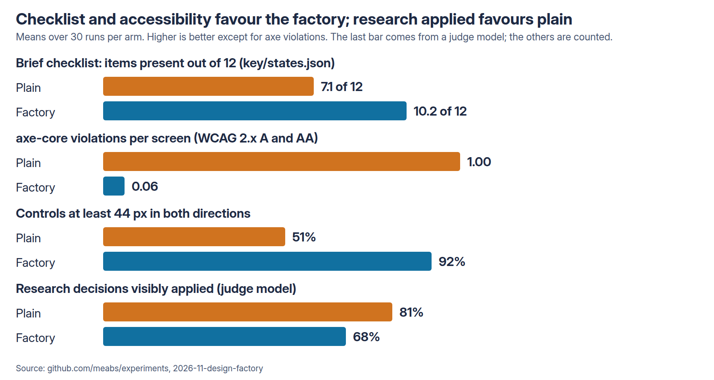

- Screens with no axe violation: 10% (plain) and 94% (factory).
- **Colour contrast is the plain agent's problem:** 27 of its 30 runs had a contrast violation, against 1 of 30 for the
  factory. The factory's skills include a contrast tool, which 29 of its 30 runs ran.
- Controls at least 44 px in both directions: 51% and 92%. Screens that scroll sideways at 320 px: 50% and 7%.
- The factory's own faults: 4 runs misused definition lists (`dlitem`) and 4 used a prohibited ARIA attribute (plain: 2).
- The agents' final messages claimed accessibility or compliance in 4 of 30 plain runs and 3 of 30 factory runs.

### Does the design apply the research?

A vision model blind to the arm read each run's `research.md` and looked at its frames.

| Arm | Decisions listed per run | Share applied | Research cites specific trends and sources |
| --- | --- | --- | --- |
| Plain | 7.9 | 81% | 100% |
| Factory | 4.5 | 68% | 73% |

H6, difference in share applied (factory minus plain): -0.13 (-0.29 to +0.03), Holm p 0.28. **No difference shown.**
The plain agent wrote more research (830 words and 7.5 distinct web addresses against 521 words and 4.4) and
tagged its frames with the decision numbers (6.0 tags a run against 1.5), which makes application easy to see. The
factory keeps its research trace in its review file, which the research judge does not read. So the factory's research
is not visibly better used, and it is thinner.

### Was the factory actually used?

From each run's Codex session log ([skill-use.md](results/main/skill-use.md)). The factory instructions say to read the
index and the workflow, then each stage's skill.

| What | Plain | Factory |
| --- | --- | --- |
| Opened `okf/index.md` and `okf/workflow.md` | 0 of 30 | 30 of 30 |
| Opened the 11 stage and specialist skills (brief, research, storyboard, visual direction, build, critique, content, accessibility, legal, banking, Impeccable) | 0 of 30 | 30 of 30 each |
| Opened `frontend-handoff` | 0 of 30 | 27 of 30 |
| Opened Impeccable reference files | 0 of 30 | 28 of 30 |
| Opened the banking industry pack | 0 of 30 | 30 of 30 |
| Ran `lint_prototype.py` / `render_check.py` | 0 / 0 | 30 / 30 |
| Ran `contrast.py` | 0 | 29 |
| Wrote `design/01-brief.md`, `04-direction.md`, `05-review.md` | 0 | 30 each |
| Wrote `design/03-storyboard.md` / `06-handoff.md` | 0 | 29 each |
| Used web search | 30 | 30 |

The mandatory review was done: all 30 `05-review.md` files contain the Impeccable review, the heuristics, the
cognitive-load checklist, personas, the accessibility table, the legal register, the banking checklist and the research
trace (28 of 30 also have a fixes section). All 30 list at least one check as "not run", as the rules require for checks
that could not be run. These are keyword checks on the section headings, not a check of their quality. The plain
arm touched no factory file, as expected (the files were not there).

### Tokens, time and cost

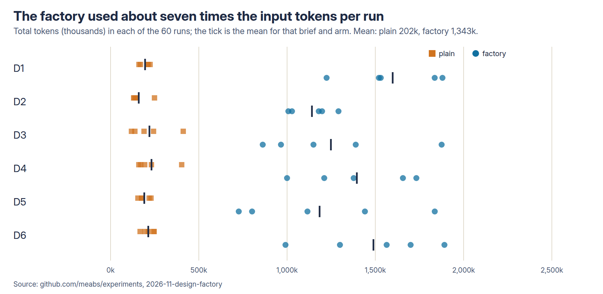

Means per run, at `gpt-5.6-luna` list prices ($0.20 per million input tokens, $0.02 cached, $1.20 output).

| Arm | Input tokens | Output tokens | Seconds | Cost per run | Design files written |
| --- | --- | --- | --- | --- | --- |
| Plain | 192k | 9.7k | 192 | $0.020 | 0.0 |
| Factory | 1,321k | 22.0k | 435 | $0.065 | 5.5 |

H5: the factory used 6.9 times the input tokens, 2.3 times the output, 2.3 times the time and 3.2 times the cost. The 60
runs cost about $2.55 and the judging about $11 (including the cropped re-score). The agent's cost is not the cost
that matters to a team: a person who reviews the factory's output has five more design files to read per run. I did
not measure people's time.

### Judges

| Judge | Calls | Chose the design shown first | Same choice in both orders |
| --- | --- | --- | --- |
| google/gemini-4-argon | 120 | 68% | 63% |
| anthropic/claude-sonnet-5.5 | 120 | 51% | 82% |

Gemini leans heavily towards whichever design is shown first; Sonnet barely does. That is why every pair was judged in
both orders. The two judges reached the same pair result (factory, plain or split) in 62% of 60 pair-views: they
agree more often than not, but not reliably.

### Robustness

- The checklist hand-check found no rejected quotes among 520 "present" calls and corrected 1 of the 104 I read (a note
  about "Other CoP outcomes" was counted as a no-match screen); `states-overrides.json`, no change to the result.
- On looks, each judge alone favours the plain agent in both the original and the cropped screens (0.28 to 0.35). On the whole
  design the judges split: original Gemini 0.48 and Sonnet 0.57; cropped Gemini 0.30 and Sonnet 0.47.
- No arm hit a ceiling: the plain agent scored 59% of the checklist and had axe findings in nearly every screen.

## 6. What surprised me

- **The plain agent was a better presenter.** Without instructions it made a presentation-style storyboard with
  device frames, captions and research tags. The factory told it to build a working prototype, and the judges, looking at
  stills, preferred the presentation.
- **The factory's research was thinner and less visible**, even though its skills spend a whole stage on research.
- **The capture method nearly produced a false tie.** The pre-registered whole-design result looked like the user's
  "little difference", and a large part of that was the plain agent being penalised for squeezed layouts.
- **Contrast.** The biggest single accessibility gap was one rule, colour contrast, which the factory's contrast tool checks.

## 7. What this might mean in practice

### Impact

For this agent, these briefs and this factory:

- **If the team needs complete, accessible, regulated journeys** (savings summary boxes, decline reasons, error states,
  contrast, target sizes), the factory made a large, measured difference: 85% against 59% of the checklist, and almost
  no axe violations against one per screen. The accessibility result does not depend on the factory's own content.
- **If the team needs a better-looking design**, this factory did not deliver it. The judges preferred the plain agent's
  look in 19 to 21 of 30 pairs.
- **If cost matters**, the factory is about three times the agent cost per run ($0.065 against $0.020), which is small
  against a designer's time but not zero at scale, and its output needs reading.
- So the factory as built is a completeness and accessibility tool. It is not yet a design-quality tool.

### Configuration recommendations

Limited to what was tested (this agent, medium effort, search on, six banking briefs, unattended):

1. **Keep the factory's accessibility and regulated-content parts for banking work.** The tested configuration cut axe
   violations from 1.00 to 0.06 a screen and put the FSCS limit, the summary box and decline reasons into the designs.
   Whether a smaller version (just the contrast tool and the banking pack) would do as well was not tested.
2. **Do not expect it to improve visual identity.** I would add a stage or a skill about presentation and brand direction
   and test it; that change is untested here.
3. **Keep the research trace visible on the frames**, as the plain agent did (frame tags such as R1, R2). The factory
   keeps it in the review file.
4. **Keep demo controls and draft text out of the frames a reviewer sees first**, or set them apart. Half the plain
   agent's wins faulted them. Whether that fix would change the preference was not tested.
5. **Show the judges, or the team, the frames cropped to the screen at natural width.** The capture method changed the
   whole-design result. Show people the same, and show them pairs blind.

### Risks this exposes

- **A model judge is not a designer.** The judges were vision models. They disagreed in 38% of pair-views and one is
  heavily order-sensitive. A team should vote on pairs blind before acting (the gallery page is not built yet).
- **The checklist is circular.** The factory scores well on a list I wrote from its own knowledge. The accessibility and
  preference measures are not circular; the checklist is.
- **The regulatory content is draft.** It was checked by search for a few points only and marked "check current rule".
  The factory put "draft" wording into the screens. Neither arm's output should be treated as compliant.
- **Missing protection in the plain output.** In D2 the plain agent never mentioned FSCS (5 of 5 runs) and in D3 it never showed an
  agreement the customer could read (5 of 5). An unattended agent will ship what it does not know to include.
- **The factory can look finished while being thin on research.** Its research was shorter and less visibly applied.
- **No people were in the loop.** The factory is run unattended, which is not how a team would mostly use it.

## 8. What the experiment does not prove

- **That knowledge alone helps.** The factory bundles knowledge, a workflow, skills and tools. A difference means "this
  whole factory against nothing". There is no arm with the knowledge as a single file, or with a one-line instruction.
- **That any single skill caused any effect.** No ablation was run.
- **That a person would prefer the plain storyboards.** The judges were models.
- **That the whole-design result is a tie or a plain lead.** The pre-registered result is no difference shown; the
  cropped re-score leans to plain; neither is significant. With 30 pairs the test could miss a moderate preference.
- **That the designs are legally compliant or accessible.** axe finds only some failures; the legal content is draft.
- **Anything about other models, other industries, longer briefs or an attended workflow.** One agent, one bank, six
  short briefs.
- **That the factory is fairly tuned.** One author (an AI agent) wrote the factory, the briefs, the checklist and the
  graders; the factory had a "trends and styles" research step added after the task changed. I did not tune it to the
  judges.

## 9. What I'd test next

1. **Blind votes from the design team** on the 30 pairs (cropped screens), next to the models' votes.
2. **A visual-direction fix:** add presentation and brand guidance to the factory and re-run the visual briefs. The
   question: does the looks gap close without losing the completeness gap?
3. **Ablations:** knowledge without workflow, the accessibility tools alone, Impeccable alone, to see which part buys
   the accessibility and completeness gains.
4. **An attended run:** a designer answers the agent's questions and reviews its output.
5. **Another industry and a stronger model**, to see whether the factory's value shrinks as the agent gets better.

## 10. How to reproduce the results

From `2026-11-design-factory/`:

```bash
python3 -I scripts/make_trial.py
bash scripts/run_all.sh                                # 60 runs -> results/main
~/code/benchmark/webmcp-exp/env-plain/bin/python scripts/shoot.py results/main
python3 scripts/sheet.py results/main
uv run --with requests --with pillow python scripts/judge_pairs.py results/main
uv run --with requests --with pillow python scripts/judge_pairs.py results/main --judge anthropic/claude-sonnet-5.5
uv run --with requests python scripts/judge_states.py results/main
uv run --with requests --with pillow python scripts/judge_research.py results/main
python3 -I scripts/analyse.py results/main
# exploratory (amendment 1) and report support
~/code/benchmark/webmcp-exp/env-plain/bin/python scripts/crop.py results/main
python3 scripts/sheet.py results/main --crop
uv run --with requests --with pillow python scripts/judge_pairs.py results/main --crop   # and --judge anthropic/claude-sonnet-5.5
python3 -I scripts/analyse_crop.py results/main
uv run --with requests python scripts/code_reasons.py results/main
python3 -I scripts/skill_use.py results/main
python3 -I scripts/diagrams.py && bash diagrams/render.sh
```

Raw agent session files and the copies of the Codex login in `agent-homes/` are not published.

## 11. What changed from the design

**Amendment 1 (12 November 2026, after the main run; exploratory).** Question: does presentation chrome in the storyboard
page explain the plain agent's lead on looks? Method and result are in section 5 ("The cropped re-score"). The
pre-registered H1 to H6 results are reported unchanged. Two further analyses were added after the main run, both
descriptive: the coding of the judges' sentences into themes, and the measurement of storyboard features on all 60 HTML
files. One hypothesis I held while analysing, that presentation chrome explained the looks gap, was tested and was not
supported.

Everything else followed the design. The blind human-vote gallery page (`scripts/gallery.py`) is described in the
README but not built yet.
