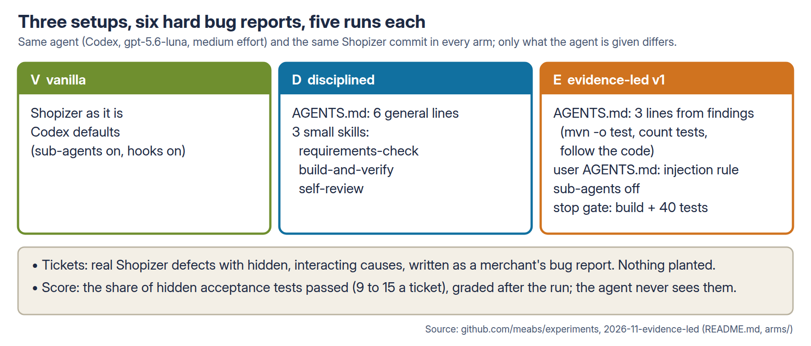
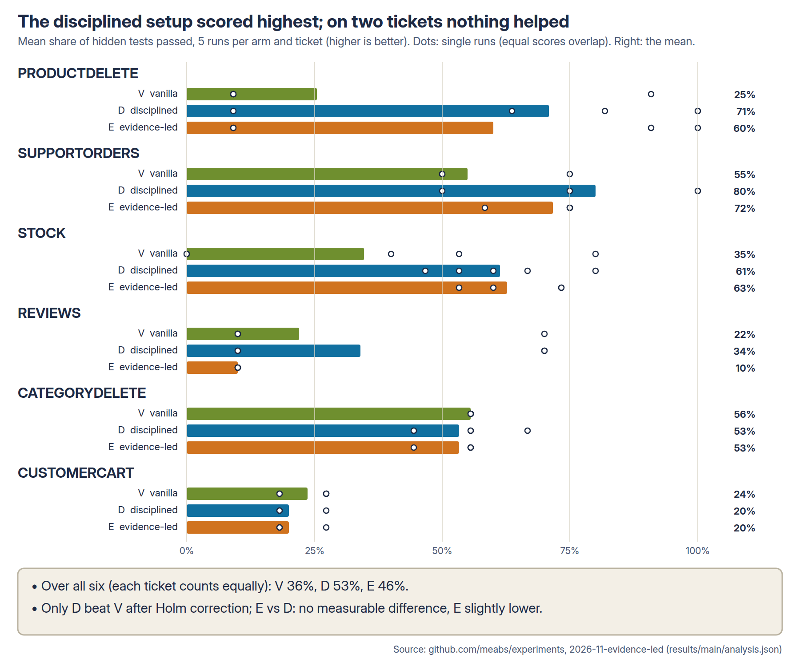
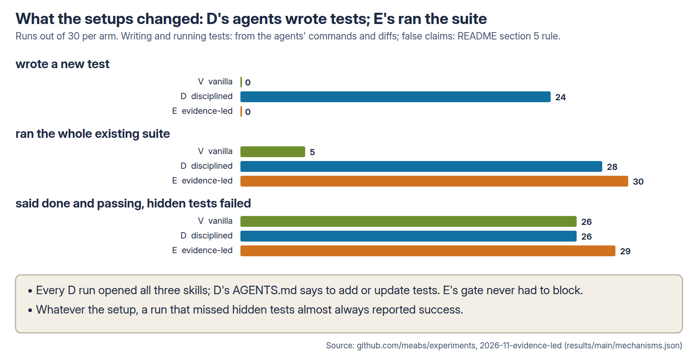
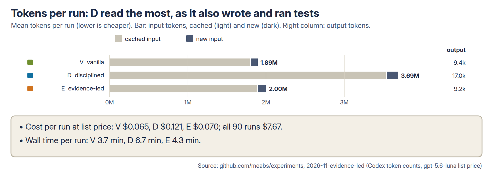

# Does an evidence-led setup beat good practice on very hard tickets? Report, round 1

*Site title: Can an AI agent turn experimental evidence into a better coding setup?*

**This experiment was written by an AI agent** (Claude Code, working for me): tickets, hidden tests, reference fixes,
D's routine and skills, and E's settings from my published findings. I chose the options and approved the design. E is
therefore the agent's interpretation of my findings. The follow-on tests how I would interpret the same findings: I
write the configuration, AGENTS.md and skills myself and run them against the agent's version.

5 November 2026. Design: [README.md](README.md), pushed before any measured run (d902d92a). The amendments made while
analysing (README section 10) don't change a hypothesis, a measure, a ticket or a test. Full numbers:
[results/main/analysis.json](results/main/analysis.json), per run [results/main/runs.csv](results/main/runs.csv),
mechanism checks [results/main/mechanisms.json](results/main/mechanisms.json). Diagrams: [diagrams/](diagrams/) (made
by `scripts/diagrams.py`).

## 1. What I wanted to find out

Each earlier experiment tested one setting on its own. This one puts together the settings my published findings
support (arm **E**, evidence-led) and compares them with what a careful team would write from common sense (arm **D**,
disciplined: six general AGENTS.md lines and three small skills) and with no setup at all (arm **V**, vanilla), on bug
reports hard enough that the agent fails often. It is a running experiment: E is rebuilt from newly published
findings, and each round adds two new held-out tickets.

## 2. Why I thought it was worth testing

Nobody runs one setting on its own, and most earlier tasks were so easy that gains were small or invisible. If the
evidence-led setup does no better than common sense on hard work, the individual findings don't add up to a better
setup, and that is worth knowing.

## 3. What I predicted

| # | Hypothesis (fixed before the runs) |
| --- | --- |
| H1 | E scores higher than D (the headline: does the evidence beat good practice?) |
| H2 | E scores higher than V |
| H3 | D scores higher than V |

## 4. How I tested it



- **Agent:** Codex 0.157 with gpt-5.6-luna at medium effort in every arm (checked in every session file: 90 of 90).
- **Repository:** Shopizer at `6a4a0a6`, a Java online shop with an admin REST API; 61 existing tests, 40 of which run.
- **Tickets:** six bug reports written the way a merchant or support team would file them. Each rests on **real**
  Shopizer defects that I found by probing the unchanged code, with hidden and interacting causes across at least
  three API areas. Nothing was planted. Each ticket's causes are in `tasks/<T>/causes.md`.
- **Pilot:** one vanilla run per candidate ticket. A ticket was kept only if V passed more than 0 and at most 60% of
  its hidden tests; three earlier candidates were too easy and were retired (README section 4).
- **Score:** the share of a ticket's hidden acceptance tests (9 to 15 a ticket) that pass after the run. The agent
  never sees them. My reference fix for every ticket passes all of them and keeps all 40 existing tests passing.
- **Runs:** 6 tickets × 3 arms × 5 runs = 90, the three arms running side by side.
- **Analysis:** arms compared on the mean over tickets of each ticket's mean score; one-sided permutation tests within
  ticket (100,000 shuffles), Holm correction over H1 to H3, bootstrap 95% intervals (10,000 resamples).

## 5. What happened

### Headline

**The disciplined setup (D) passed 53% of the hidden tests, against 36% for no setup (V): 17 points more, and the
only significant difference. The evidence-led setup (E) passed 46%: not measurably better than V after correction,
and 7 points below D (H1 not supported).**

| Arm | Hidden tests passed (mean share; higher is better) | Runs that passed every hidden test (of 30; higher is better) | Runs that broke existing tests (of 30; lower is better) |
| --- | --- | --- | --- |
| V vanilla | 36% | 0 | 2 |
| D disciplined | **53%** | 4 | 0 |
| E evidence-led | 46% | 1 | 0 |

### Hypotheses

Difference in the mean share of hidden tests passed, in percentage points (positive means the first arm is better).

| # | Comparison | Difference | 95% interval | p (one-sided) | p after Holm | Verdict |
| --- | --- | --- | --- | --- | --- | --- |
| H1 | E − D | −7.0 | −16.9 to +2.6 | 0.90 | 0.90 | Not supported: E scored lower |
| H2 | E − V | +10.2 | −0.3 to +19.8 | 0.044 | 0.089 | Not significant after correction: no measurable difference |
| H3 | D − V | +17.2 | +6.4 to +27.6 | 0.004 | 0.012 | **Supported** |

### Per ticket



Mean share of hidden tests passed, 5 runs each (higher is better).

| Ticket | Hidden tests | V | D | E | What separated the runs |
| --- | --- | --- | --- | --- | --- |
| PRODUCTDELETE | 11 | 25% | **71%** | 60% | Finding the root cause: `ProductService.getBySku` throws for a missing product. Runs passed either 1 test or 7 to 11, and every run in the upper group changed `ProductServiceImpl`. V got there in 1 run of 5, D in 4, E in 3 |
| SUPPORTORDERS | 12 | 55% | **80%** | 72% | Paging and deleted customers' orders; D reached 12 of 12 twice |
| STOCK | 15 | 35% | 61% | **63%** | Two V runs added a bean whose name clashed with an existing one, so the application failed to start: 0 hidden tests and 31 existing failures each |
| REVIEWS | 10 | 22% | **34%** | 10% | 12 of 15 runs broke review creation itself: they treated every new review as an edit of review 0 (the request's id defaults to 0), so creating any review failed with HTTP 500 or 503 and only 1 test could pass. V avoided it once and D twice (7 of 10 each); E never did |
| CATEGORYDELETE | 9 | **56%** | 53% | 53% | Nearly identical runs everywhere: no setup found the remaining causes |
| CUSTOMERCART | 11 | **24%** | 20% | 20% | Every run passed 2 or 3 of 11, whatever the setup |

On two of the six tickets no setup helped at all. The arms differed on the tickets with a single hidden root cause
(PRODUCTDELETE) or a trap a broader check would catch (REVIEWS, STOCK).

### What each setup changed in the runs



Runs out of 30 per arm, from the agents' commands and diffs.

| Behaviour | V | D | E |
| --- | --- | --- | --- |
| Opened all three skills | – | 30 | – |
| Wrote a new test | 0 | 24 | 0 |
| Ran the whole existing suite | 5 | 28 | 30 |
| Used sub-agents (V and D could) | 0 | 0 | – (off) |
| Gate sent the agent back | – | – | 0 |
| Said done and passing while hidden tests failed (lower is better) | 26 of 30 | 26 of 26 | 29 of 29 |

- **E's gate never fired a block.** Every E run stopped with a green build and all 40 tests run, because E's AGENTS.md
  already had the agent run `mvn -o test`. The gate only checks the existing suite, which none of the tickets'
  failures touch. In practice, E in this round was V plus three AGENTS.md lines and the injection paragraph.
- **No arm used sub-agents**, so turning them off in E made no difference here.
- **Writing tests doesn't explain D's lead on its own.** Within D, runs that wrote a test scored about the same as
  runs that didn't (where a ticket had both). D also worked through a requirements checklist and a self-review, and
  spent about twice the tokens and time of the other arms. This round can't separate those.
- **The final summaries were unreliable in every arm.** A run that missed hidden tests nearly always said the work was
  done and its tests passed. Its tests had passed: they were the existing suite and the agent's own tests, not the
  ticket's behaviour. Only four V runs reported a failed or skipped check.

### Tokens, time and cost



Mean per run; list price for gpt-5.6-luna ($0.20 per million new input tokens, $0.02 cached, $1.20 output, OpenAI's
pricing page on 5 November 2026). Lower is cheaper.

| Arm | Input tokens | of which cached | Output tokens | Wall time | Cost per run | Cost per hidden test passed |
| --- | --- | --- | --- | --- | --- | --- |
| V | 1.89M | 1.81M | 9.4k | 3.7 min | $0.065 | $0.016 |
| D | 3.69M | 3.54M | 17.0k | 6.7 min | $0.121 | $0.020 |
| E | 2.00M | 1.90M | 9.2k | 4.3 min | $0.070 | $0.013 |

All 90 runs cost $7.67 at list price, below the design's estimate of $20 to $45 (which used a higher price). The
person's time is the larger cost: finding real defects, writing each ticket, its hidden tests and a
reference fix, and piloting it took far longer than running it.

## 6. What surprised me

- **Common sense beat the evidence.** I expected E to win. D's general advice (list the requirements, add tests,
  build and verify, review yourself) did better on these tickets than E's settings, each of which had worked in its
  own experiment.
- **E's strongest setting did nothing.** The gate was meant to catch broken work. Here the broken work never showed in
  the existing suite, so the gate let every run through.
- **The REVIEWS trap.** 12 of 15 runs across the arms broke the one thing the ticket took for granted, creating a review, and
  then reported success. Only an end-to-end check would have caught it.

## 7. What this might mean in practice

### Impact

- For this agent and model on hard bug reports in a Java codebase, a short general AGENTS.md with three small skills
  raised the share of the ticket's acceptance tests passed from 36% to 53%, at about twice the tokens and time per run.
- My single-setting findings did not combine into a setup that beat that. Settings tested on easy tasks (count the
  tests, run the suite, gate on the suite) mostly guard against failures these tickets don't produce.
- Even the best arm passed every hidden test in only 4 of 30 runs. On tickets like these, the agent's change still
  needs a person or a real acceptance test.

### Configuration recommendations

Bounded to the configuration tested: Codex 0.157, gpt-5.6-luna at medium effort, single-turn runs, one Java repository.

- **Give the agent a short, general working routine:** list the ticket's requirements and point to the code for each,
  add or update tests for what changed, build and run the whole suite, review the diff against the requirements.
  D's text is in [arms/D/](arms/D/). This was the only setting that measurably helped.
- **Don't treat a green existing suite as evidence that a ticket is done.** It was green in nearly every run here,
  including runs that passed 1 of 10 acceptance tests. A gate on the existing suite blocks breakage, not missing work.
- **Write the ticket's acceptance tests before the agent starts, if you can.** Hidden tests were the only thing that
  told good runs from bad; the agents' own summaries could not.
- **Don't drop the general routine for a set of narrow settings.** E's settings cost little and did no harm, but
  without D's routine they gave no measurable gain over no setup.

### Risks this exposes

- **Confident wrong summaries.** 81 of the 85 runs that missed hidden tests said the work was done and passing. A
  reviewer who reads the summary and the green check would merge most of them.
- **A change that breaks the basic path.** In REVIEWS, 12 of 15 runs made review creation fail for every request while
  "fixing" the edge cases around it. The existing suite's only review test is skipped (`@Ignore`), so nothing caught it.
- **A gate tuned to one failure gives false comfort.** E's gate passed every run because it checks what the existing
  suite checks.

## 8. What the experiment does not prove

- **One repository, one agent and model, one effort level, single turn.** Six tickets is a small sample of hard work;
  two of them showed no differences at all.
- **"No measurable difference" is not "the same".** E against V was +10 points with an interval from −0.3 to +19.8;
  a larger round could show a real gain.
- **D's lead can't be traced to one part.** D differs from V in six AGENTS.md lines, three skills and twice the spend.
- **An AI agent (Claude Code, working for me) wrote the tickets, the hidden tests, the references, D's routine and
  E's settings**; I chose the options and approved the design before any run. For E it was given my published
  findings and asked to choose settings from them, so this round tests the findings and the agent's selection and
  combination of them together, and can't separate the two. The configurations were known when the tickets were
  written; the tickets follow the pre-registered criteria, contain only real defects and were frozen after a pilot on
  V only.
- **Every arm got the rig's request to end with a VERIFICATION line** (the tool behind the false-claim count). It is a
  small nudge to check the work, the same in all arms, and it may narrow the differences between them.

## 9. What I'd test next

- **A follow-on, separate from ELC: my interpretation of the evidence against the agent's.** I write an evidence-led configuration
  myself (AGENTS.md, skills and settings) from the same findings, with the reason for each choice, freeze it, and compare it with V, D and E v1 on fresh
  held-out tickets, with cost. ELC itself continues under its original rules.
- **Round 2**, as designed: E changes only when a newly published finding supports it. This round's result is not a
  finding E may use (that would tune E to these tickets). It becomes a question for a separate experiment.
- **Which part of D helps**: the requirements checklist, the "add tests" line, or the self-review, each on its own on
  these tickets.
- **A gate that runs the ticket's acceptance tests**, written by a person before the run, against D's routine.
- **Two new held-out tickets** per round, piloted on V only, so that E can't gain only on the old ones.

## 10. How to reproduce the results

```bash
# from the AgentTrialRig checkout, with the hosted Codex profile set up
python3 scripts/make_trial.py                     # writes trial-{V,D,E}.local.toml
uv run trialrig run trial-V.local.toml --agent codex --out results/main/V   # and D, E (side by side)
python3 -I scripts/analyse.py                     # analysis.json, runs.csv, answers.json
python3 -I scripts/mechanisms.py                  # mechanisms.json
python3 -I scripts/diagrams.py && bash diagrams/render.sh
```

Each ticket's reference fix is in `tasks/<T>/reference/`, and `scripts/validate.sh` checks it against the hidden tests
and the existing suite. Raw agent event logs, work clones and agent homes are kept locally and not exported.

## 11. What changed from the design

See the README's amendment log (section 10). After the push: the three arms ran side by side, one run each at a
time; the rig's VERIFICATION request, used in every arm, is now stated; the list price and the false-claim rule are
fixed; E's gate never blocked, so the pre-registered "gate's effect" comparison has nothing to compare. None of these
changes a hypothesis, a measure, a ticket or a test.
