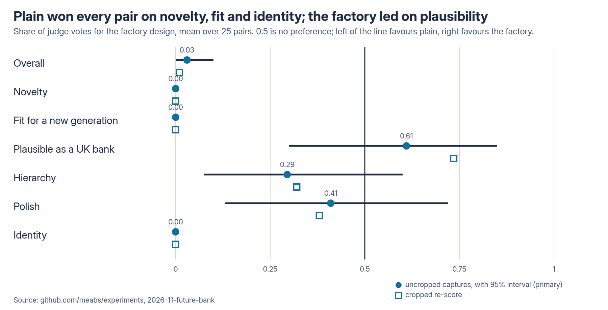
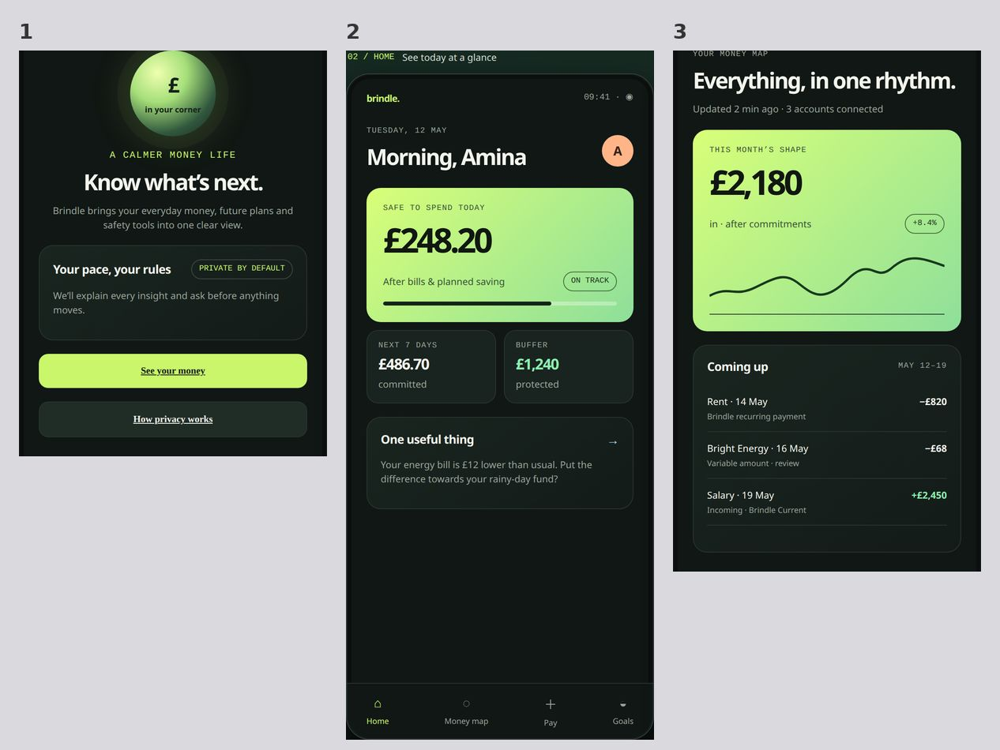
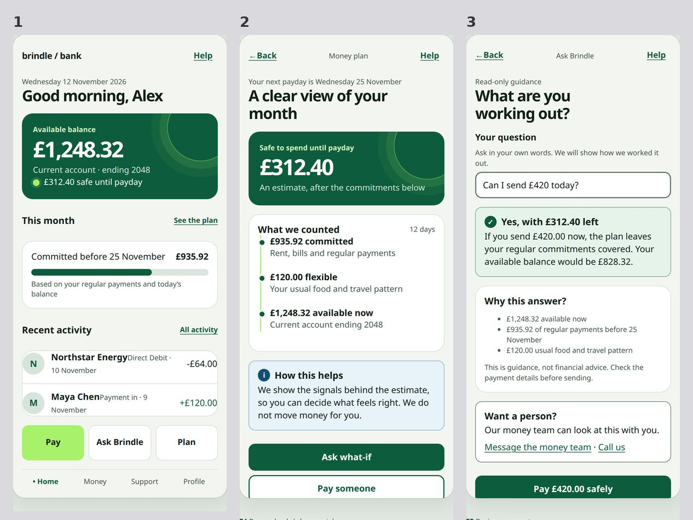
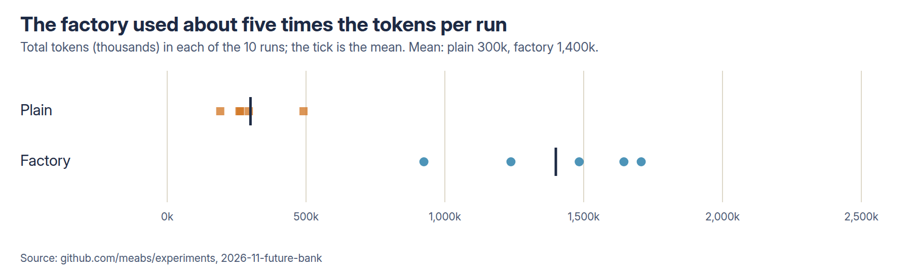

# Does design knowledge help an agent design a futuristic bank app? Report (FUT-1)

12 November 2026. Design: [README.md](README.md), pushed before any run (e7c39363). Three amendments, all made before
any judging (README, amendment log). Numbers: [results/main/analysis.md](results/main/analysis.md) (uncropped, primary),
[analysis-crop.md](results/main/analysis-crop.md), [analysis-drop5.md](results/main/analysis-drop5.md),
[analysis-features.md](results/main/analysis-features.md), [skill-use.md](results/main/skill-use.md).

## 1. What I wanted to find out

In [DFX](../2026-11-design-factory/) a Design Factory (OKF knowledge, 12 skills including Impeccable, a mandatory
review) made an agent's banking storyboards more complete and more accessible, and a blind judge preferred the plain
agent's look. Those briefs named the journey. Here the brief is open: **design a futuristic version of a mobile banking
app for a new generation of users**, where "futuristic" (the user's definition) means a next-generation app based on what the
agent judges the future needs of future users to be. The agent chooses the users, the needs and the features. Does the
factory's knowledge help that, or does it pull the agent towards conventional banking?

## 2. What I predicted

Written in the README before any run: whole design no preference, probably a lean to plain on novelty and identity;
factory ahead on "plausible as a UK bank", research applied and accessibility; factory runs converging on a more
similar feature set than plain runs.

## 3. How I tested it

Same agent as DFX (Codex CLI 0.167.1, hosted `gpt-5.6-luna`, medium effort, live web search in both arms, sandboxed).
Plain: a README only. Factory: the DFX factory, unchanged. **One brief, 5 runs per arm, 10 runs.** Each run did its own
research. Each delivered `research.md` (sources, then numbered features F1, F2... with the supporting finding),
`storyboard/index.html` (8 to 12 frames of 390 × 844 px) and `screens.json`. All 10 delivered.

**Judging.** Every plain run against every factory run (25 pairs), blind, by two vision models
(`google/gemini-4-argon`, `anthropic/claude-sonnet-5.5`), both orders (100 calls per capture method). Criteria: overall,
**novelty**, **fit for a new generation**, **plausible as a UK bank's app**, hierarchy, polish, identity. Pair score = share
of votes for the factory (0.5 no preference; below 0.5 the plain agent is preferred). Test: a run-level permutation
over the 252 splits of the 10 runs (the smallest possible p is 0.008; approximate, because the 25 pairs share runs);
bootstrap interval over runs. **Primary: the original uncropped captures** (the user asked for no cropping). **Also run,
declared beforehand: the same pairs on screens cropped to the phone.** In DFX the capture method moved the
whole-design result.

## 4. What happened

### Headline

- **The plain agent's design was preferred in every one of the 25 pairs on overall** (factory 0 wins, plain 25). Pair
  score 0.03 (0.00 to 0.10), p 0.008 (the minimum possible). Cropped: 0.01. Dropping the one broken capture: 0.04. The same in each judge
  alone.
- **On novelty, fit for a new generation and identity, the plain agent won every pair, in every judge**
  (score 0.00 in all three).
- **On "plausible as a UK bank", the factory was preferred:** 0.61 uncropped (not significant, p 0.22), 0.73 cropped
  (22 pairs to 1, p 0.008), 0.76 without the broken capture.
- **The factory's design chose ordinary banking; the plain agent's chose new capabilities** (section 4.3).
- **Accessibility, by program: 0 violations per screen for the factory, 0.41 for plain.**
- **The factory cost 2.4 times as much** ($0.068 against $0.028 a run).

The prediction "no preference on the whole" was **wrong**: the preference for the plain agent was complete. Factory
ahead on plausibility, research applied and accessibility was right. Plain ahead on novelty was right and stronger than
I expected.

### Which design the judges preferred

| Criterion | Pair score, uncropped (95% interval) | p | Factory wins / plain wins / split | Cropped re-score | Sonnet 5.5 alone | Gemini alone |
| --- | --- | --- | --- | --- | --- | --- |
| overall | 0.03 (0.00 to 0.10) | 0.008 | 0 / 25 / 0 | 0.01 | 0.00 | 0.06 |
| novelty | 0.00 (0.00 to 0.00) | 0.008 | 0 / 25 / 0 | 0.00 | 0.00 | 0.00 |
| fit for a new generation | 0.00 (0.00 to 0.00) | 0.008 | 0 / 25 / 0 | 0.00 | 0.00 | 0.00 |
| plausible as a UK bank | 0.61 (0.30 to 0.85) | 0.22 | 16 / 5 / 4 | 0.73 | 0.79 | 0.43 |
| hierarchy | 0.29 (0.07 to 0.60) | 0.032 | 4 / 16 / 5 | 0.32 | 0.32 | 0.27 |
| polish | 0.41 (0.13 to 0.72) | 0.35 | 8 / 14 / 3 | 0.38 | 0.42 | 0.40 |
| identity | 0.00 (0.00 to 0.00) | 0.008 | 0 / 25 / 0 | 0.00 | 0.00 | 0.00 |

Scores above 0.5 favour the factory, below 0.5 the plain agent. The p values are unadjusted and approximate (the
25 pairs share 10 runs, and 0.008 is the floor of the test). Both judges chose the same design in both orders in 88% to
100% of pairs; first-shown bias was small here (50% and 56%), unlike DFX.

**Why the judges chose plain, in their words** (shortened, from the judges' one-sentence reasons): "a distinctive,
forward-looking product (cashflow forecast, an explainable money guide, guarded goals, shared pots, human handoff with
context, privacy centre)" against "a competent, honest but conventional safe-to-spend and payment-with-scam-warning
flow"; "a safe, honest but generic payment flow that barely feels futuristic, even though it is more clearly shippable
for a UK bank"; "unfinished draft copy and broken icon rendering". The judges named the factory's trust and UK credibility
and still chose plain because the brief asked for futuristic.



### Sample screens

Run 2 of each arm, first screens, cropped to the phone screen (the judges saw the uncropped captures; the cropped
re-score is reported above). Plain, then factory.




### What features they chose

A model read each run's `research.md` feature list (it did not see the arm). Descriptive.

| Arm | Features per run | Backed by a named source | New capability | Ordinary banking function | Gimmick | Categories used per run |
| --- | --- | --- | --- | --- | --- | --- |
| Plain | 9.6 | 79% | 73% | 27% | 0% | 7.8 |
| Factory | 7.2 | 61% | 28% | 69% | 3% | 4.4 |

All five plain runs chose a savings or goals feature, a balances or spending view, security or fraud protection and an
AI assistant. All five factory runs chose payments, balances and security; one chose an assistant. The factory's own
research said to "keep everyday banking familiar" (pilot run). **Prediction 3 is not supported:** overlap between runs
within an arm (mean Jaccard of category sets) was 0.59 for the factory and 0.66 for plain, so the factory runs were not
more alike. Both arms are alike in using the common categories; the difference is in what else they added.

### Research applied

A blind model judge looked at each run's own listed features and the frames: plain 46 of 48 (96%) visibly applied;
factory 30 of 36 (83%). Five of the six factory misses are one run (B5) whose uncropped capture was blank (below); the
rest of the factory runs applied 29 of 29. **So the arms applied their own research about equally; the plain agent's was
larger in scope.** This is the original uncropped capture; I did not re-run it on crops.

### Accessibility, by program

axe-core violations per screen (lower is better): plain **0.41** (49 screens; 59% with none; 20 screens with a
colour-contrast violation), factory **0.00** (51 screens; all clean). No conformance is claimed for either; a program finds
only part of the failures.

### Was the factory used?

From the session logs ([skill-use.md](results/main/skill-use.md)): all 5 factory runs opened the index, the workflow and all
11 stage and specialist skills, 4 of 5 opened Impeccable reference files, 4 of 5 ran the contrast tool, all 5 ran the
lint and render checks, and all 5 wrote the brief, direction, storyboard, review and handoff files (3 of 5 wrote a
separate research file in `design/`). No plain run touched a factory file. All 10 used web search.

### Tokens, time and cost

Means per run at `gpt-5.6-luna` list prices ($0.20 per million input tokens, $0.02 cached, $1.20 output).

| Arm | Input tokens | Output tokens | Seconds | Cost per run |
| --- | --- | --- | --- | --- |
| Plain | 286k | 13.5k | 263 | $0.028 |
| Factory | 1,377k | 22.4k | 459 | $0.068 |



The factory used 4.8 times the input tokens and 2.4 times the cost. The 10 runs cost about $0.48 and the judging
(including the research judge) $5.35. People's time reading the factory's five extra design files per run is not counted.

### The broken capture, and the cropped check

The uncropped capture of factory run 5 showed one screen and ten blank ones, because the page hides every frame but the
first at viewport widths up to 430 px. It displayed correctly at 1280 px, as the brief asked. I found this when checking the
captures and logged it (amendment 3) before judging. It cannot explain the result: dropping that run leaves overall at 0.04
(20 pairs, 0 to 20) and the cropped re-score, which captures it correctly, gives 0.01. The cropped re-score also moves the plausibility
result from not significant to significant (0.61 to 0.73).

## 5. What surprised me

- **The completeness of the result.** 25 of 25 on overall, and 0.00 on three criteria in both judges. DFX's result
  was close and mixed; this one is not.
- **The factory's answer was a safer, narrower app.** It treated "futuristic" as a calm, trustworthy payment and
  money-in-view flow, with a few new touches, while the plain agent built a wider set of new things.
- **The judges said so and still weighed it the same way.** They named the factory's UK credibility and chose the
  other design for being futuristic, which is what the brief asked for.

## 6. What this might mean in practice

### Impact

For this agent and an open "futuristic" brief:

- **If the aim is a bold, next-generation concept, this factory made it worse, not better.** Every judge vote went to
  the plain agent on novelty and fit. The factory's design reads as a careful current bank app with a futuristic
  skin.
- **If the aim is a concept that survives a bank's risk and regulatory review, the factory's output had the edge** (22 to 1 on
  plausibility on cropped screens) and a clean accessibility check.
- So the factory is a **delivery** tool: it makes the thing you ask for safe and accessible. It narrows what the agent
  chooses to build.

### Configuration recommendations

Limited to what was tested (this agent, medium effort, search on, one brief, unattended):

1. **For concept and exploration work, do not run the factory's workflow as it is.** Use the plain agent, or the factory with the
   banking and payments pack and the "keep everyday banking familiar" steer left out; the second was not tested.
2. **For a concept that is going to be built, run it through the factory afterwards** as a safety and accessibility
   pass. This sequence was not tested; I am inferring it from the two arms' strengths.
3. **Ask for ranges, not one idea.** The plain agent chose about 10 features a run; the factory about 7, mostly ordinary.
   A brief that asks for novel features explicitly was not tested.

### Risks this exposes

- **Design knowledge can make an agent conservative.** Given a banking pack, a mandatory review and a set of
  rules, the factory agent optimised for what is credible and checkable. A team that adds knowledge to an agent may be
  buying safety at the cost of imagination without noticing.
- **The factory output looks safer than it is novel,** and a reviewer scoring only for plausibility would prefer it.
  The criteria you choose decide the winner: plausibility went to the factory, novelty and identity to plain.
- **The plain agent's concepts were not checked for regulatory feasibility.** On "plausible as a UK bank" the judges
  scored the plain designs at 0.39 (uncropped) and 0.27 (cropped) against the factory's. Features such as open-banking aggregation and an AI
  assistant that explains cashflow raise consent, data and conduct questions nobody reviewed.
- **Model judges are not designers.** Both were vision models; no people voted.
- **A capture fault can corrupt a comparison.** One run's page hid its frames at phone width. A design team should look
  at the stimuli before trusting any score.

## 7. What the experiment does not prove

- **That the factory would be bad at all open briefs.** One brief, one wording of "futuristic", one model, five runs a
  cell. The test's smallest possible p is 0.008 and it cannot say how large the effect would be elsewhere.
- **That knowledge alone causes this.** The factory is a bundle (knowledge, workflow, skills, tools, a mandatory
  review); no arm separates them. The banking and payments pack is the likely cause of the payment-heavy choices
  (all five factory runs chose payments) but I did not test that.
- **That people would agree with the judges.** The judges are vision models, and the criteria (novelty, fit) are mine.
- **That the plain designs are good, or that the factory's are bad.** The judges compared them to each other only.
- **That the feature coding is exact.** A model coded it; categories and "new capability" are judgements.
- **The p values are approximate** and the pairs are not independent.

## 8. What I'd test next

1. **A factory without the banking and payments pack**, or with a brief-specific steer ("be ambitious"), to see whether
   the narrowing comes from that pack.
2. **Plain, then factory as a reviewer** (a two-step arm), to test the recommendation to run the factory afterwards.
3. **Blind human votes** on the 25 pairs, which would also settle the judge question.
4. **More runs and more open briefs** (another industry), to see whether this is a property of the factory or of one brief.

## 9. How to reproduce

From `2026-11-future-bank/`:

```bash
python3 -I scripts/make_trial.py
bash scripts/run_all.sh                       # 10 runs -> results/main
~/code/benchmark/webmcp-exp/env-plain/bin/python scripts/shoot.py results/main
~/code/benchmark/webmcp-exp/env-plain/bin/python scripts/crop.py results/main
python3 scripts/sheet.py results/main ; python3 scripts/sheet.py results/main --crop
uv run --with requests --with pillow python scripts/judge_cross.py results/main [--judge anthropic/claude-sonnet-5.5] [--crop]
uv run --with requests --with pillow python scripts/judge_research.py results/main
python3 -I scripts/analyse_cross.py results/main [--crop] [--drop 5]
uv run --with requests python scripts/code_features.py results/main
python3 -I scripts/skill_use.py results/main
```

Raw agent session files and the copies of the Codex login in `agent-homes/` are not published.

## 10. What changed from the design

Amendments 1 to 3 (README): judge uncropped captures (the user's instruction); also run a cropped re-score; handle the
one broken capture with a labelled sensitivity analysis. All were made before any judging. Not done: the blind
human-vote gallery. The research-applied judge was run on the uncropped captures only.
