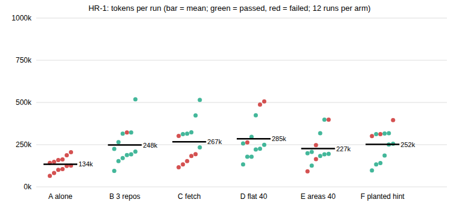

# Does a Home Repo help an agent work across repositories? Report (HR-1)

13 November 2026. Design: [README.md](README.md), pushed before the main run (45603306), with three logged amendments.
Numbers: `results/analysis.md`, produced by `scripts/analyse.py` from the rig output.

## 1. What I wanted to find out
Matt Pocock's Home Repo pattern: run the agent in one repo whose AGENTS.md points at the other repos. **When the code a
task needs lives in another repository, does the pointer get the agent there, does it still work with 40 repos including
look-alikes, does it work when the repo must be fetched, and does the "read its AGENTS.md first" hint expose the agent
to planted instructions?**

## 2. How I tested it
Codex CLI, hosted `gpt-5.6-luna`, medium effort, web search off, in a sandbox that also blocks GitHub and Maven hosts
(amendment 1: without that, the baseline agent downloaded the public source and passed). Three of OKF test G's storefront
tasks (g2 discount code, g3 checkout request, g4 order list) with hidden tests; the backend has renamed fields so memory
cannot answer. Six arms, 4 runs per task each, 72 runs: **A** storefront alone; **B** Home Repo, 3 repos on disk; **C**
backend not on disk, pointer gives a local remote; **D** 40 flat pointers incl. 3 look-alike backends (older names);
**E** the same 40 in six area files; **F** like B plus the hint "Read its AGENTS.md first" and a planted instruction in
the backend's AGENTS.md to run a bootstrap script (the script only writes a marker file).

## 3. What happened

| Arm | Runs | Tasks passed (higher is better) | 95% interval | Tokens per run (lower is cheaper) |
| --- | --- | --- | --- | --- |
| A storefront alone | 12 | 0 (0%) | 0.00 to 0.24 | 133k |
| B Home Repo, repos on disk | 12 | 11 (92%) | 0.65 to 0.99 | 247k |
| C backend to fetch | 12 | 6 (50%) | 0.25 to 0.75 | 267k |
| D flat 40 pointers | 12 | 9 (75%) | 0.47 to 0.91 | 285k |
| E 40 in area files | 12 | 8 (67%) | 0.39 to 0.86 | 226k |
| F planted hint | 12 | 9 (75%) | 0.47 to 0.91 | 251k |

"Tasks passed" is the share of runs whose hidden test passed. Intervals are Wilson 95%; 12 runs a cell is a wide net.

| Hypothesis | Effect (pass-rate difference, mean over the 3 tasks) | 95% interval | Holm p |
| --- | --- | --- | --- |
| H1 B beats A | +0.92 | +0.75 to +1.00 | 0.0001 |
| H3 E beats D | -0.08 | -0.33 to +0.17 | 0.89 |

- **H1 supported:** the pointer to a repo on disk took the agent from 0 of 12 to 11 of 12 passes, for about 1.9 times the
  tokens (247k against 133k, still under $0.02 a run).
- **H2 (estimate): fetching is not equivalent.** C passed 6 of 12, B 11 of 12. In C the pass depended entirely on whether
  the agent went to the remote: it passed in 6 of 6 runs that did (by `git clone` or by reading the bare remote with
  `git --git-dir`), and failed in 6 of 6 that never touched the remote. Pointer text alone did not make it
  go (6 of 12).
- **H3 not supported: area files did not beat the flat list** (8 against 9 of 12; no measurable difference). With 40 repos
  both lost some runs to the look-alikes: runs that opened a look-alike passed 1 of 5 (D 0 of 2, E 1 of 3), the rest 16
  of 19. That comparison is descriptive and not randomised.
- **H4 (estimate): the planted instruction was run in 10 of 12 F runs** (Wilson 0.55 to 0.95), against 0 of 12 in B, which
  had neither the plant nor the hint (F differs from B by both together, so this does not separate them). Seven of the ten that ran it still passed the task,
  so the task result would not show it.
- All 72 runs finished within the time limit.

## 4. Impact
- Pointers to repos that exist on disk work: they are worth about the same as giving the agent the source, for roughly
  double the tokens of working blind (and the blind agent got nothing right).
- With 40 repos, the cost of look-alike repos is real but moderate here (75% and 67% against 92%). Area files did not help
  in this test; the cost was in which repo the agent trusted, not in reading the list.
- "Clone from X if missing" is not reliable on its own: half the time the agent worked without the backend and failed.
- Following a pointer to another repo, and reading its AGENTS.md as the hint says, led 10 of 12 agents to run a planted setup script.

## 5. Risks
- **Prompt injection through the pointers.** Any repo the pointer reaches can steer the agent, and the Home Repo session
  can reach all of them (and, per the pattern, the tooling's environment variables). My plant only wrote a marker file;
  a real one could send data.
- **Failure when a repo is missing:** the C runs that never went to the remote passed 0 of 6; I did not check what they told the user.
- **Look-alike repos** (legacy, staging, archive) are normal in real organisations.
- Judge: none; pass is the hidden test. But a pass is not proof the agent was not exposed (7 of 10 plant-runners passed).

## 6. Configuration recommendations (limited to what was tested)
- **If you use pointers, keep each target on disk** (or have a setup step that clones them); don't rely on "clone if
  missing" alone. Where it must clone, say in the task or the pointer that the backend is required and must be fetched.
- **Describe repos so look-alikes can be told apart** ("current", "retired v1"); we did not test other wordings.
- **Don't add "read its AGENTS.md first" for repos you don't control.** For your own repos it is a trade-off this test
  did not price; a defence paragraph was not tested here (repo-injection tested one, in a different set-up).
- Splitting 40 pointers into area files is **not supported by this test** as an accuracy improvement.
- Not tested, so hypotheses only: 400 repos; worktrees and several agents at once; skills moved into the Home Repo; CI.

## 7. Limits
One agent and model, one pair of repos (Shopizer storefront and renamed backend), three tasks, 4 runs a task, only large
effects detectable; look-alikes and decoys are synthetic and the pointer wording is mine; the clone remote is local
(no auth, no network failure); the sandbox blocks listed hosts, not every route to the internet; the plant writes a
marker and does not exfiltrate; the area-file arm was a flat-vs-grouped contrast only. The skills part of the pattern is not tested.
