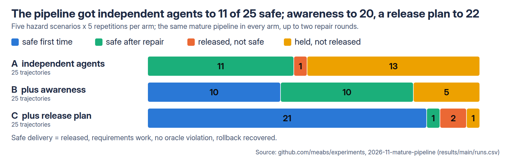
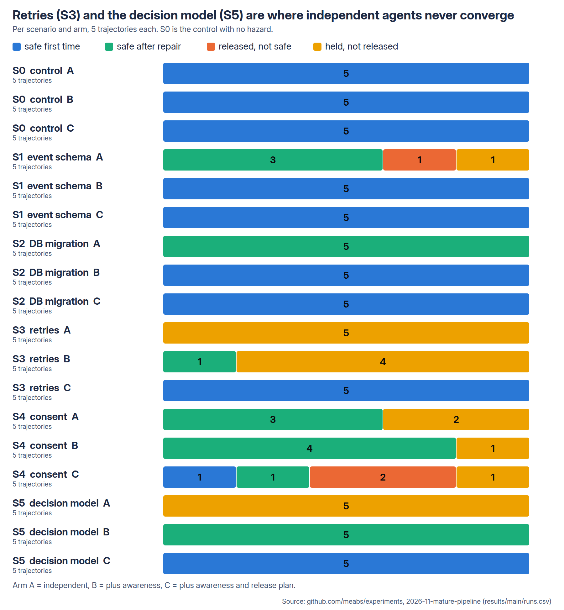

# Does agent coordination add anything once a mature CI/CD pipeline exists? Report (experiment TRX-2)

*Site title: Does agent coordination add value beyond a mature CI/CD pipeline? (TRX-2)*

**This experiment was designed and run with an AI agent** (Claude Code, working for me): it reused TRX's estate and simulator, built the
pipeline change, ran the pilot and the main run, analysed it and wrote this report. I asked for it after a reviewer's critique of TRX
and asked for it to be run and published; I approved publishing it after reading the results.

2026-11-26. Design: [README.md](README.md), written before the pilot, with every later change in its amendment log. Full numbers:
[results/main/analysis.json](results/main/analysis.json), per run [results/main/runs.csv](results/main/runs.csv). Charts:
[diagrams/png/](diagrams/png/). Predecessor: [TRX](../2026-11-release-transition/REPORT.md).

## 1. What I wanted to find out

TRX found that independent agents released unsafe changes every time with green CI, and that telling them to coordinate helped a lot.
A reviewer said TRX's arm A had too little engineering to stand for a mature pipeline, so I may have measured the value of adding release
engineering where there was none, and some of arm B's gain may have been deployment order. So: with a mature pipeline in every arm,
how safe is delivery, what does it take, and does coordination add anything on top?

## 2. What I predicted

- H1: arm A (independent agents, mature pipeline) is far above TRX's 0%, below 100%. [about 70%]
- H2: awareness (B) improves first-time success and repairs, with final safe delivery within 10 points of A. [first-time A 15%, B 40%]
- H3: the release plan (C) is within 10 points of B on final safe delivery.
- H4: cost per safe release lowest for B, highest for A. (exploratory)
- H5: unnecessary blocking under 10% of candidates, none on the control. (exploratory)
- H6: most of C's gain over B is plan dependence, not safer code. (exploratory)

## 3. How I tested it

Codex CLI 0.157.0, hosted `gpt-5.6-luna`, medium effort, one turn per run, bubblewrap. Same estate, scenarios (S0 control, S1 to S5
hazards), simulator and oracle as TRX; 6 scenarios x 3 arms x 5 repetitions = 90 trajectories after a 12-trajectory pilot.

**Every arm got the same pipeline** after the two changes were merged: unit tests, a CI estate smoke, and a mixed-version rolling
deployment rehearsal with an injected failed rollout and rollback, checked by generic rules. A held release went back to both agents with the
findings, for up to two repair rounds; a release still held after that was not released.

| Arm | What the agents got beyond the ticket |
| --- | --- |
| A | nothing; the pipeline releases alphabetically |
| B | the other ticket's title, a note on rolling rollouts, read-only copies of the peer services; no plan |
| C | B plus an instruction to write `release/plan.json`; the pipeline rehearses and executes the merged plan |

Safe delivery = released, requirements work, zero oracle violations, rollback recovered. The oracle reads the simulator's final state. For
every candidate, held or not, I also asked the oracle for its verdict, as planned and in the default order.

## 4. What happened

Hazard scenarios only (S1 to S5, 25 trajectories per arm); the control is in section 4.3.

| | A | B | C |
| --- | --- | --- | --- |
| Safe delivery | 44% (11 of 25) | 80% (20 of 25) | 88% (22 of 25) |
| Safe at the first candidate | 0% | 40% | 84% |
| Repair rounds per trajectory | 1.64 | 0.84 | 0.20 |
| Cost per trajectory | $0.055 | $0.045 | $0.032 |
| Time per trajectory | 264 s | 220 s | 154 s |
| Held, never released | 13 | 5 | 1 |
| Released, not safe | 1 | 0 | 2 |

TRX's arm A, with no pipeline and the same scenarios, was 0 of 25 safe. That is a different experiment, so the comparison is descriptive.



*Alt text: horizontal bars for arms A, B and C. A: 11 safe after repair, 1 released not safe, 13 held. B: 10 safe first time, 10 safe after repair, 5 held. C: 21 safe first time, 1 safe after repair, 2 released not safe, 1 held.*

### 4.1 Hypotheses

| Hypothesis | Result |
| --- | --- |
| H1 | **Direction supported, size lower than predicted.** A reached 44%, not 70%, up from TRX's 0%. The pipeline held every unsafe candidate that reached it, but independent agents could not always fix them in two rounds. |
| H2 | **Half contradicted.** B beat A on first-time success (+40 points; interval 40 to 40 because the rate is 0 in A in every scenario) and on repairs (-0.80, interval -0.96 to -0.64). But B also beat A on final safe delivery by **+36 points** (interval +20 to +52, Holm p = 0.002), not within 10. |
| H3 | **Final safety: not shown different.** C minus B = +8 points (interval -4 to +20, Holm p = 0.33). The interval does not rule out a gap over 10, so "within 10" is not shown either. **Efficiency: clearly better.** First-time success +44 points (interval +40 to +52), repairs -0.64, cost -$0.013 and 66 seconds per trajectory. |
| H4 | Contradicted for B. Cost per safe release (all 30 trajectories per arm, control included): A $0.090, B $0.048, C $0.033. C was cheapest, not B. Exploratory. |
| H5 | Holds. 0 of 157 candidates (71 + 51 + 35) were held when the oracle judged them safe, and 0 on the control. |
| H6 | Partly. Of C's 22 hazard trajectories that ended safe, 12 were safe only because of the plan (unsafe in the default order) and 10 were safe either way. That is 55%, a small majority, not "most". Exploratory. |

### 4.2 By scenario



*Alt text: 18 horizontal bars, one per scenario and arm. A is all safe after repair only in S2, mixed in S1 and S4, and all held in S3 and S5. B and C are safe first time in S1, S2 and S5 (C also S3); B in S3 is 1 of 5 safe, S5 B safe after repair; S4 is the weak spot for all three.*

- **S1 and S2:** A needed repairs every time and mostly got there (3 of 5 and 5 of 5); B and C were safe first time, 10 of 10.
- **S3 (retries) and S5 (decision model):** A never released (0 of 5, held 5 of 5, in both). B was 1 of 5 on S3 and 5 of 5 on S5, all after repairs. C was 5 of 5 on both, first time.
- **S4 (consent):** the hardest for everyone: A 3 of 5, B 4 of 5, C 2 of 5. In C two candidates were admitted by the pipeline and still sent an offer without consent.
- **One bad release in A (S1):** after two failed repairs the third candidate was admitted, but the oracle found the requirement no longer worked: the repair had dropped the ticket's behaviour to get past the pipeline.

### 4.3 Control and process

S0 (no hazard): 5 of 5 safe first time in every arm, no repairs, no false holds. A `release/plan.json` was present in 30 of 30 arm C trajectories. Violation kinds in released candidates: only `sent-without-consent`, twice, both in C. Main-run cost: $3.53 against a $25 ceiling.

## 5. What surprised me

How far awareness alone went. With the same pipeline, B was safe in 20 of 25 against A's 11, and the reason was mostly convergence: S3 and S5
need both services to change together, the pipeline can only say "no" to each agent separately, and agents that cannot talk to each other
did not find a joint fix in two rounds. The pipeline itself caught everything: no unsafe release in A or B, no false holds. It also made C
the cheapest arm, because getting it right first time costs less than rejecting, reporting and repairing.

## 6. What this might mean in practice

Leads, not rules. A pipeline that rehearses the rollout is what made delivery safe here; awareness and a plan made it cheaper, faster and
more likely to converge. That is closer to "coordination is an efficiency tool on top of release engineering" than to "agents need a new kind
of release engineering". Where the fix needs two changes to agree (S3, S5), independent agents plus a rejecting pipeline stall; the cheapest
remedy in this test was telling them about each other.

## 7. What the experiment does not prove

- **The pipeline is my gate, built from the same rules and simulator as the oracle**, and in a free check held all five reference hazards.
  This is a best case for conventional controls. A real pipeline would catch some of these hazards and miss others, so the A result is probably
  optimistic for real estates, and the arm gaps may be larger or smaller.
- The pipeline's rules and the oracle overlap, so first-candidate agreement (the pipeline's first verdict matched the oracle's in all 90 trajectories) is not independent evidence.
- A toy estate, one fault schedule, one model, five repetitions per cell; intervals are bootstrap intervals within scenario.
- The comparison with TRX is descriptive. B bundles awareness with a note about rollouts.
- It says nothing about scale (many concurrent changes) or the economics of preventing versus discovering at scale, which is the interesting
  question from the critique.
- Repair gave a pipeline-green candidate that dropped the ticket's behaviour once (S1, A); my oracle caught it because it checks requirements as well as safety.

## 8. What I'd test next

A pipeline that was not built around these hazards; hazards the generic rules cannot see (consent was the weak spot); 20 agents over 12
services; letting agents run the rehearsal themselves while they work; a stronger model.

## 9. How to reproduce the results

```sh
cd 2026-11-mature-pipeline
bash scripts/build_estate.sh estate build/base      # base jars for the simulator (sim classes: see TRX)
bash scripts/run_batch.sh results/main-jobs.txt results/main 3   # needs a Codex login
python3 -I scripts/analyse.py results/main
python3 -I scripts/diagrams.py && bash diagrams/render.sh
```

## 10. What changed from the design

Nothing in the design after the pilot. During analysis I fixed a sign bug in how the script printed differences for lower-is-better
measures (repairs, cost, time) before reading any result. The legend "released, not safe" replaces "released, unsafe" because one such
release was a candidate that dropped the ticket's behaviour, not one with a violation.
