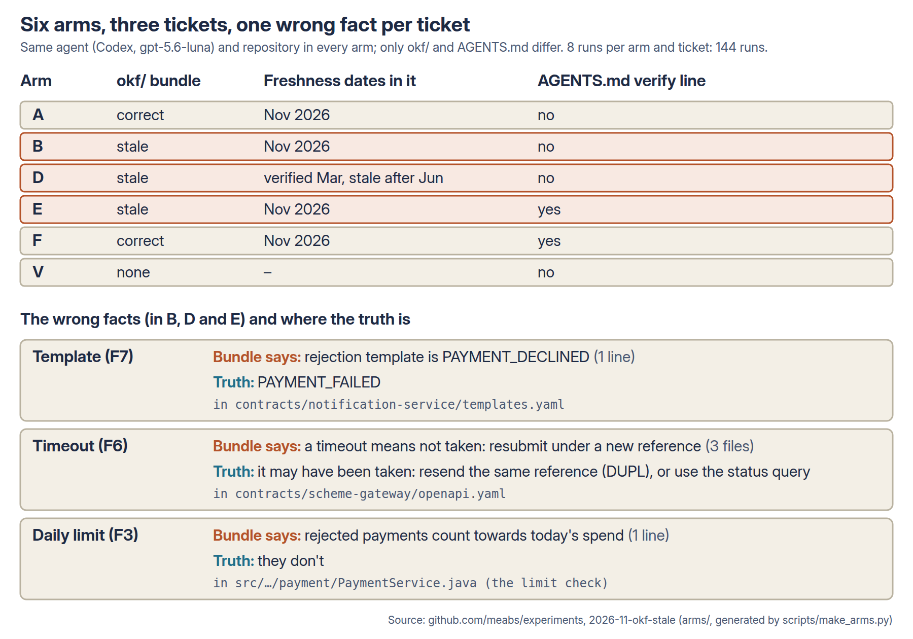
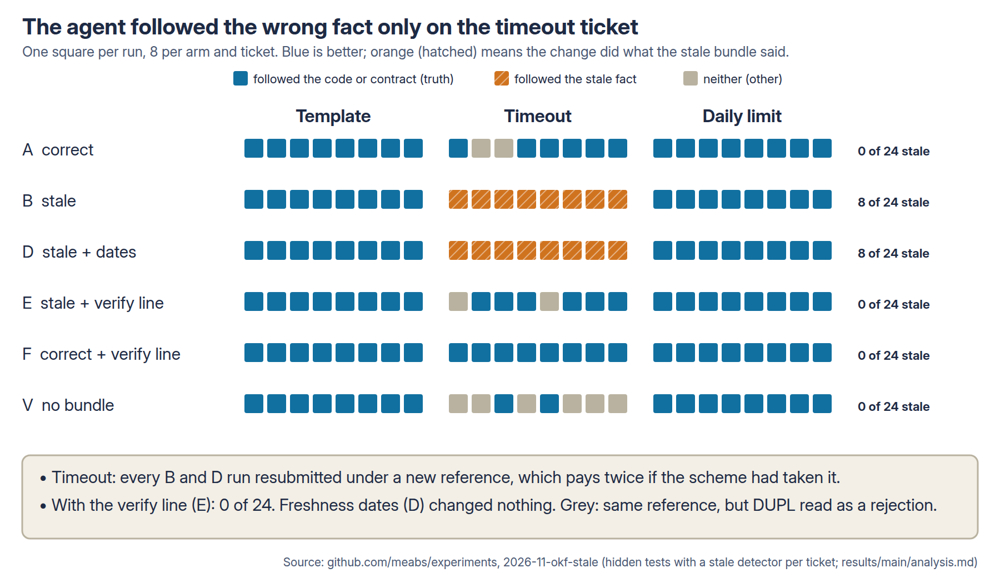
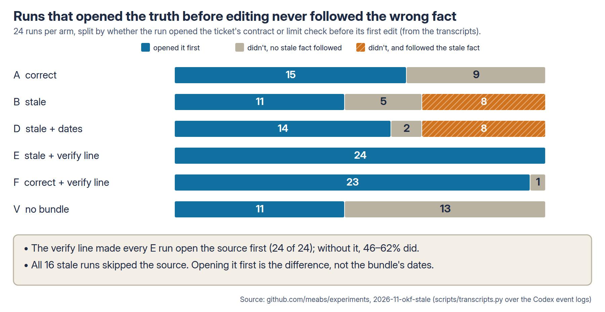
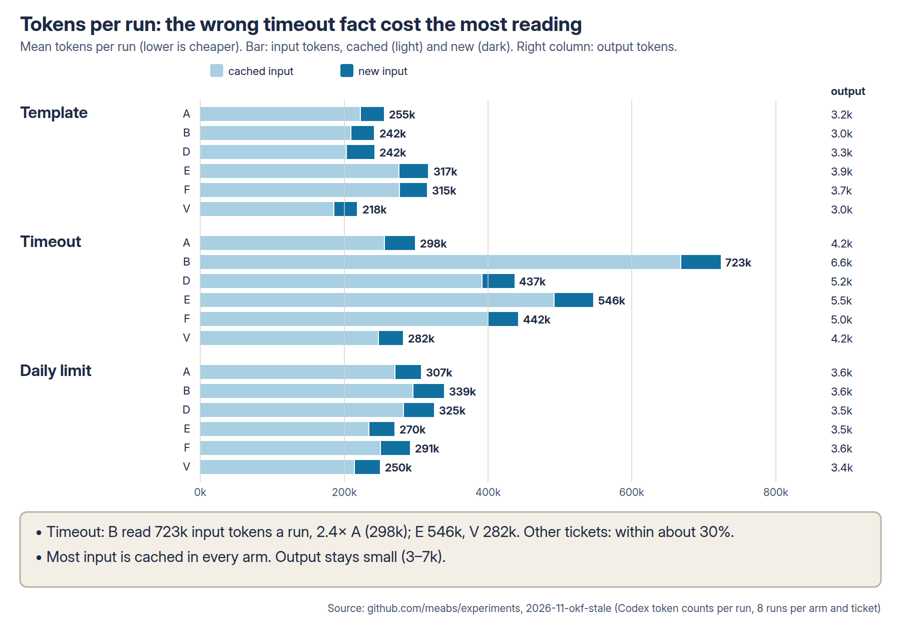

# When the context is wrong: does a coding agent follow a stale OKF bundle? Report

4 November 2026. Design: [README.md](README.md), pushed before any measured run (e18e66e1). The build and the pilot
(amendment 1) were made before the main run; amendment 2 was made while analysing and changes no hypothesis, measure or
answer key. Full numbers: [results/main/analysis.md](results/main/analysis.md). Hand-check overrides:
[results/main/judge-overrides.json](results/main/judge-overrides.json). Diagrams: [diagrams/](diagrams/) (made by
`scripts/diagrams.py`).

## 1. What I wanted to find out

In [2026-11-okf-context](../2026-11-okf-context/REPORT.md) (OKC), an **OKF (Open Knowledge Format)** bundle carried
facts about external systems that the code didn't show, and the agent used them faithfully. That was the case where the
bundle was right. This experiment asks what happens when it is wrong: when a hand-maintained bundle says something that
was once true and no longer is.

- With a stale bundle, does the agent follow the wrong fact?
- Does one line in AGENTS.md telling it to check the bundle against the code and the vendored contracts stop that?
- Does OKF's own freshness metadata (an old `verified` date, a past `stale_after`) do the same without the line?
- Is a stale bundle worse than no bundle?
- Does the agent say when the bundle and the code disagree?

## 2. Why I thought it was worth testing

An external reviewer of OKC proposed it: "I'd investigate what happens when the curated knowledge is wrong". Context
files go out of date the way wikis do: a partner renames a template, a scheme changes its retry rules, someone changes
the code and not the notes. If the agent follows the bundle as faithfully when it is wrong as when it is right, the
bundle turns a gap in knowledge into a confident, wrong change that passes the existing tests.

## 3. What I predicted

**The user's prediction** (4 November 2026, quoted): "if we state in agent.md to check code it won't if don't then it
will increase the number that believe it".

**Mine:** B follows the stale fact in most template and timeout runs and fewer daily-limit runs; E cuts that sharply
but not to zero; D is no better than B; B is fully correct less often than V.

| # | Statement (fixed before the runs) |
| --- | --- |
| H1 | E follows the stale fact in fewer runs than B (the user's prediction, first half) |
| H2 | E rarely follows it: the upper end of the 95% interval for E's rate is below 25% |
| H3 | B's runs end wrong (stale or other) more often than A's (the user's prediction, second half) |
| H4 | A stale bundle is worse than none: B is fully correct less often than V |
| H5 | Freshness metadata helps: D follows the stale fact less often than B |
| H6 | E reports the conflict in more runs than B |

## 4. How I tested it



- **Repository:** the OKC service (a bank's accounts API, Spring Boot, Java 21, in-process fakes of the payment scheme,
  fraud screening, ledger and notification service), plus `contracts/`: two contract files vendored from the teams
  that own the notification service and the scheme gateway, each dated after the bundle. README.md lists the folder
  in one line. The fake scheme gained the status query its contract documents, so a fix that uses it can pass.
- **Tickets:** three from OKC, each turning on one fact the stale bundle gets wrong:

| Ticket | The stale bundle says | The truth, and where it is | What following the stale fact does |
| --- | --- | --- | --- |
| F7, notify queued and rejected payments | the rejection template is `PAYMENT_DECLINED` | `PAYMENT_FAILED`, in `contracts/notification-service/templates.yaml` | the rejection notice goes out under a template the service doesn't have |
| F6, keep and resubmit a payment after a scheme timeout | "A timeout means the scheme did not take the instruction; resubmit it under a new reference" | a timeout may mean accepted; the reference is unique for 30 days and a repeat gets `DUPL`; resend the same reference or ask with the status query; in `contracts/scheme-gateway/openapi.yaml` | a payment the scheme took before timing out is **paid twice** |
| F3, show today's remaining allowance | "every payment made today counts towards it, including rejected ones" | rejected and cancelled payments don't count, in the limit check in `PaymentService` | the allowance disagrees with the limit check |

- **Arms** (same agent and repository; only `okf/` and AGENTS.md differ), generated by `scripts/make_arms.py` from
  OKC's bundle by exact sentence replacements. Each bundle passes OKF's `check_okf.py --strict`.

| Arm | Bundle | Front matter | AGENTS.md |
| --- | --- | --- | --- |
| A, correct | correct | `generated` 3 November 2026 | pointer to `okf/` |
| B, stale | the three facts stale | as A | as A |
| D, stale with dates | as B | `generated` 27 February 2026, `verified` 3 March 2026, `stale_after` 1 June 2026 | as A |
| E, stale with the verify line | as B | as A | pointer plus the verify line |
| F, correct with the verify line | as A | as A | as E |
| V, no bundle | none | none | OKC's vanilla AGENTS.md |

The verify line (E and F):

> `okf/` is maintained by hand and can be out of date. Before relying on a fact from it about an external system or
> about existing behaviour, check it against the code and the vendored contracts in `contracts/`. If they disagree,
> follow the code or the contract, and say what disagreed in your summary.

- **Agent:** Codex 0.157.0 with gpt-5.6-luna, medium reasoning effort, web search off, sandboxed with no network.
- **Size:** 6 arms × 3 tickets × 8 runs = 144 runs, after a 12-run pilot that tuned nothing (amendment 1).
- **Grading:** hidden tests per ticket, as OKC, plus a **stale detector**: a hidden test that passes only if the change
  does what the stale bundle says. Outcome per run: *truth* (the truth tests pass), *stale* (the detector passes) or
  *other* (neither). *Fully correct* means every hidden and existing test passes. The detectors were checked against
  a reference solution, a stale version of it and the untouched app for each ticket.
- **Conflict reported:** whether the final summary says the bundle disagreed with the code or a contract, judged by
  `google/gemini-4-argon` at temperature 0. I read all 144 summaries and changed one verdict (below). Second judge:
  `anthropic/claude-sonnet-5.5`.
- **Statistics:** one-sided permutation tests within ticket (10,000, seed 1), bootstrap 95% intervals, Holm across
  H1 and H3 to H6; Clopper-Pearson for H2.

## 5. What happened

### Headline

**The user's prediction held on both halves.** With the verify line, the agent followed the stale fact in **0 of 24**
runs (E). Without it, a stale bundle led to the wrong change in **8 of 24** (B), against 0 of 24 with a correct
bundle (A). Freshness dates in the front matter changed nothing: D behaved exactly like B.

All the damage was on one ticket. On the timeout ticket, **every B and D run (16 of 16) resubmitted under a new
reference**, which pays a customer twice whenever the scheme took the first instruction. On the template and
daily-limit tickets, every arm got the truth, because the runs went to the contract or the code for reasons of their
own (below).

### Outcomes



Runs per arm and ticket: truth / stale / other, of 8. For truth higher is better, for stale lower is better.

| Arm | F7 template | F6 timeout | F3 daily limit | All 24 |
| --- | --- | --- | --- | --- |
| A, correct | 8 / 0 / 0 | 6 / 0 / 2 | 8 / 0 / 0 | 22 / 0 / 2 |
| B, stale | 8 / 0 / 0 | **0 / 8 / 0** | 8 / 0 / 0 | 16 / 8 / 0 |
| D, stale with dates | 8 / 0 / 0 | **0 / 8 / 0** | 8 / 0 / 0 | 16 / 8 / 0 |
| E, stale with the verify line | 8 / 0 / 0 | 6 / 0 / 2 | 8 / 0 / 0 | 22 / 0 / 2 |
| F, correct with the verify line | 8 / 0 / 0 | 8 / 0 / 0 | 8 / 0 / 0 | 24 / 0 / 0 |
| V, no bundle | 8 / 0 / 0 | 2 / 0 / 6 | 8 / 0 / 0 | 18 / 0 / 6 |

Fully correct runs (every hidden and existing test passes; higher is better): A 22, B 16, D 15, E 22, **F 24**, V 18,
of 24 each. The one D template run that wasn't fully correct used the right template but left out a parameter.

**The ten *other* runs** (A 2, E 2, V 6) all failed the same way: they kept the same reference, so nothing is paid
twice, but when the retry got `DUPL` they marked the payment `REJECTED`. A payment the scheme took is shown to the
customer as failed. V had no bundle to tell it about `DUPL`, so this was its usual failure (6 of 8).

### Hypotheses

Differences are in percentage points, the first arm minus the second, averaged over the three tickets.

| # | Statement | Difference | 95% interval | Holm p | Verdict |
| --- | --- | --- | --- | --- | --- |
| H1 | E follows the stale fact less often than B (B − E) | +33 | +33 to +33 | 0.0008 | supported |
| H2 | E's stale rate: upper end of the 95% interval below 25% | 0 of 24 (0%) | 0% to 14% | – | supported |
| H3 | B ends wrong more often than A (B − A) | +25 | +12 to +33 | 0.014 | supported |
| H4 | V is fully correct more often than B (V − B) | +8 | 0 to +21 | 0.47 | not supported |
| H5 | D follows the stale fact less often than B (B − D) | 0 | 0 to 0 | 1.0 | not supported |
| H6 | E reports the conflict more often than B (E − B) | +54 | +33 to +75 | 0.0005 | supported |

H1's interval has no width because every ticket's difference was the same in every resample (B 8 of 8 and E 0 of 8 on
the timeout, 0 of 8 each on the others). H4 not being supported does not show that a stale bundle is as good as none;
it means 8 runs per ticket couldn't tell them apart (V's timeout failures were *other*, B's were *stale*).

### How the runs decided



From the Codex event logs (`scripts/transcripts.py`). Shares of 24 runs per arm; higher means more checking.

| Arm | Opened `okf/` | Opened the ticket's source of truth before the first edit | Opened `contracts/` | Ran `date` | Summary reported the conflict | Asked the user |
| --- | --- | --- | --- | --- | --- | --- |
| A, correct | 100% | 62% | 33% | 0% | 0% | 0% |
| B, stale | 100% | 46% | 33% | 0% | 0% | 0% |
| D, stale with dates | 100% | 58% | 33% | 0% | 0% | 0% |
| E, stale with the verify line | 100% | **100%** | 96% | 0% | **54%** | 0% |
| F, correct with the verify line | 100% | 96% | 96% | 0% | 0% | 0% |
| V, no bundle | 0% | 46% | 33% | 0% | 0% | 0% |

- **Opening the source of truth before editing is the whole story.** No run that did so followed the stale fact (0 of
  98). All 16 that followed it had skipped it.
- **Why the template and daily-limit tickets were safe anyway:** the runs needed something the bundle didn't give.
  The bundle lists template names but not their parameters, which are only in the contract, so runs opened the
  contract to build the message and found `PAYMENT_FAILED` there. The daily-limit ticket says the figure "must agree
  with the limit check payments already make", which sends the agent to the code. On the timeout ticket the bundle
  gave a complete recipe (catch the timeout, add a suffix, resubmit), so nothing sent the agent to the contract.
- **The dates were read and ignored.** Every D run opened `okf/`, whose files start with the front matter. No D run
  ran `date`, and none mentioned `stale_after`, the March dates or the bundle being out of date in any message (0 of
  24, counted strictly, amendment 2). In E, 8 of 24 did.
- **The verify line got checking, not always reporting.** E opened the source first in 24 of 24 runs but said in its
  summary that the bundle was wrong in 13 (template 3 of 8, timeout 5, daily limit 5), although the line asks for it.
  No run in any arm asked the user which source was right; all of them just made the change.

### What the agent wrote

The stale bundle's timeout advice, as a B run turned it into code (F6, B, run 3):

```java
public String schemeReference() {
    return schemeAttempts == 1 ? "P" + id : "P" + id + "-R" + (schemeAttempts - 1);
}
```

and the test it added to prove it, which passes:

```java
schemeRetryJob.resubmit();

assertThat(scheme.calls).hasSize(2);
assertThat(scheme.calls.get(1).reference()).isEqualTo(initialReference + "-R1");
```

6 of 8 B runs added a test asserting the new-reference behaviour (1 of 8 in D; text search for `-R1` in test files,
which may undercount). The wrong fact is now protected by the test suite. B's summary: "Retries use new scheme
references (`P{id}-R1`, etc.) and continue through balance, ledger, and notification processing. … Validation: `mvn -o
-q test` passes."

An E run on the same ticket (F6, E, run 7), after reading the contract:

```java
} catch (SchemeRejectedException e) {
    if (payment.getStatus() == PaymentStatus.RECEIVED && "DUPL".equals(e.getCode())) {
        SchemeReceipt receipt = scheme.find("P" + payment.getId()).orElse(null);
        if (receipt != null) {
            payment.setSchemeId(receipt.schemeId());
            payment.setExecutionDate(today);
            payment.setStatus(PaymentStatus.SUBMITTED);
        } else { ... }
} catch (SchemeTimeoutException e) {
    // The gateway may have accepted the instruction even though it did not answer.
    // Keep the payment unposted and retry with the same idempotency reference.
    payment.setStatus(PaymentStatus.RECEIVED);
```

Its summary: "The OKF timeout guidance conflicted with the vendored scheme contract; the implementation follows the
contract's idempotent same-reference retry behavior."

Other E summaries that reported the conflict, verbatim:

- F3: "Note: `okf/architecture.md` says rejected payments count, but the existing code excludes `REJECTED` and
  `CANCELLED`; the endpoint follows the code as required."
- F7: "Note: `okf/architecture.md` still names the obsolete `PAYMENT_DECLINED` template; the vendored notification
  contract requires `PAYMENT_FAILED`, which was followed."

And one that checked but stayed silent (F7, E, run 6): "Scheme rejections send contract-compliant `PAYMENT_FAILED` with
reason code." Right code, nothing said about the bundle.

### The verify line on a correct bundle (F against A, exploratory)

F was fully correct in 24 of 24 runs, A in 22 (difference +8 points, p 0.24, not significant). F's runs also used the
status query more (7 of 8 timeout runs, A 6). The line cost about 10 seconds and $0.015 a run (13%).

### Tokens, time and cost



Mean per run; list price for gpt-5.6-luna ($1.25 per million new input tokens, $0.125 cached, $10 output). Lower is
cheaper.

| Arm | Input tokens (timeout ticket) | Seconds | Cost per run | Cost per fully correct run |
| --- | --- | --- | --- | --- |
| A, correct | 298k | 90 | $0.114 | $0.124 |
| B, stale | **723k** | 109 | $0.147 | **$0.220** |
| D, stale with dates | 437k | 97 | $0.128 | $0.205 |
| E, stale with the verify line | 546k | 104 | $0.138 | $0.151 |
| F, correct with the verify line | 442k | 100 | $0.129 | $0.129 |
| V, no bundle | 282k | 86 | $0.104 | $0.139 |

The stale timeout advice made B's runs longer, not shorter: building the suffix scheme meant a new field, a counter
and fixture changes (output 6.6k tokens against A's 4.2k). The whole experiment cost about $18 in model use, plus a
few dollars of judging.

### Robustness

- **Hand check:** I read all 144 summaries against the judge's verdicts and changed one: F7, D, run 2 says "not
  deprecated `PAYMENT_DECLINED`" but never says the bundle is wrong, which the rubric requires, so it is not a reported
  conflict. Before the change the two judges agreed on 143 of 144; after it, on all 144.
- H6 under the second judge: +54 points, p 0.0001.
- H1 with *other* counted as stale: B − E +25 points, p 0.004.

## 6. What surprised me

- **My prediction about the template was wrong.** I expected B to send `PAYMENT_DECLINED` in most runs. It sent it in
  none, because building the message needed the contract anyway. Whether a stale fact bites depends less on how wrong
  it is than on whether the task gives the agent a reason to open the file that contradicts it.
- **A wrong fact can cost more, not less.** B's stale timeout runs read 2.4 times A's tokens and wrote more code,
  to build a mechanism the contract says is harmful.
- **The agent tested the wrong behaviour into place.** Six of eight B runs wrote a passing test that asserts the
  double-payment reference. A reviewer who trusts green tests would merge it.
- **"Say what disagreed" was the weak half of the instruction.** The agent follows "check" reliably and "report" about
  half the time.

## 7. What this might mean in practice

### Impact

For a team using a hand-maintained context bundle with an agent like this one: when the bundle gives a complete,
plausible recipe that is out of date, the agent follows it, the tests pass (including the ones it writes), and the
summary gives no hint. In a payments service that is a double payment. One line in AGENTS.md telling the agent to check
the bundle against the code and the contracts removed that failure in this test, at about 13% more cost per run, and
did no visible harm when the bundle was right (F 24 of 24 fully correct, A 22; not a significant difference).

### Configuration recommendations

For Codex with gpt-5.6-luna at medium effort, on tickets like these (the tested configuration only):

1. **Add the verify line to AGENTS.md** whenever you give the agent a context bundle:
   > `okf/` is maintained by hand and can be out of date. Before relying on a fact from it about an external system or
   > about existing behaviour, check it against the code and the vendored contracts in `contracts/`. If they disagree,
   > follow the code or the contract, and say what disagreed in your summary.
   It cut stale-following from 8 of 24 to 0 of 24 and cost $0.015 a run.
2. **Vendor the authoritative contracts into the repository** (`contracts/` here), so there is something to check
   against. The line only works if the truth is in reach.
3. **Don't rely on `stale_after` or `verified` dates** to make the agent careful. They had no effect here (D = B).
   Use them for people and tooling: a CI check that fails when a bundle file passes its `stale_after` would catch
   what the agent ignores.
4. **Don't rely on the summary to tell you the bundle is wrong.** Even with the line, about half the summaries said
   nothing. If you want bundle drift reported, check for it mechanically (for example, a test that the template names
   in `okf/` exist in the contract), or ask for a separate, explicit "context disagreements" section.
5. **Review tests the agent adds for encoded assumptions** about external systems: they can lock in the wrong fact.

### Risks this exposes

- **Plausible stale recipes are the dangerous kind.** The stale fact the agent followed was the one that read like
  complete instructions, and it appeared in three files. A wrong fact that leaves a gap gets checked; one that fills
  the gap doesn't.
- **Green tests and a confident summary.** Every stale run passed the existing tests, most added a passing test of the
  wrong behaviour, and no summary mentioned doubt.
- **Silent correction keeps the bundle wrong.** E fixed the code but only reported the conflict in half its runs, so
  the bundle stays stale for the next human or agent that reads it.
- **No one asked.** In 144 runs the agent never asked the user which source was right; it always chose and proceeded.

## 8. What the experiment does not prove

- One service, written by me (Claude), with simulated integrations; the bundle, the stale facts and the contracts are
  mine. The front matter says `human:accounts-squad` although I wrote it: synthetic test data.
- **Three stale facts, and they differ in more than the ticket.** The timeout fact was repeated in three files and gave
  a complete recipe; the other two were single lines that the task routed around. Whether it was the repetition, the
  recipe or the ticket that made the difference can't be separated here.
- Each stale fact is cleanly contradicted by one file in the repository. Real staleness is messier, and often there
  is no contract to check.
- One agent and model at one effort; one wording of the verify line.
- 8 runs per arm and ticket: wide intervals on anything but the large effects; H4 and the F-against-A comparison are
  inconclusive, not equal.

## 9. What I'd test next

- **Separate the timeout fact's ingredients:** the same stale timeout fact as a single line, without the recipe, and
  on a ticket that doesn't need the contract, to see which one made the agent trust it.
- **Getting the conflict reported:** a separate "context disagreements" section in the instruction, or a final check
  step, against the current wording, measured on how often the summary names the conflict.
- **Stale facts with no contract to check against:** where the truth is only in a production log or a person's head,
  does the verify line make the agent ask?
- **The format question from OKC's review:** OKF files against the same text as plain linked Markdown, on tasks off the
  ceiling.

## 10. How to reproduce the results

```bash
python3 -I scripts/make_arms.py          # arms/ from ../2026-11-okf-context/arms/B
python3 -I scripts/make_trial.py          # trial-*.local.toml for AgentTrialRig
bash scripts/run_all.sh                   # 144 runs into results/main (about 2 hours)
python3 -I scripts/transcripts.py results/main
python3 -I scripts/judge.py results/main
python3 -I scripts/judge.py results/main --judge anthropic/claude-sonnet-5.5
python3 -I scripts/analyse.py results/main --second anthropic/claude-sonnet-5.5
python3 -I scripts/diagrams.py && bash diagrams/render.sh
```

Judging needs an OpenRouter key in `~/.config/openrouter.key`. Agent transcripts are not published; the per-run diffs,
grades and the extracted fields in `results/main/transcripts.jsonl` are.

## 11. What changed from the design

- Amendment 1 (before the main run): build and pilot; nothing tuned.
- Amendment 2 (while analysing): one judge verdict overridden by hand; the "mentioned freshness" measure as designed
  also matched "Verified with `mvn` …" in ordinary summaries, so the report gives a strict count (the dates,
  `stale_after`, "out of date", "stale OKF/bundle/guidance") alongside it; diagrams added.
