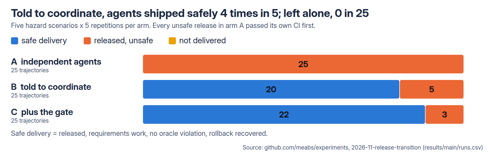
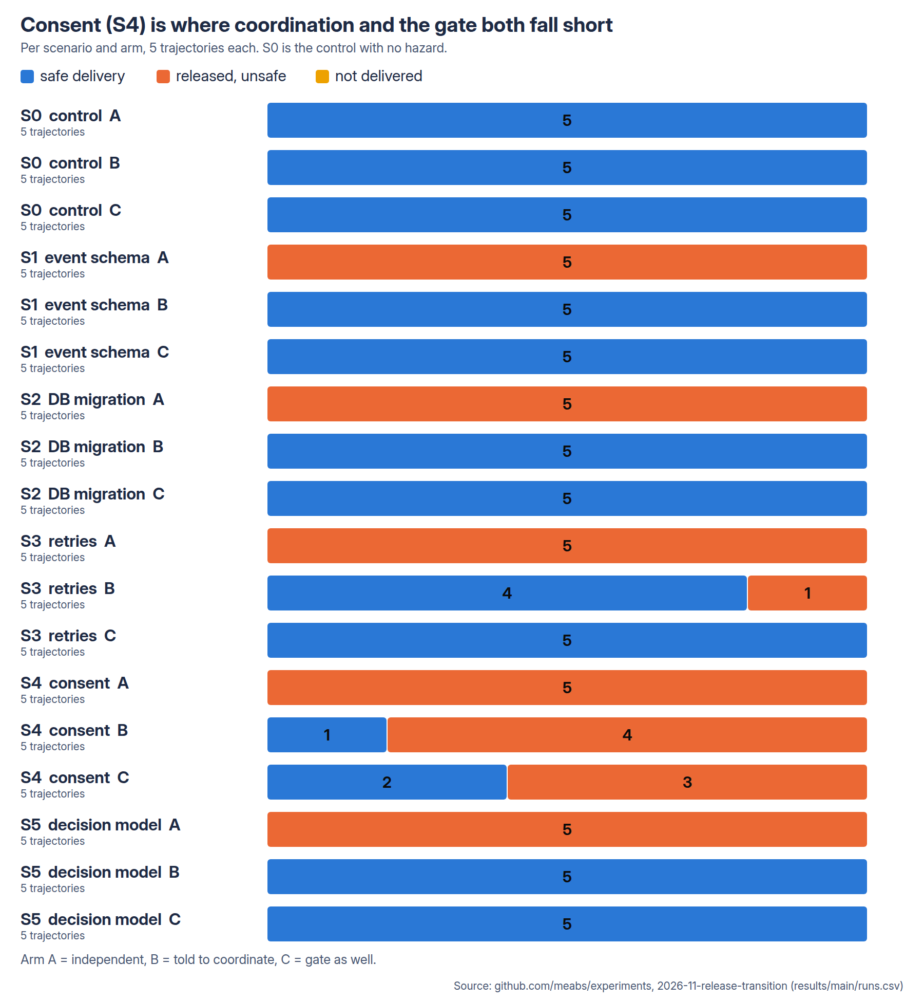

# Can AI agents that each deliver a correct change break the estate together? Report (experiment TRX)

*Site title: Everything passed. Production failed. Can agents that each deliver correct changes break an estate together? (TRX)*

**This experiment was designed and run with an AI agent** (Claude Code, working for me): it wrote the estate, the release
simulator, the oracle, the gate, the runner and the analysis, ran the pilot and the main run, and wrote this report. I proposed
the idea and approved the outline, then asked it to carry on through the pilot, the main run and publication while I was away.

2026-11-26. Design: [README.md](README.md), written before the pilot, with every later change in its amendment log. Full
numbers: [results/main/analysis.json](results/main/analysis.json), per run [results/main/runs.csv](results/main/runs.csv).
Charts: [diagrams/png/](diagrams/png/).

## 1. What I wanted to find out

Several coding agents each work on a ticket for a different service of one small enterprise estate. Each change is correct and
passes its own tests. Do the changes still break the estate when they are deployed together, one instance at a time, with a
failed rollout and a rollback in the middle? And does telling the agents to coordinate, or putting an external deterministic
gate in front of the release, change that?

## 2. What I predicted

- H1: in arm A (independent agents, normal CI) at least half the unsafe releases had green CI. [about 90%]
- H2: telling agents to coordinate (B) does not lift safe delivery above A's by a margin that survives correction. [B gains a little]
- H3: the gate (C) beats B and A. [A about 25%, B about 40%, C about 70%]
- H4: the gate is not a wall: S0 delivered at least 4 of 5, overall delivered within 10 points of B.
- H5: C costs more per trajectory than A but less per safe delivery (exploratory).

## 3. How I tested it

Codex CLI 0.157.0, hosted `gpt-5.6-luna`, medium effort, one turn, in bubblewrap. Each trajectory is two agent runs, one per
changed service, that cannot talk to each other. The estate is four plain Java 21 services (customer, decision, ledger,
notifier) with H2 databases, run as two instances each in an in-process release simulator with delayed events, a failed
rollout, a rollback and a retry. Five hazard scenarios (S1 event schema, S2 database migration, S3 retries and duplicates, S4
consent, S5 decision model) and a control S0 with no hazard, 5 repetitions per arm and scenario, 90 trajectories.

| Arm | What the agents get |
| --- | --- |
| A | ticket and service contracts; normal CI; one repair round on a CI failure |
| B | A, plus the other ticket's title, read-only copies of the peers, and an instruction to write `release/plan.json` and `release/RELEASE.md` |
| C | B, plus a deterministic gate that rehearses the release plan; one repair round on a gate reject |

Primary measure: safe delivery = released, the new requirements work, zero oracle violations, rollback recovered. The oracle
reads the simulator's final state, not the agents' reports. Pilot: 15 arm-A trajectories (15 of 15 unsafe with green CI, no
scenario retired by the pilot rule). Statistics as in the other experiments (permutation within scenario, bootstrap, Holm).

## 4. What happened

| Arm | Safe delivery (hazard scenarios, 25 trajectories each) | Delivered | Cost per trajectory | Cost per safe delivery |
| --- | --- | --- | --- | --- |
| A | 0% (0 of 25) | 100% | $0.0185 | $0.111 |
| B | 80% (20 of 25) | 100% | $0.0269 | $0.0323 |
| C | 88% (22 of 25) | 92% | $0.0327 | $0.0363 |



*Alt text: horizontal bars for arms A, B, C. A: 25 of 25 released unsafe. B: 20 safe, 5 unsafe. C: 22 safe, 3 unsafe.*

| Hypothesis | Result |
| --- | --- |
| H1 | **Supported.** All 25 arm-A hazard trajectories released unsafe, and all 25 had green CI first (100%). |
| H2 | **Contradicted.** B minus A = +80 points (95% interval 72 to 88), p = 0.00001. |
| H3 | **Half supported.** C minus A = +88 points (80 to 96), Holm p = 0.00002. C minus B = +8 points (-4 to 20), Holm p = 0.29: not distinguishable from zero. |
| H4 | Holds. S0 delivered 5 of 5 in every arm. Overall delivered: C 92% against B 100% and A 100%, a difference of -8 points (-16 to 0). |
| H5 | Holds against A ($0.036 against $0.111 per safe delivery) but C is not cheaper than B ($0.0363 against $0.0323). Exploratory. |



*Alt text: 18 horizontal bars, one per scenario and arm. Arm A is all unsafe in S1 to S5; B and C are all safe except S3 B (4 of 5), S4 B (1 of 5) and S4 C (2 of 5).*

**Where the arms differ.** In S1, S2 and S5, B and C were 5 of 5 safe, A 0 of 5. In S3, B had one unsafe release, C none. S4
(consent) is the weak spot: B 1 of 5 safe, C 2 of 5. Violation kinds in B: sent without consent (4), duplicate posting (1),
ledger balance wrong (1). In C: sent without consent (3) and one aborted deploy.

**Process evidence** (counted from files): `release/plan.json` was present in 30 of 30 B and 30 of 30 C trajectories, and its
constraints were used by the merged plan in all of them, never in A.

**The gate against the oracle on released candidates.** On arm A's candidates it agreed with the oracle every time (25 unsafe
rejected, 5 safe admitted). On B's it missed 1 of 5 unsafe candidates; on C's final candidates it admitted 3 that the oracle
found unsafe. In S4 the gate rejected the first candidate in 4 of 5 C trajectories; after one repair round it admitted all
five, and three of those still sent offers without consent. Cost: the main run was $2.34 against a ceiling of $25.

## 5. What surprised me

That telling the agents the other ticket exists and asking for a release plan was almost enough on its own. I predicted B would
gain a little. It went from 0 to 80%. The extra the gate added is within the noise of 25 trajectories per arm. The other
surprise is how uniform arm A was: 25 of 25 unsafe, every one with green CI.

## 6. What this might mean in practice

Leads, not rules. In this toy estate, the missing ingredient was awareness of the other change and a place to put release
constraints, not a verifier. Where the hazard was subtle (S4), neither the instruction nor my gate was reliable, and the repair
round let an agent satisfy the gate's rules without removing the hazard. A gate that can be satisfied by editing the plan is
only as good as its rules.

## 7. What the experiment does not prove

- A toy estate of four small services, one fault schedule, one agent and model, 5 repetitions per cell.
- The gate and the oracle share an author (Claude Code), the simulator engine and the hazard vocabulary. That may flatter the
  gate on the hazards it was built around, and so overstate how this gate would do against hazards it was not built around.
  That is a suspicion I have not tested; it is not an upper bound. The result is about this gate (a rehearsal of the release
  plan on a staging copy with eight generic rules), not about deterministic gates in general. The interval for C minus B
  (-4 to +20 points) includes no benefit and a large one, so the result does not show that the gate has no benefit.
- B bundles four things: read-only copies of the peer services, the other ticket's title, a paragraph on rolling deployment,
  rollback and persisted state, and the instruction to write a release plan. I did not separate them.
- I chose the scenarios to contain a transition hazard. How often real changes contain one is not measured.
- B bundles awareness (peer ticket and code) with an instruction (write a plan); I did not separate them.
- The default order is alphabetical, so arm A's outcomes depend partly on that convention.
- **A flaw found and fixed:** the first main run was invalid (see section 10). Its data is kept as `results/main-invalid-auth`
  and is not analysed.
- The "not delivered" bucket is empty in the charts: the two C trajectories that did not deliver were also released with an
  oracle violation, so they appear as released, unsafe.

## 8. What I'd test next

Separate awareness from instruction in B. Hazards the gate was not built around (a feature-flag removal, a cache-key change).
A stronger model. Agents allowed to run the gate while they work. Real HTTP services with latency. Another look at S4: why did
the gate's repair loop end in an admit with violations?

## 9. How to reproduce the results

```sh
cd 2026-11-release-transition
bash scripts/build_estate.sh estate build/base      # base jars for the simulator
python3 -I scripts/selftest.py                       # free checks, 11 reference pairs
# needs a working Codex login; then:
bash scripts/run_batch.sh results/main-jobs.txt results/main 3
python3 -I scripts/analyse.py results/main
python3 -I scripts/diagrams.py && bash diagrams/render.sh
```

## 10. What changed from the design

- The `events` service became `notifier`; release constraints go in `release/plan.json`; the gate is a rehearsal with generic
  rules; every arm gets one repair round (see the README amendment log).
- **The first main run was invalid.** 163 of 180 agent sessions died with `refresh_token_reused` (401): per-run copies of the
  shared login rotated its refresh token and I deleted the copies, losing the new token. I noticed because cost per trajectory
  was a tenth of the pilot's and S0 delivered 1 of 5. I fixed the runner (it writes a refreshed login back, and a trajectory
  whose sessions hit a login error is not recorded), kept the old data labelled invalid, and reran all 90 after a fresh login.
  Side effect: the rotation may have logged out other sessions that share this login.
- The replay viewer in the design was **not built**.
- **Wording corrected after review (2026-11-26, no new data):** the limits no longer call C an "upper bound"; they say what
  B bundles, and that an interval from -4 to +20 points does not show the gate has no benefit. The numbers are unchanged.
